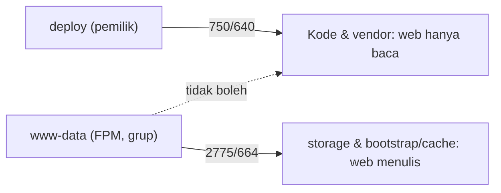

# File Permissions

Setelah deploy, kesalahan paling umum adalah `Permission denied` pada `storage/logs` atau `bootstrap/cache`, dan "perbaikan cepat" yang paling umum, yaitu `chmod -R 777`, adalah celah keamanan. Sub bab ini mengajarkan model kepemilikan yang benar: siapa memiliki apa, siapa boleh menulis ke mana, dan mengapa.

!!! danger "Belum teruji penulis"
    Perintah diturunkan dari dokumentasi Laravel 13.x dan praktik Linux umum, belum dijalankan penulis pada server nyata. Kesalahan `chown -R` pada path yang salah dapat merusak sistem: periksa path dua kali.

## Tujuan Pembelajaran

- [ ] Menjelaskan direktori yang harus ditulis Laravel (`storage`, `bootstrap/cache`).
- [ ] Menentukan model kepemilikan: pengguna deploy vs pengguna web (`www-data`).
- [ ] Menerapkan izin `750/640` atau `775/664` dengan grup, bukan `777`.
- [ ] Memakai bit `setgid` pada direktori agar berkas baru mewarisi grup.
- [ ] Mendiagnosis galat izin dari log.
- [ ] Mengamankan `.env` dan kode agar tidak dapat ditulis proses web.

## Prasyarat

- [Linux Server Fundamentals](10-02-linux-server-fundamentals.md), [Laravel Deployment](10-08-laravel-deployment.md).

## Pengantar

Aplikasi menulis log sebagai `www-data`, tetapi `storage/logs` dimiliki `deploy` dengan izin `755`. Hasilnya 500 dan log kosong. Memberi `777` memperbaikinya, dan sekaligus mengizinkan proses mana pun di server menimpa log atau menaruh skrip.

## Penjelasan Konsep

### Menurut dokumentasi

Laravel perlu menulis ke `bootstrap/cache` dan `storage`; pastikan pemilik proses web punya izin tulis ke direktori itu. Hanya itu. Kode aplikasi, `vendor`, dan `.env` **tidak** perlu dapat ditulis oleh proses web.

### Dua identitas

| Identitas | Peran |
|---|---|
| `deploy` | Pemilik kode; menjalankan Composer, git, artisan manual |
| `www-data` | Proses PHP-FPM; menulis log, cache, sesi, unggahan |

Pola yang aman: `deploy` memiliki semua berkas, grup `www-data`, dan hanya direktori yang perlu ditulis memberi hak tulis grup.

### Aturan izin

| Lokasi | Pemilik:Grup | Izin | Alasan |
|---|---|---|---|
| Kode (`app`, `vendor`, `public`, ...) | `deploy:www-data` | Direktori `750`, berkas `640` | Web membaca, tidak menulis |
| `.env` | `deploy:www-data` | `640` | Rahasia |
| `storage`, `bootstrap/cache` | `deploy:www-data` | Direktori `2775`, berkas `664` | Web menulis (grup), `setgid` |

Pada pola rilis (10.08), `storage` ada di `shared/` sehingga izin diatur sekali.

### `setgid`

```bash
sudo chmod g+s shared/storage      # bagian dari 2775
```

Dengan `setgid` pada direktori, berkas dan subdirektori baru mewarisi **grup** direktori (`www-data`), sehingga log yang dibuat `deploy` (mis. dari `artisan`) tetap dapat ditulis oleh FPM. Tanpa itu, worker CLI sebagai `deploy` bisa membuat berkas log yang tak bisa ditulis FPM, dan sebaliknya.

### Menerapkan

```bash
APP=/var/www/contoh.com
sudo chown -R deploy:www-data "$APP"
sudo find "$APP/releases" -type d -exec chmod 750 {} \;
sudo find "$APP/releases" -type f -exec chmod 640 {} \;

sudo find "$APP/shared/storage" -type d -exec chmod 2775 {} \;
sudo find "$APP/shared/storage" -type f -exec chmod 664 {} \;
sudo chmod 640 "$APP/shared/.env"

# bootstrap/cache perlu ditulis (config/route/view cache)
sudo find "$APP/releases/*/bootstrap/cache" -type d -exec chmod 2775 {} \; 2>/dev/null
```

Memasukkan semua ini ke skrip deploy menjamin konsistensi. `artisan` bisa dijalankan sebagai `www-data` untuk perintah yang menulis cache bila lebih sederhana: `sudo -u www-data php artisan optimize`.

### umask

Proses worker dan FPM dapat membuat berkas dengan izin sempit (`644`/`600`). Pada Supervisor, atur `umask`/jalankan sebagai pengguna yang sama (`www-data`) agar konsisten; pada FPM `listen.mode`/`umask` pool.

### Unggahan dan eksekusi

Direktori unggahan (`storage/app/public` → `public/storage`) berisi data pengguna. Pastikan Nginx **tidak mengeksekusi PHP** di sana (10.04 memblokir `.php` selain `index.php`) dan jangan beri bit eksekusi pada berkas unggahan.

### Mendiagnosis

```bash
ls -ld storage storage/logs
ls -l storage/logs | head
sudo -u www-data test -w storage/logs && echo "bisa menulis" || echo "TIDAK bisa menulis"
sudo tail -n 20 /var/log/nginx/error.log
tail -n 20 storage/logs/laravel.log
```

`sudo -u www-data test -w ...` menguji dari sudut pandang proses web, berguna daripada menebak.

### Keamanan

- Jangan `chmod 777`; jangan `chown -R www-data` pada seluruh kode (proses web yang disusupi dapat mengubah kode).
- Proses web tidak boleh dapat menulis `app/`, `routes/`, `vendor/`, atau `.env`.
- Periksa berkas tak terduga di `public/` dan `storage/app/public` (shell upload).

## Cara Kerja



## Contoh Praktik

Kamu menerapkan izin pada struktur dari 10.08, membuktikan `www-data` dapat menulis ke `storage` tetapi tidak ke `app/`, dan memperbaiki skenario "log tidak bisa ditulis".

## Penjelasan Kode

Uji dua arah dengan identitas web:

```bash
sudo -u www-data touch /var/www/contoh.com/shared/storage/logs/uji.txt && echo OK-tulis
sudo -u www-data touch /var/www/contoh.com/current/app/uji.txt || echo OK-ditolak
sudo rm -f /var/www/contoh.com/shared/storage/logs/uji.txt
```

## Implementasi Langkah demi Langkah

### Langkah 1: periksa kondisi awal

```bash
ls -ld /var/www/contoh.com/shared/storage /var/www/contoh.com/shared/.env
```

### Langkah 2: terapkan kepemilikan dan izin

Jalankan blok "Menerapkan" setelah memeriksa variabel `APP`.

### Langkah 3: uji identitas web

Jalankan perintah "Penjelasan Kode". Harapan: tulis ke `storage` berhasil, tulis ke `app/` ditolak.

### Langkah 4: uji aplikasi

Buka situs dan picu pencatatan log; pastikan tidak ada galat izin.

### Langkah 5: picu masalah sengaja

`sudo chmod 755 shared/storage/logs` lalu muat halaman: lihat galat; perbaiki dengan `2775`.

### Langkah 6: otomasi

Tambahkan blok izin ke `deploy.sh` setelah penautan.

### Langkah 7: audit `public/`

```bash
find /var/www/contoh.com/current/public -type f -name "*.php"
```

Hanya `index.php` yang diharapkan.

## Eksekusi dan Verifikasi

| Langkah | Hasil yang diharapkan |
|---|---|
| 3 | `OK-tulis` dan `OK-ditolak` |
| 4 | Tidak ada `Permission denied` di log |
| 7 | Hanya `index.php` |

## Daftar periksa verifikasi

- [ ] Tidak ada `777` di mana pun.
- [ ] `www-data` tidak bisa menulis kode atau `.env`.
- [ ] `storage` dan `bootstrap/cache` dapat ditulis grup, dengan `setgid`.
- [ ] Tidak ada `.php` tak terduga di `public/` dan unggahan.

## Hasil yang Diharapkan

Diturunkan dari dokumentasi dan praktik umum; belum diuji penulis.

## Kesalahan Umum dan Pemecahan Masalah

| Gejala | Penyebab | Cara mengenali | Solusi | Pencegahan |
|---|---|---|---|---|
| 500 + log tak ditulis | Izin `storage` | `Permission denied` di error.log | `2775`/`664` grup web | Skrip deploy |
| Berkas log milik `deploy` tak bisa ditulis FPM | Tanpa `setgid`/umask | Log dibuat CLI | `setgid` + umask | Konsisten |
| "Fix" dengan `777` | Pintas | `ls -l` | Ganti izin tepat | Aturan tim |
| Cache config tidak dibuat | `bootstrap/cache` read-only | Optimize gagal | Beri izin tulis | Skrip |
| Kode ditulis proses web | `chown -R www-data` kode | Berkas berubah | Pemilik deploy | Pola kepemilikan |
| Unggahan dieksekusi | Konfigurasi Nginx longgar | `.php` di unggahan jalan | Blokir `.php` | Uji `curl` |

## Latihan Praktik

### Latihan dasar

**D1. Terjemahkan izin**
- *Masalah:* membaca angka.
- *Persyaratan:* terjemahkan `2775` dan `640`.
- *Perilaku yang diharapkan:* `2775` = setgid + rwxrwxr-x; `640` = rw-r-----.
- *Tujuan belajar:* notasi oktal.

### Latihan implementasi

**I1. Skrip izin**
- *Masalah:* izin berantakan setelah deploy.
- *Persyaratan:* tulis fungsi Bash `fix_permissions` yang idempoten dan masukkan ke `deploy.sh`.
- *Perilaku yang diharapkan:* dapat dijalankan berulang tanpa efek samping.
- *Tujuan belajar:* otomasi.

**I2. Audit izin**
- *Masalah:* ingin memastikan tidak ada izin longgar.
- *Persyaratan:* gunakan `find` untuk mencari berkas world-writable dan berkas milik `www-data` di luar `storage`.
- *Perilaku yang diharapkan:* daftar kosong.
- *Tujuan belajar:* audit.

### Latihan tantangan

**T1. Pengguna terpisah per aplikasi**
- *Masalah:* dua aplikasi satu server.
- *Persyaratan:* rancang pengguna, grup, dan pool FPM terpisah agar kompromi satu aplikasi tidak menjalar.
- *Perilaku yang diharapkan:* rancangan benar.
- *Tujuan belajar:* isolasi.
- *Catatan:* kerjakan mandiri; tidak ada kunci jawaban.

## Uji Pemahaman

1. Direktori mana yang perlu ditulis proses web?
2. Mengapa `777` berbahaya?
3. Apa fungsi `setgid`?
4. Mengapa kode tidak boleh dapat ditulis `www-data`?

??? success "Kunci jawaban singkat"
    1. `storage` dan `bootstrap/cache`.
    2. Semua pengguna/proses dapat menulis dan menaruh skrip.
    3. Berkas baru mewarisi grup direktori.
    4. Penyusup lewat aplikasi tidak bisa mengubah kode.

## Ringkasan

- Hanya `storage` dan `bootstrap/cache` yang ditulis proses web.
- Pemilik `deploy`, grup `www-data`, izin ketat, `setgid` untuk direktori tulis.
- Uji dari sudut pandang `www-data`; jangan `777`.

Selanjutnya: *Queue Workers with Supervisor*.

## Referensi Resmi

- [Laravel: Deployment, Directory Permissions](https://laravel.com/docs/13.x/deployment#directory-permissions)
- [Ubuntu: File Permissions](https://help.ubuntu.com/community/FilePermissions)
