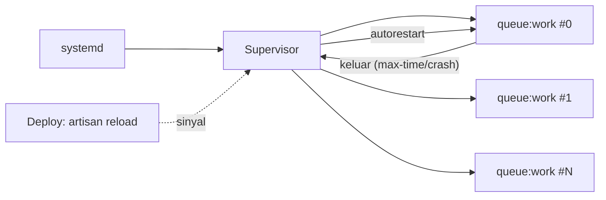

# Queue Workers with Supervisor

`php artisan queue:work` yang dijalankan di terminal berhenti saat sesi SSH ditutup atau proses mati. Di produksi, worker harus berjalan terus, hidup kembali otomatis saat gagal, dan dimuat ulang saat deploy. Itu tugas **Supervisor**, pengelola proses yang direkomendasikan dokumentasi Laravel.

!!! danger "Belum teruji penulis"
    Konfigurasi diturunkan dari dokumentasi Laravel 13.x (Queues, Supervisor Configuration) dan Supervisor, belum dijalankan penulis pada server nyata. Sesuaikan path dan pengguna, dan uji di staging.

## Tujuan Pembelajaran

- [ ] Menjelaskan mengapa worker membutuhkan pengelola proses.
- [ ] Memasang Supervisor dan menulis konfigurasi `laravel-worker`.
- [ ] Menjelaskan `numprocs`, `autorestart`, `stopwaitsecs`, `user`, `--max-time`.
- [ ] Menjalankan `supervisorctl reread/update/start/status/restart`.
- [ ] Memuat ulang worker saat deploy (`php artisan reload` / `queue:restart`).
- [ ] Mendiagnosis worker yang gagal start atau macet.

## Prasyarat

- [Queue Workers](../level-07/07-10-queue-workers.md), [Queue Optimization](../level-09/09-09-queue-optimization.md), [Laravel Deployment](10-08-laravel-deployment.md).

## Pengantar

Email notifikasi berhenti terkirim sejak pukul 02.00 karena worker mati akibat kehabisan memori. Tidak ada yang tahu sampai pelanggan mengeluh. Supervisor menghidupkan ulang worker dalam hitungan detik dan mencatat kejadiannya.

## Penjelasan Konsep

### Mengapa Supervisor

| Masalah | Penanganan Supervisor |
|---|---|
| Proses mati | `autorestart=true` |
| Server reboot | Supervisor sendiri dijalankan `systemd`; worker `autostart=true` |
| Banyak worker | `numprocs=N` |
| Pengelolaan log | `stdout_logfile` |
| Berhenti anggun | `stopwaitsecs`, `stopasgroup` |

### Pasang

```bash
sudo apt install supervisor
sudo systemctl enable --now supervisor
```

### Konfigurasi

Menurut dokumentasi, berkas konfigurasi berada di `/etc/supervisor/conf.d`.

File: `/etc/supervisor/conf.d/laravel-worker.conf`

```ini
[program:laravel-worker]
process_name=%(program_name)s_%(process_num)02d
command=php /var/www/contoh.com/current/artisan queue:work --queue=critical,default,bulk --sleep=3 --tries=3 --max-time=3600
autostart=true
autorestart=true
stopasgroup=true
killasgroup=true
user=www-data
numprocs=4
redirect_stderr=true
stdout_logfile=/var/www/contoh.com/shared/storage/logs/worker.log
stopwaitsecs=3600
```

| Direktif | Fungsi |
|---|---|
| `command` | Perintah worker; `current` agar mengikuti rilis aktif |
| `--max-time=3600` | Worker berhenti sendiri setelah satu jam; Supervisor memulai ulang (bersih dari kebocoran memori) |
| `autorestart=true` | Hidup kembali bila keluar |
| `user=www-data` | Jalan sebagai pengguna yang sama dengan FPM (izin `storage` konsisten, 10.09) |
| `numprocs=4` | Empat proses (sesuaikan beban dan memori) |
| `stopwaitsecs=3600` | Menunggu job selesai sebelum dibunuh; menurut dokumentasi harus lebih besar dari durasi job terlama |

Ingat: `--tries` pada command kalah oleh `#[Tries]` pada job (07.09). Path menunjuk `current/artisan`; setelah tautan `current` diganti, worker lama masih memegang jalur rilis lama sampai di-restart, sehingga reload diperlukan.

### Menjalankan

```bash
sudo supervisorctl reread
sudo supervisorctl update
sudo supervisorctl start "laravel-worker:*"
sudo supervisorctl status
```

`reread` membaca berkas baru, `update` menerapkannya, `start` menjalankan grup. Status `RUNNING` untuk tiap proses menandakan sehat.

### Deploy: muat ulang worker

Dokumentasi menyatakan bahwa setelah deploy, layanan panjang harus dimuat ulang, dan Laravel menyediakan `php artisan reload`; Supervisor menghidupkan ulang proses yang keluar. Alternatif klasik:

```bash
php artisan queue:restart             # worker selesai job sekarang lalu keluar → Supervisor menyalakan ulang
sudo supervisorctl restart "laravel-worker:*"   # paksa (hati-hati: job berjalan terpotong sesuai stopwaitsecs)
```

`queue:restart` memakai cache untuk sinyal; pastikan driver cache bukan `array` (07.10).

### Worker khusus

Pisahkan antrean berat: program kedua `laravel-worker-media` dengan `--queue=media`, `numprocs=1`, timeout lebih panjang (09.09).

### Log

```bash
sudo tail -f /var/www/contoh.com/shared/storage/logs/worker.log
sudo tail -n 50 /var/log/supervisor/supervisord.log
```

Log worker tumbuh; sertakan dalam rotasi (`logrotate`) atau `stdout_logfile_maxbytes`/`stdout_logfile_backups` Supervisor.

### Keamanan

- Jalankan worker sebagai pengguna non-root (`www-data`).
- Job menyimpan payload di antrean; jangan taruh rahasia.
- Batasi akses ke `supervisorctl` (socket) hanya untuk administrator.
- Pantau agar worker yang macet atau gagal berulang terdeteksi (10.19).

## Cara Kerja



## Contoh Praktik

Kamu memasang Supervisor, mendaftarkan worker, mengirim job, membunuh proses worker untuk melihat hidup kembali otomatis, dan mensimulasikan deploy.

## Penjelasan Kode

Uji ketahanan:

```bash
sudo supervisorctl status
sudo pkill -f "queue:work" ; sleep 3 ; sudo supervisorctl status
```

Dalam hitungan detik status kembali `RUNNING` (dengan PID baru). Jangan lakukan ini di produksi yang sedang memproses job penting.

## Implementasi Langkah demi Langkah

### Langkah 1: pasang

```bash
sudo apt install supervisor
```

### Langkah 2: konfigurasi

Buat `laravel-worker.conf` dengan path dan pengguna benar.

### Langkah 3: aktifkan

```bash
sudo supervisorctl reread && sudo supervisorctl update
sudo supervisorctl status
```

### Langkah 4: kirim job

Picu aksi aplikasi yang men-dispatch job dan periksa log worker serta hasilnya.

### Langkah 5: uji ketahanan

Bunuh proses worker dan amati pemulihan.

### Langkah 6: uji deploy

Ubah log di job, deploy rilis baru (10.08), jalankan `php artisan reload`/`queue:restart`, dan pastikan worker memakai kode baru.

### Langkah 7: rotasi log

Tambahkan batas ukuran log Supervisor atau konfigurasi `logrotate`.

### Langkah 8: catat

Simpan konfigurasi (tanpa rahasia) di `docs-deploy.md`.

## Eksekusi dan Verifikasi

| Langkah | Hasil yang diharapkan |
|---|---|
| 3 | Empat proses berstatus `RUNNING` |
| 4 | Job diproses; log worker tercatat |
| 5 | Proses hidup kembali otomatis |
| 6 | Perilaku baru terlihat tanpa SSH ke worker satu per satu |

## Daftar periksa verifikasi

- [ ] Worker berjalan sebagai `www-data`, bukan root.
- [ ] `stopwaitsecs` > durasi job terlama.
- [ ] Worker hidup kembali setelah dimatikan.
- [ ] Prosedur reload ada di skrip deploy.
- [ ] Log worker dirotasi.

## Hasil yang Diharapkan

Bergantung versi Supervisor/Ubuntu; belum diuji penulis.

## Kesalahan Umum dan Pemecahan Masalah

| Gejala | Penyebab | Cara mengenali | Solusi | Pencegahan |
|---|---|---|---|---|
| `FATAL` / `BACKOFF` | Command salah / path / izin | `supervisorctl status` | Baca log; perbaiki path/pengguna | Jalankan command manual dulu |
| Kode lama berjalan | Worker tak di-reload | Perilaku lama | `php artisan reload`/restart | Skrip deploy |
| Job terpotong saat stop | `stopwaitsecs` kecil | Job gagal sebagian | Naikkan | Hitung durasi job |
| Worker membengkak memori | Tanpa `--max-time` | OOM | `--max-time`/`--memory` | Batas umur |
| `queue:restart` tak berefek | Cache `array` | Worker tak berhenti | Cache nyata | Konfigurasi |
| Log penuh disk | Tanpa rotasi | `df -h` | Rotasi | Batas log |
| Izin tulis log ditolak | Pengguna berbeda | Galat di log | Samakan pengguna | 10.09 |

## Latihan Praktik

### Latihan dasar

**D1. Baca konfigurasi**
- *Masalah:* paham direktif.
- *Persyaratan:* jelaskan `autorestart`, `numprocs`, dan `stopwaitsecs`.
- *Perilaku yang diharapkan:* sesuai tabel.
- *Tujuan belajar:* direktif Supervisor.

### Latihan implementasi

**I1. Dua program**
- *Masalah:* job media berat.
- *Persyaratan:* tambah program `laravel-worker-media` untuk antrean `media` dengan 1 proses dan timeout panjang.
- *Perilaku yang diharapkan:* terpisah dari worker utama.
- *Tujuan belajar:* pemisahan beban.

**I2. Pengingat job gagal**
- *Masalah:* job gagal tak terlihat.
- *Persyaratan:* jadwalkan pemeriksaan `queue:failed` (atau hitung baris `failed_jobs`) dan kirim peringatan bila > 0.
- *Perilaku yang diharapkan:* peringatan terkirim.
- *Tujuan belajar:* deteksi dini.

### Latihan tantangan

**T1. Systemd vs Supervisor**
- *Masalah:* tim ingin memakai unit `systemd` saja.
- *Persyaratan:* tulis unit `systemd` setara untuk worker, bandingkan kelebihan/kekurangan dengan Supervisor.
- *Perilaku yang diharapkan:* perbandingan benar.
- *Tujuan belajar:* alternatif pengelola proses.
- *Catatan:* kerjakan mandiri; tidak ada kunci jawaban.

## Uji Pemahaman

1. Mengapa worker perlu Supervisor?
2. Apa fungsi `--max-time` bersama Supervisor?
3. Mengapa `stopwaitsecs` harus besar?
4. Apa yang dilakukan setelah deploy?

??? success "Kunci jawaban singkat"
    1. Agar hidup terus dan dihidupkan ulang saat gagal.
    2. Worker keluar berkala dan dimulai ulang bersih.
    3. Job yang sedang berjalan tidak dibunuh di tengah.
    4. Muat ulang worker (`php artisan reload`/`queue:restart`).

## Ringkasan

- Supervisor menjaga worker hidup, banyak, dan dapat dimuat ulang.
- Atur `numprocs`, `--max-time`, `stopwaitsecs`, dan pengguna non-root.
- Reload worker pada setiap deploy dan pantau kegagalan.

Selanjutnya: *Scheduler Configuration*.

## Referensi Resmi

- [Laravel: Queues, Supervisor Configuration](https://laravel.com/docs/13.x/queues#supervisor-configuration)
- [Laravel: Deployment, Reloading Services](https://laravel.com/docs/13.x/deployment#reloading-services)
- [Supervisor Documentation](http://supervisord.org/)
