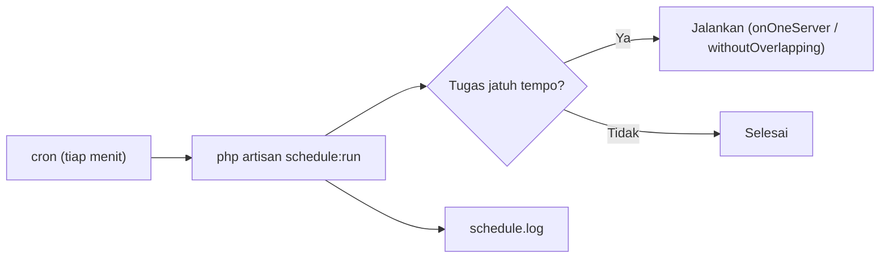

# Scheduler Configuration

Penjadwal Laravel (07.11) hanya bekerja bila ada yang memanggil `php artisan schedule:run` setiap menit. Di server itu berarti satu entri **cron**. Sub bab ini memasangnya dengan benar: pengguna yang tepat, path rilis, log, dan perilaku di server ganda.

!!! danger "Belum teruji penulis"
    Konfigurasi diturunkan dari dokumentasi Laravel 13.x (Task Scheduling) dan cron/systemd, belum dijalankan penulis pada server nyata. Ubah crontab dengan hati-hati dan verifikasi dengan log.

## Tujuan Pembelajaran

- [ ] Menambahkan entri cron tunggal untuk `schedule:run`.
- [ ] Menjalankannya sebagai pengguna yang tepat dari jalur rilis `current`.
- [ ] Memastikan tugas berjalan dan mencatat hasil/galat.
- [ ] Mencegah eksekusi ganda (`onOneServer`, `withoutOverlapping`) pada server ganda.
- [ ] Mengenal alternatif `systemd timer` dan `schedule:work`.
- [ ] Mendiagnosis jadwal yang tidak jalan.

## Prasyarat

- [Task Scheduling](../level-07/07-11-task-scheduling.md), [Laravel Deployment](10-08-laravel-deployment.md), [File Permissions](10-09-file-permissions.md).

## Pengantar

Pembersihan token kedaluwarsa dijadwalkan harian, tetapi tabel token terus membesar: cron belum dipasang di server baru. Tanpa pemantauan, kegagalan semacam ini tak terlihat berminggu-minggu.

## Penjelasan Konsep

### Entri cron

Menurut dokumentasi, satu entri tiap menit:

```text
* * * * * cd /path-to-your-project && php artisan schedule:run >> /dev/null 2>&1
```

Untuk pola rilis dan pengguna web:

```bash
sudo crontab -u www-data -e
```

```text
* * * * * cd /var/www/contoh.com/current && /usr/bin/php artisan schedule:run >> /var/www/contoh.com/shared/storage/logs/schedule.log 2>&1
```

| Bagian | Alasan |
|---|---|
| `crontab -u www-data` | Tugas berjalan sebagai pengguna yang sama dengan aplikasi (izin berkas konsisten) |
| `cd .../current` | Mengikuti rilis aktif |
| Path PHP penuh (`/usr/bin/php`) | Lingkungan cron memiliki `PATH` minimal |
| `>> schedule.log 2>&1` | Menyimpan keluaran untuk diagnosis, bukan `/dev/null` (tidak ada jejak) |

Mengirim ke `/dev/null` seperti contoh dokumentasi membuang kegagalan senyap; saat belajar, simpan log sampai kamu yakin.

### Verifikasi

```bash
php artisan schedule:list                 # daftar & waktu berikutnya
sudo -u www-data php artisan schedule:run # jalankan manual satu putaran
tail -n 20 /var/www/contoh.com/shared/storage/logs/schedule.log
grep CRON /var/log/syslog | tail           # (Ubuntu) bukti cron memanggil
```

### Beberapa server

Bila aplikasi berjalan di banyak server, cron di semua server akan menjalankan tugas yang sama berkali-kali. Gunakan `->onOneServer()` (membutuhkan cache bersama, 07.11) atau jalankan cron hanya di satu server khusus. `->withoutOverlapping()` mencegah dua putaran tugas yang sama tumpang tindih di server yang sama.

### Zona waktu

Jadwal mengikuti `config('app.timezone')` kecuali `->timezone(...)`. Server (`timedatectl`) dan aplikasi sebaiknya konsisten; sebaiknya server UTC dan aplikasi menentukan zona per tugas bila perlu.

### Alternatif: systemd timer

`systemd` timer dapat menggantikan cron: unit `.service` yang menjalankan `schedule:run` dan `.timer` dengan `OnCalendar=*-*-* *:*:00`. Kelebihan: log di `journalctl`, ketergantungan layanan. Kekurangan: lebih banyak berkas. Cron lebih sederhana dan merupakan referensi dokumentasi.

### `schedule:work`

`php artisan schedule:work` menjalankan penjadwal di latar depan terus-menerus (untuk pengembangan). Di produksi, jika kamu memilihnya, kelolalah dengan Supervisor seperti worker; cron tetap lebih umum.

### Tugas yang disarankan

| Tugas | Frekuensi |
|---|---|
| `sanctum:prune-expired --hours=24` | Harian |
| `queue:prune-batches` / `queue:prune-failed` (bila dipakai) | Harian |
| `model:prune` (model dengan `Prunable`) | Harian |
| Ekspor/laporan, backup (10.18) | Sesuai kebutuhan |

### Keamanan

- Jalankan sebagai pengguna non-root.
- Jangan menaruh rahasia di baris cron (terlihat di daftar proses); gunakan `.env`.
- Batasi siapa boleh mengubah crontab.
- Tugas terjadwal dengan hak luas (hapus data) harus mencatat log dan idempoten.

## Cara Kerja



## Contoh Praktik

Kamu memasang cron, membuktikan penjadwal berjalan dengan tugas uji, lalu menghapus tugas uji dan memastikan tugas nyata muncul di `schedule:list`.

## Penjelasan Kode

Tugas uji sementara di `routes/console.php`:

```php-inline
use Illuminate\Support\Facades\Log;
use Illuminate\Support\Facades\Schedule;

Schedule::call(fn () => Log::info('Detak penjadwal'))->everyMinute();
```

## Implementasi Langkah demi Langkah

### Langkah 1: daftar tugas

```bash
cd /var/www/contoh.com/current
php artisan schedule:list
```

### Langkah 2: tambah tugas uji

Tambahkan closure di atas dan deploy/salin ke staging.

### Langkah 3: pasang cron

```bash
sudo crontab -u www-data -e
```

Tambahkan baris cron dengan log.

### Langkah 4: verifikasi

Tunggu 2–3 menit, lalu periksa `laravel.log` dan `schedule.log`.

### Langkah 5: periksa pemanggilan cron

```bash
grep CRON /var/log/syslog | tail
```

### Langkah 6: bersihkan

Hapus tugas uji, deploy ulang, dan pastikan `schedule:list` berisi tugas nyata.

### Langkah 7: catat

Dokumentasikan baris cron di `docs-deploy.md`.

## Eksekusi dan Verifikasi

| Langkah | Hasil yang diharapkan |
|---|---|
| 4 | Log "Detak penjadwal" muncul tiap menit |
| 5 | Baris `CRON ... schedule:run` tercatat |

## Daftar periksa verifikasi

- [ ] Satu entri cron, pengguna `www-data`, path rilis `current`.
- [ ] Keluaran tersimpan di log.
- [ ] Tugas terbukti berjalan.
- [ ] `onOneServer` bila multi-server.
- [ ] Tidak ada tugas uji tersisa.

## Hasil yang Diharapkan

Bergantung distribusi dan konfigurasi cron; belum diuji penulis.

## Kesalahan Umum dan Pemecahan Masalah

| Gejala | Penyebab | Cara mengenali | Solusi | Pencegahan |
|---|---|---|---|---|
| Tak ada eksekusi | Cron belum dipasang / pengguna salah | Tak ada baris CRON | Pasang crontab | Verifikasi log |
| `php: command not found` | `PATH` cron minimal | Galat di log | Path penuh | `which php` |
| Izin log ditolak | Pengguna cron ≠ pemilik log | Galat tulis | Samakan pengguna | 10.09 |
| Tugas ganda | Cron di banyak server | Email ganda | `onOneServer` | Rancang |
| Waktu salah | Zona waktu berbeda | Jam tak sesuai | Konsistenkan | `timedatectl` |
| Kegagalan tak terlihat | Keluaran ke `/dev/null` | Tak ada jejak | Simpan log, pantau | Monitoring |

## Latihan Praktik

### Latihan dasar

**D1. Baca baris cron**
- *Masalah:* paham sintaks.
- *Persyaratan:* jelaskan `* * * * *` dan `*/5 * * * *`.
- *Perilaku yang diharapkan:* tiap menit; tiap 5 menit.
- *Tujuan belajar:* sintaks cron.

### Latihan implementasi

**I1. Heartbeat eksternal**
- *Masalah:* ingin tahu jika penjadwal berhenti.
- *Persyaratan:* tugas yang tiap menit memanggil URL layanan pemantau (kamu pilih) dengan `Http::get`, dan peringatan bila tidak ada panggilan 5 menit.
- *Perilaku yang diharapkan:* peringatan saat cron mati.
- *Tujuan belajar:* pemantauan jadwal.

**I2. systemd timer**
- *Masalah:* tim memilih systemd.
- *Persyaratan:* tulis unit `.service` dan `.timer` setara dan jelaskan cara mengujinya.
- *Perilaku yang diharapkan:* jadwal berjalan tiap menit.
- *Tujuan belajar:* alternatif.

### Latihan tantangan

**T1. Migrasi ke multi-server**
- *Masalah:* beralih dari 1 ke 3 server.
- *Persyaratan:* rancang perubahan (cache bersama, `onOneServer`, satu penjadwal, atau layanan terkelola) dan risiko.
- *Perilaku yang diharapkan:* rencana jelas.
- *Tujuan belajar:* penjadwalan terdistribusi.
- *Catatan:* kerjakan mandiri; tidak ada kunci jawaban.

## Uji Pemahaman

1. Mengapa hanya satu entri cron?
2. Mengapa path PHP penuh?
3. Apa risiko cron di banyak server?
4. Mengapa tidak mengirim keluaran ke `/dev/null` saat belajar?

??? success "Kunci jawaban singkat"
    1. Laravel menentukan tugas jatuh tempo dari jadwal di kode.
    2. `PATH` cron minimal.
    3. Tugas berjalan ganda.
    4. Kegagalan tidak meninggalkan jejak.

## Ringkasan

- Satu entri cron memanggil `schedule:run` tiap menit sebagai pengguna aplikasi.
- Simpan log, verifikasi eksekusi, gunakan `onOneServer` di multi-server.
- Pantau agar jadwal yang berhenti terdeteksi.

Selanjutnya: *SSL and HTTPS*.

## Referensi Resmi

- [Laravel: Task Scheduling, Running the Scheduler](https://laravel.com/docs/13.x/scheduling#running-the-scheduler)
- [Ubuntu: cron](https://help.ubuntu.com/community/CronHowto)
