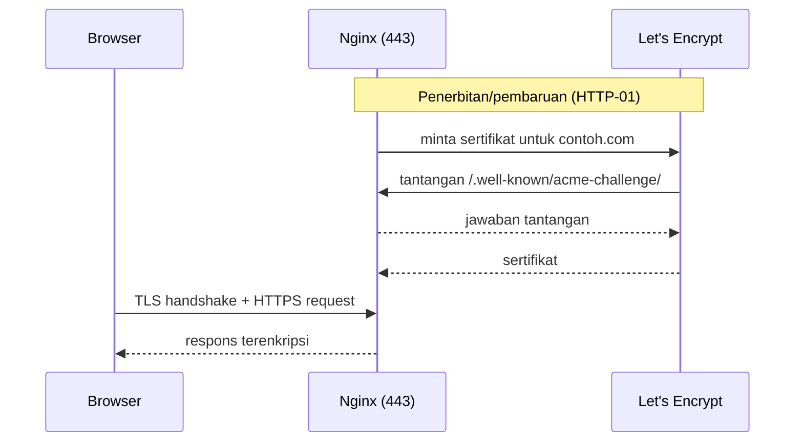

# SSL dan HTTPS

Tanpa HTTPS, kata sandi, cookie sesi, dan token API berjalan sebagai teks biasa di jaringan. Browser modern menandai situs HTTP sebagai "tidak aman" dan sebagian fitur (cookie `Secure`, HTTP/2, service worker) mensyaratkan HTTPS. Sub bab ini memasang sertifikat gratis dari **Let's Encrypt** dengan Certbot, mengalihkan HTTP ke HTTPS, dan menegakkan konfigurasi aman di Laravel.

!!! danger "Belum teruji penulis"
    Perintah diturunkan dari dokumentasi Certbot/Let's Encrypt, Nginx, dan Laravel 13.x, belum dijalankan penulis. Let's Encrypt memiliki **batas laju penerbitan**; uji dulu dengan opsi `--dry-run`/staging agar tidak terkena batas. Domain harus mengarah ke IP servermu.

## Tujuan Pembelajaran

- [ ] Menjelaskan fungsi TLS, sertifikat, dan otoritas sertifikat (CA).
- [ ] Memasang sertifikat Let's Encrypt dengan Certbot dan Nginx.
- [ ] Memastikan pembaruan otomatis berjalan (`certbot renew --dry-run`).
- [ ] Mengalihkan HTTP ke HTTPS dan mengaktifkan HSTS dengan hati-hati.
- [ ] Mengatur Laravel agar mengenali HTTPS di belakang proxy (`trustProxies`, `APP_URL`).
- [ ] Memeriksa konfigurasi TLS dari luar.

## Prasyarat

- [Nginx Configuration](10-04-nginx-configuration.md), domain dengan rekaman DNS A/AAAA ke server, port 80/443 terbuka (10.03).

## Pengantar

Situs berjalan di HTTP; pengguna di kafe Wi-Fi masuk ke dashboard. Siapa pun di jaringan yang sama dapat menyadap cookie sesinya. HTTPS menutup celah itu.

## Penjelasan Konsep

### TLS dan sertifikat

TLS mengenkripsi lalu lintas dan membuktikan identitas server lewat sertifikat yang ditandatangani CA tepercaya. Let's Encrypt adalah CA gratis dan otomatis; sertifikat berlaku sekitar 90 hari dan harus diperbarui otomatis.

### Certbot

Cara pemasangan resmi saat ini mengutamakan paket `snap` atau paket distribusi; ikuti petunjuk di certbot.eff.org untuk OS-mu. Contoh dengan plugin Nginx:

```bash
sudo apt install certbot python3-certbot-nginx
sudo certbot --nginx -d contoh.com -d www.contoh.com
```

Certbot memverifikasi kepemilikan domain (tantangan HTTP-01 lewat `/.well-known/acme-challenge/`), menerbitkan sertifikat, dan mengedit server block Nginx untuk HTTPS. Itu sebabnya konfigurasi Nginx 10.04 tidak memblokir `.well-known`.

Coba dulu tanpa menerbitkan sungguhan:

```bash
sudo certbot --nginx -d contoh.com --dry-run
```

Bila perlu, gunakan `--staging` untuk CA uji. Periksa pesan Certbot dan hasil edit pada `/etc/nginx/sites-available/contoh.com`.

### Hasil konfigurasi

Setelah Certbot, server block memiliki:

```nginx
listen 443 ssl;
ssl_certificate     /etc/letsencrypt/live/contoh.com/fullchain.pem;
ssl_certificate_key /etc/letsencrypt/live/contoh.com/privkey.pem;
include /etc/letsencrypt/options-ssl-nginx.conf;
ssl_dhparam /etc/letsencrypt/ssl-dhparams.pem;
```

dan blok port 80 yang mengalihkan (`return 301 https://$host$request_uri;`). **Kunci privat (`privkey.pem`) adalah rahasia**: jangan salin ke repositori atau bagikan.

### Pembaruan otomatis

Paket Certbot biasanya memasang timer `systemd` (atau cron). Verifikasi:

```bash
systemctl list-timers | grep -i certbot
sudo certbot renew --dry-run
```

Setelah pembaruan, Nginx perlu memuat ulang sertifikat; Certbot melakukannya lewat hook deploy bawaan plugin. Pantau kedaluwarsa (10.19) agar kegagalan pembaruan terdeteksi sebelum sertifikat habis.

### HSTS

`Strict-Transport-Security` memerintahkan browser selalu memakai HTTPS:

```nginx
add_header Strict-Transport-Security "max-age=31536000; includeSubDomains" always;
```

**Hati-hati**: setelah browser menerimanya, situs yang kembali ke HTTP akan tak dapat diakses sampai masa berlaku habis. Mulailah dengan `max-age` pendek (mis. 300), pastikan semua subdomain mendukung HTTPS, baru naikkan. Jangan menambah `preload` tanpa memahami konsekuensinya.

### Laravel di belakang proxy/Nginx

Nginx berbicara HTTPS ke klien tetapi meneruskan ke PHP-FPM tanpa informasi skema; Laravel menentukan "aman atau tidak" lewat header. Untuk Nginx+FPM yang sama server, set `fastcgi_param HTTPS on;` di blok PHP atau pastikan `$https` diteruskan (`fastcgi_params` bawaan menyertakan `HTTPS $https if_not_empty`). Untuk load balancer, konfigurasikan *trusted proxies* di `bootstrap/app.php` (menurut dokumentasi Requests) sehingga header `X-Forwarded-Proto` dipercaya. Atur juga:

```text
APP_URL=https://contoh.com
SESSION_SECURE_COOKIE=true
```

Tanpa itu, tautan yang dibuat Laravel bisa berskema `http://` dan cookie `Secure` tak terkirim.

### Pemeriksaan dari luar

```bash
curl -I http://contoh.com            # 301 ke https
curl -I https://contoh.com           # 200 + header keamanan
echo | openssl s_client -connect contoh.com:443 -servername contoh.com 2>/dev/null | openssl x509 -noout -dates -issuer
```

Layanan pemindai TLS pihak ketiga dapat menilai konfigurasi (kirimkan hanya domain publik).

### Keamanan

- Lindungi `privkey.pem` (izin ketat milik root).
- Nonaktifkan protokol usang; pakai `options-ssl-nginx.conf` dari Certbot (diperbarui oleh proyek Certbot).
- Jangan menonaktifkan verifikasi sertifikat di klien HTTP aplikasi (`verify => false`).
- Atur pengingat kedaluwarsa dan pembaruan.

## Cara Kerja



## Contoh Praktik

Kamu menguji penerbitan dengan `--dry-run`, menerbitkan sertifikat, memverifikasi pengalihan HTTP→HTTPS, dan memeriksa tanggal kedaluwarsa serta pembaruan otomatis.

## Penjelasan Kode

Nilai `APP_URL=https://...` dan `SESSION_SECURE_COOKIE=true` di `.env`, lalu `php artisan config:cache`. Di Laravel, `URL::forceScheme('https')` pada `AppServiceProvider::boot()` (hanya di produksi) dapat memaksa skema tautan bila proxy tidak meneruskan header; lebih baik memperbaiki sumber (proxy tepercaya).

## Implementasi Langkah demi Langkah

### Langkah 1: pastikan DNS

```bash
dig +short contoh.com
```

Harus menunjuk IP servermu.

### Langkah 2: pasang Certbot

Ikuti petunjuk resmi untuk OS-mu.

### Langkah 3: dry-run

```bash
sudo certbot --nginx -d contoh.com -d www.contoh.com --dry-run
```

### Langkah 4: terbitkan

```bash
sudo certbot --nginx -d contoh.com -d www.contoh.com
```

### Langkah 5: periksa pembaruan otomatis

```bash
sudo certbot renew --dry-run
systemctl list-timers | grep -i certbot
```

### Langkah 6: konfigurasi Laravel

Perbarui `.env` (`APP_URL`, `SESSION_SECURE_COOKIE`), `config:cache`, dan periksa tautan serta cookie di browser (atribut `Secure`).

### Langkah 7: HSTS bertahap

Tambah HSTS dengan `max-age=300`, uji, lalu naikkan perlahan.

### Langkah 8: verifikasi

Jalankan perintah `curl` dan `openssl` di atas.

## Eksekusi dan Verifikasi

| Langkah | Hasil yang diharapkan |
|---|---|
| 4 | Sertifikat terpasang; situs terbuka via HTTPS |
| 5 | `renew --dry-run` sukses |
| 8 | HTTP → 301 ke HTTPS; tanggal kedaluwarsa ±90 hari ke depan |

## Daftar periksa verifikasi

- [ ] HTTPS aktif dengan sertifikat valid (tanpa peringatan browser).
- [ ] HTTP dialihkan ke HTTPS.
- [ ] Pembaruan otomatis lulus `--dry-run`.
- [ ] `APP_URL` https; cookie `Secure`.
- [ ] HSTS diaktifkan bertahap.
- [ ] Kunci privat tidak di luar server.

## Hasil yang Diharapkan

Bergantung CA, DNS, dan versi Certbot; belum diuji penulis.

## Kesalahan Umum dan Pemecahan Masalah

| Gejala | Penyebab | Cara mengenali | Solusi | Pencegahan |
|---|---|---|---|---|
| Certbot gagal validasi | DNS belum mengarah / port 80 tertutup / `.well-known` diblokir | Pesan gagal HTTP-01 | Perbaiki DNS/UFW/Nginx | `dig`, `--dry-run` |
| Batas laju Let's Encrypt | Terlalu banyak percobaan | Pesan rate limit | Tunggu; pakai staging/dry-run | Uji dulu |
| Tautan `http://` di halaman | Proxy header/`APP_URL` | Konten campuran | Trusted proxies, `APP_URL` | Uji |
| Sertifikat kedaluwarsa | Pembaruan gagal | Peringatan browser | Perbaiki timer, `renew` | Pantau kedaluwarsa |
| Situs tak bisa diakses setelah HSTS | Kembali ke HTTP | Browser memaksa HTTPS | Perbaiki HTTPS / tunggu | HSTS bertahap |
| Cookie tak terkirim | `Secure` tanpa HTTPS | Sesi hilang | Pastikan HTTPS aktif | Urutan pengaktifan |
| Konten campuran | Aset `http://` | Peringatan konsol | Gunakan URL relatif/https | Audit |

## Latihan Praktik

### Latihan dasar

**D1. Fungsi sertifikat**
- *Masalah:* paham TLS.
- *Persyaratan:* jelaskan dua hal yang diberikan HTTPS (enkripsi dan identitas).
- *Perilaku yang diharapkan:* jawaban benar.
- *Tujuan belajar:* konsep TLS.

### Latihan implementasi

**I1. Peringatan kedaluwarsa**
- *Masalah:* pembaruan bisa gagal.
- *Persyaratan:* tulis skrip yang memeriksa hari tersisa sertifikat (`openssl s_client`) dan memberi peringatan bila < 14 hari; jadwalkan.
- *Perilaku yang diharapkan:* peringatan terkirim bila mendekati.
- *Tujuan belajar:* pemantauan sertifikat.

**I2. Audit konten campuran**
- *Masalah:* peringatan di browser.
- *Persyaratan:* telusuri halaman utama di DevTools dan perbaiki semua sumber `http://`.
- *Perilaku yang diharapkan:* tidak ada peringatan.
- *Tujuan belajar:* HTTPS menyeluruh.

### Latihan tantangan

**T1. Sertifikat wildcard / DNS-01**
- *Masalah:* butuh `*.contoh.com`.
- *Persyaratan:* jelaskan tantangan DNS-01, konsekuensi penyimpanan kredensial API DNS, dan alternatif.
- *Perilaku yang diharapkan:* penjelasan benar.
- *Tujuan belajar:* validasi domain lanjutan.
- *Catatan:* kerjakan mandiri; tidak ada kunci jawaban.

## Uji Pemahaman

1. Apa fungsi sertifikat TLS?
2. Mengapa menjalankan `--dry-run`?
3. Mengapa HSTS dimulai dengan `max-age` pendek?
4. Mengapa `APP_URL` harus HTTPS?

??? success "Kunci jawaban singkat"
    1. Membuktikan identitas server dan memungkinkan enkripsi.
    2. Menguji proses tanpa menerbitkan/terkena batas laju.
    3. Kesalahan konfigurasi akan terkunci di browser lama.
    4. Agar tautan dan cookie memakai skema aman.

## Ringkasan

- Pasang Let's Encrypt dengan Certbot dan pastikan pembaruan otomatis.
- Alihkan HTTP→HTTPS, aktifkan HSTS bertahap, dan konfigurasikan Laravel untuk HTTPS.
- Lindungi kunci privat dan pantau kedaluwarsa.

Selanjutnya: *Docker Fundamentals*.

## Referensi Resmi

- [Certbot](https://certbot.eff.org/)
- [Let's Encrypt Documentation](https://letsencrypt.org/docs/)
- [Laravel: Requests, Configuring Trusted Proxies](https://laravel.com/docs/13.x/requests#configuring-trusted-proxies)
- [MDN: Strict-Transport-Security](https://developer.mozilla.org/en-US/docs/Web/HTTP/Headers/Strict-Transport-Security)
