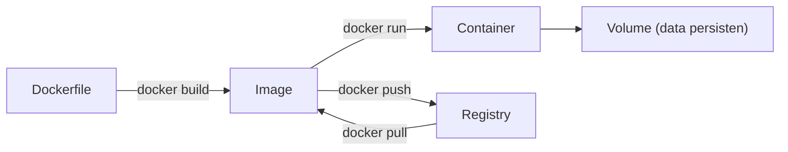

# Docker Fundamentals

"Di laptopku jalan." Docker menyelesaikan masalah itu dengan membungkus aplikasi beserta lingkungannya (versi PHP, ekstensi, konfigurasi) menjadi **image** yang berjalan identik di laptop, CI, dan server. Sub bab ini memperkenalkan konsep inti dan perintah dasar sebelum kita membuat Dockerfile dan Compose untuk Laravel.

!!! danger "Belum teruji penulis"
    Penulis menjalankan hanya pemeriksaan sintaks `docker compose config` secara lokal (pada sub bab Compose). Daemon Docker tidak aktif di lingkungan penulis, jadi `docker run`/`build` **tidak pernah dijalankan** untuk materi ini. Perintah diturunkan dari dokumentasi Docker; periksa versi dan baca setiap perintah, terutama yang menghapus data.

## Tujuan Pembelajaran

- [ ] Membedakan image, container, registry, volume, dan network.
- [ ] Membedakan container dan mesin virtual.
- [ ] Menjalankan, melihat, menghentikan, dan menghapus container.
- [ ] Memakai port mapping, variabel lingkungan, dan volume.
- [ ] Membaca log dan masuk ke container (`logs`, `exec`).
- [ ] Mengenali risiko keamanan dasar (image tak tepercaya, root, rahasia di image).

## Prasyarat

- [Linux Server Fundamentals](10-02-linux-server-fundamentals.md).
- Docker Desktop (Windows/macOS) atau Docker Engine (Linux) terpasang dan berjalan.

## Pengantar

Rekan memakai PHP 8.2 tanpa ekstensi `intl`, servermu PHP 8.3. Bug hanya muncul di salah satu. Dengan container, lingkungan menjadi bagian dari artefak yang dikirim.

## Penjelasan Konsep

### Istilah

| Istilah | Arti |
|---|---|
| Image | Templat baca-saja berisi sistem berkas dan konfigurasi (mis. `php:8.3-fpm`) |
| Container | Instans image yang berjalan (proses terisolasi) |
| Registry | Penyimpanan image (Docker Hub, GHCR) |
| Volume | Penyimpanan data yang bertahan di luar umur container |
| Network | Jaringan virtual antar-container |

### Container vs VM

Container berbagi kernel host dan hanya mengisolasi proses, sistem berkas, dan jaringan; ia ringan dan cepat dinyalakan. VM menjalankan sistem operasi penuh di atas hypervisor; lebih berat, isolasi lebih kuat. Container **bukan** batas keamanan sekuat VM.

### Perintah dasar

```bash
docker version
docker run --rm hello-world                   # uji pemasangan
docker run -d --name web -p 8080:80 nginx:alpine
docker ps                                     # container berjalan
docker logs -f web
docker exec -it web sh                        # masuk ke container
docker stop web
docker rm web
docker images
docker rmi nginx:alpine
```

| Opsi | Arti |
|---|---|
| `-d` | Berjalan di latar belakang |
| `--name` | Nama container |
| `-p 8080:80` | Port host 8080 → port container 80 |
| `--rm` | Hapus container otomatis saat berhenti |
| `-e KEY=nilai` | Variabel lingkungan |
| `-v nama:/path` | Pasang volume |

### Data dan volume

Sistem berkas container bersifat sementara: saat container dihapus, datanya hilang. Data penting (database, unggahan) harus di **volume** atau *bind mount*:

```bash
docker volume create data-uji
docker run --rm -v data-uji:/data alpine sh -c "echo halo > /data/tes.txt"
docker run --rm -v data-uji:/data alpine cat /data/tes.txt     # halo
docker volume rm data-uji
```

### Jaringan

Pada jaringan buatan pengguna, container saling menjangkau dengan **nama layanan** sebagai host. Aplikasi menghubungi `db:3306`, bukan `127.0.0.1`.

### Tag dan versi

`nginx:alpine` dan `php:8.3-fpm` memakai tag yang dapat bergeser. Untuk produksi sematkan versi spesifik (mis. `nginx:1.27-alpine`) atau digest agar build berulang; periksa tag yang tersedia di registry.

### Keamanan

- Gunakan image resmi/terverifikasi dari registry tepercaya; image tak dikenal dapat berisi malware.
- Jangan menjalankan aplikasi sebagai root di container bila memungkinkan.
- **Jangan menyimpan rahasia di image** (`COPY .env`, `ENV PASSWORD=`): image bisa dibaca siapa pun yang punya akses, dan lapisannya tersimpan.
- Jangan membuka port Docker daemon (2375) ke jaringan.
- Memberi akses ke grup `docker` setara memberi akses root di host.
- Perbarui image dasar secara berkala (patch keamanan).

## Cara Kerja



## Contoh Praktik

Kamu menjalankan Nginx dalam container, mengakses lewat browser, menyimpan data di volume, dan membersihkan semuanya.

## Penjelasan Kode

Skenario: `docker run -d --name web -p 8080:80 nginx:alpine` lalu buka `http://localhost:8080` untuk halaman sambutan Nginx.

## Implementasi Langkah demi Langkah

### Langkah 1: verifikasi pemasangan

```bash
docker version
docker run --rm hello-world
```

### Langkah 2: jalankan Nginx

```bash
docker run -d --name web -p 8080:80 nginx:alpine
docker ps
```

### Langkah 3: buka dan lihat log

```bash
curl -i http://localhost:8080
docker logs web | tail
```

### Langkah 4: masuk ke container

```bash
docker exec -it web sh
ls /usr/share/nginx/html
exit
```

### Langkah 5: volume

Jalankan contoh volume di bagian konsep dan buktikan data bertahan antar container.

### Langkah 6: bersihkan

```bash
docker stop web && docker rm web
docker volume ls
```

### Langkah 7: jangan hapus massal

Hindari `docker system prune -a --volumes` kecuali kamu paham ia menghapus volume dan image tak terpakai (termasuk data!).

## Eksekusi dan Verifikasi

| Langkah | Hasil yang diharapkan |
|---|---|
| 1 | Pesan "Hello from Docker!" |
| 3 | `HTTP/1.1 200 OK` dan halaman sambutan Nginx |
| 5 | `halo` tercetak dari container kedua |

## Daftar periksa verifikasi

- [ ] Kamu dapat menjelaskan image vs container.
- [ ] Data penting disimpan di volume, bukan di sistem berkas container.
- [ ] Tidak ada rahasia di perintah/ image.
- [ ] Container uji dibersihkan.

## Hasil yang Diharapkan

Output bergantung versi Docker dan tag image; belum dijalankan oleh penulis.

## Kesalahan Umum dan Pemecahan Masalah

| Gejala | Penyebab | Cara mengenali | Solusi | Pencegahan |
|---|---|---|---|---|
| `Cannot connect to the Docker daemon` | Docker tidak berjalan | Galat koneksi | Nyalakan Docker Desktop/daemon | Cek `docker info` |
| `port is already allocated` | Port host terpakai | Gagal start | Ganti port host | `docker ps`, `ss -tlnp` |
| Data hilang | Tanpa volume | Data tak ada setelah recreate | Pakai volume | Rancang data |
| Container langsung berhenti | Proses utama selesai | `docker ps -a` Exited | `docker logs` | Proses foreground |
| `permission denied` pada socket | Pengguna bukan anggota `docker` | Galat izin | Tambah ke grup (paham risiko) | Atur akses |
| Disk penuh | Image/volume menumpuk | `docker system df` | Bersihkan hati-hati | Pembersihan terencana |

## Latihan Praktik

### Latihan dasar

**D1. Pemetaan port**
- *Masalah:* paham `-p`.
- *Persyaratan:* jelaskan `-p 9000:80` dan `-p 127.0.0.1:9000:80`.
- *Perilaku yang diharapkan:* yang kedua hanya dapat diakses lokal.
- *Tujuan belajar:* port mapping.

### Latihan implementasi

**I1. Variabel dan volume**
- *Masalah:* ingin menjalankan MySQL uji.
- *Persyaratan:* jalankan `mysql:8.4` dengan volume dan variabel `MYSQL_ROOT_PASSWORD` (sandi uji, jangan dipakai ulang), hubungkan dengan `docker exec` ke `mysql`, lalu hapus.
- *Perilaku yang diharapkan:* database berjalan dan data bertahan di volume.
- *Tujuan belajar:* menjalankan layanan.

**I2. Jaringan**
- *Masalah:* dua container saling bicara.
- *Persyaratan:* buat network, jalankan dua container, `ping`/`curl` memakai nama.
- *Perilaku yang diharapkan:* resolusi nama berhasil.
- *Tujuan belajar:* jaringan Docker.

### Latihan tantangan

**T1. Analisis keamanan image**
- *Masalah:* tim ingin memakai image dari sumber tak dikenal.
- *Persyaratan:* tulis daftar pemeriksaan (sumber, tanda tangan, pemindai kerentanan, pengguna non-root, ukuran).
- *Perilaku yang diharapkan:* daftar periksa praktis.
- *Tujuan belajar:* rantai pasok.
- *Catatan:* kerjakan mandiri; tidak ada kunci jawaban.

## Uji Pemahaman

1. Apa beda image dan container?
2. Mengapa data penting di volume?
3. Bagaimana container saling menjangkau?
4. Mengapa rahasia tidak boleh di image?

??? success "Kunci jawaban singkat"
    1. Image templat baca-saja; container instans yang berjalan.
    2. Sistem berkas container hilang saat container dihapus.
    3. Lewat nama layanan di jaringan Docker yang sama.
    4. Image dan lapisannya dapat dibaca pihak lain dan tersimpan permanen.

## Ringkasan

- Docker membungkus aplikasi dan lingkungannya sebagai image yang berjalan sebagai container.
- Data di volume; komunikasi lewat nama layanan; tag harus disematkan.
- Jaga keamanan: image tepercaya, non-root, tanpa rahasia di image.

Selanjutnya: *Dockerfile for Laravel*.

## Referensi Resmi

- [Docker: Get Started](https://docs.docker.com/get-started/)
- [Docker: CLI Reference](https://docs.docker.com/reference/cli/docker/)
- [Docker: Security](https://docs.docker.com/engine/security/)
