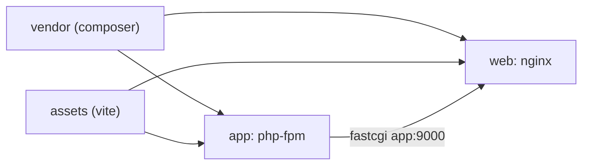

# Dockerfile for Laravel

Dockerfile adalah resep membangun image. Untuk Laravel, resep yang baik memisahkan tahap pembangunan (Composer, Vite) dari image akhir yang ramping dan aman, memanfaatkan cache lapisan, dan tidak membawa rahasia atau alat pengembangan ke produksi. Sub bab ini menyusun Dockerfile *multi-stage* untuk `cms-artikel` dengan PHP-FPM dan Nginx sebagai dua target.

!!! danger "Belum teruji penulis"
    Dockerfile ini **belum pernah di-build** oleh penulis (daemon Docker tidak aktif di lingkungan penulis). Versi image (`composer:2`, `node:22-alpine`, `php:8.3-fpm-alpine`, `nginx:1.27-alpine`) diturunkan dari praktik umum dan dapat berubah; periksa tag di Docker Hub. Lakukan build di mesin uji dan perbaiki bila ada galat; jadikan temuanmu bagian dari verifikasi.

## Tujuan Pembelajaran

- [ ] Menjelaskan instruksi `FROM`, `WORKDIR`, `COPY`, `RUN`, `USER`, `EXPOSE`, `CMD`.
- [ ] Menyusun Dockerfile multi-stage (vendor, assets, app, web).
- [ ] Memanfaatkan cache lapisan dengan urutan `COPY` yang tepat.
- [ ] Memakai `.dockerignore` agar rahasia dan berkas besar tidak masuk.
- [ ] Menjalankan sebagai pengguna non-root dan menyiapkan izin `storage`.
- [ ] Membangun dan memeriksa ukuran serta isi image.

## Prasyarat

- [Docker Fundamentals](10-13-docker-fundamentals.md), [PHP-FPM](10-05-php-fpm.md), [Nginx Configuration](10-04-nginx-configuration.md).

## Pengantar

Image naif (`FROM php` lalu `COPY . .`, `composer install`, `npm install`) berukuran besar, lambat di-build, dan membawa `.env`, `.git`, serta alat pengembangan. Multi-stage menghasilkan image akhir hanya berisi yang perlu.

## Penjelasan Konsep

### Konsep multi-stage

Setiap `FROM` memulai tahap baru. Tahap awal membangun artefak; tahap akhir hanya menyalin hasilnya (`COPY --from=`). Alat build (Composer, Node) tidak ikut ke image akhir.

### `.dockerignore`

File: `.dockerignore`

```text
.git
.env
.env.*
!.env.example
node_modules
vendor
storage/logs/*
storage/framework/cache/*
storage/framework/sessions/*
storage/framework/views/*
tests
.idea
.vscode
docker-compose*.yml
compose*.yaml
```

`.env` **harus** diabaikan agar rahasia tidak masuk ke konteks build dan lapisan image. `vendor` dan `node_modules` dibuat ulang dalam image.

### Dockerfile

File: `Dockerfile`

```dockerfile
# syntax=docker/dockerfile:1

# ---------- Tahap 1: dependensi PHP ----------
FROM composer:2 AS vendor
WORKDIR /app
COPY composer.json composer.lock ./
RUN composer install --no-dev --no-scripts --no-autoloader --prefer-dist --no-interaction
COPY . .
RUN composer dump-autoload --optimize --classmap-authoritative --no-dev

# ---------- Tahap 2: aset frontend ----------
FROM node:22-alpine AS assets
WORKDIR /app
COPY package.json package-lock.json ./
RUN npm ci
COPY vite.config.js ./
COPY resources ./resources
COPY public ./public
RUN npm run build

# ---------- Tahap 3: aplikasi (PHP-FPM) ----------
FROM php:8.3-fpm-alpine AS app
WORKDIR /var/www/html

RUN docker-php-ext-install pdo_mysql bcmath pcntl opcache

COPY docker/php/php.ini /usr/local/etc/php/conf.d/zz-app.ini

COPY --from=vendor /app ./
COPY --from=assets /app/public/build ./public/build

RUN mkdir -p storage/framework/{cache,sessions,views} storage/logs bootstrap/cache \
    && chown -R www-data:www-data storage bootstrap/cache \
    && chmod -R ug+rwX storage bootstrap/cache

USER www-data
EXPOSE 9000
CMD ["php-fpm"]

# ---------- Tahap 4: web (Nginx) ----------
FROM nginx:1.27-alpine AS web
COPY docker/nginx/default.conf /etc/nginx/conf.d/default.conf
COPY --from=vendor /app/public /var/www/html/public
COPY --from=assets /app/public/build /var/www/html/public/build
EXPOSE 80
```

| Bagian | Penjelasan |
|---|---|
| `COPY composer.json composer.lock` lalu `composer install`, baru `COPY . .` | Lapisan dependensi di-cache selama `composer.lock` tidak berubah |
| `--no-dev --classmap-authoritative` | Hanya dependensi produksi; autoloader dioptimasi |
| `npm ci` | Instalasi bersih dari `package-lock.json` (reprodusibel) |
| `docker-php-ext-install` | Memasang ekstensi PHP yang belum ada (ekstensi umum seperti mbstring, curl, dom sudah termasuk di image resmi) |
| `zz-app.ini` | Pengaturan produksi (10.05): `display_errors=Off`, OPcache |
| `chown ... storage bootstrap/cache` | Hanya direktori tulis yang dimiliki `www-data` (10.09) |
| `USER www-data` | Tidak berjalan sebagai root |
| Target `app` dan `web` | Dua image dari satu Dockerfile (`--target`) |

Karena `COPY --from=vendor /app ./` menyalin seluruh aplikasi (kecuali `.dockerignore`), pastikan `.dockerignore` benar.

### Konfigurasi pendukung

File: `docker/php/php.ini`

```ini
expose_php = Off
display_errors = Off
log_errors = On
memory_limit = 256M
upload_max_filesize = 10M
post_max_size = 12M

opcache.enable = 1
opcache.memory_consumption = 192
opcache.max_accelerated_files = 20000
opcache.validate_timestamps = 0
```

File: `docker/nginx/default.conf`

```nginx
server {
    listen 80;
    server_name _;
    root /var/www/html/public;

    add_header X-Frame-Options "SAMEORIGIN";
    add_header X-Content-Type-Options "nosniff";

    index index.php;
    charset utf-8;

    location / {
        try_files $uri $uri/ /index.php?$query_string;
    }

    location ~ ^/index\.php(/|$) {
        fastcgi_pass app:9000;
        fastcgi_param SCRIPT_FILENAME $realpath_root$fastcgi_script_name;
        include fastcgi_params;
        fastcgi_hide_header X-Powered-By;
    }

    location ~ \.php$ {
        return 404;
    }

    location ~ /\.(?!well-known).* {
        deny all;
    }
}
```

`fastcgi_pass app:9000` memakai nama layanan Compose `app` (10.15). `opcache.validate_timestamps = 0` aman karena image tidak berubah selama container hidup.

### Build

```bash
docker build --target app -t cms-artikel-app:dev .
docker build --target web -t cms-artikel-web:dev .
docker images | grep cms-artikel
```

Cek isi: `docker run --rm cms-artikel-app:dev php -m` dan pastikan `.env` tidak ada:

```bash
docker run --rm cms-artikel-app:dev ls -la /var/www/html | grep -i "\.env" || echo "OK: tidak ada .env"
```

### Konfigurasi aplikasi di container

Aplikasi membaca konfigurasi dari **variabel lingkungan** yang disuntikkan saat runtime (Compose/orkestrator), bukan dari berkas dalam image. Laravel membaca variabel lingkungan proses; `.env` tidak wajib ada. Jalankan `php artisan optimize` saat startup atau di entrypoint bila ingin cache config (setelah variabel tersedia), bukan saat build, karena build tidak memiliki rahasia.

### Pemindaian

Pindai image terhadap kerentanan dengan alat seperti `docker scout` atau Trivy (alat pihak ketiga) di CI (10.17).

### Keamanan

- `.dockerignore` mengecualikan `.env`, `.git`.
- Jangan `COPY .env`, jangan `ARG`/`ENV` untuk rahasia (terlihat di `docker history`).
- Non-root (`USER www-data`).
- Sematkan versi image dasar; bangun ulang rutin untuk patch.
- Image akhir tanpa Composer/Node/dev dependencies.

## Cara Kerja



## Contoh Praktik

Kamu membuat `.dockerignore`, Dockerfile, dan dua berkas konfigurasi, membangun kedua target, dan memeriksa ukuran serta isi image.

## Penjelasan Kode

Urutan `COPY` menentukan efisiensi cache: berkas yang jarang berubah (`composer.lock`, `package-lock.json`) disalin lebih dulu.

## Implementasi Langkah demi Langkah

### Langkah 1: siapkan berkas

Buat `.dockerignore`, `docker/php/php.ini`, `docker/nginx/default.conf`, dan `Dockerfile`.

### Langkah 2: build target app

```bash
docker build --target app -t cms-artikel-app:dev .
```

### Langkah 3: build target web

```bash
docker build --target web -t cms-artikel-web:dev .
```

### Langkah 4: periksa isi

Jalankan perintah pemeriksaan `.env` dan `php -m`.

### Langkah 5: ukuran dan lapisan

```bash
docker images cms-artikel-app:dev
docker history cms-artikel-app:dev | head -20
```

Pastikan tidak ada rahasia pada riwayat.

### Langkah 6: uji cache

Ubah satu berkas di `app/`, build ulang: tahap `composer install` memakai cache; hanya lapisan setelah `COPY . .` yang dibangun ulang.

### Langkah 7: catat di Git

```bash
git add Dockerfile .dockerignore docker
git commit -m "Tambah Dockerfile multi-stage untuk Laravel"
```

## Eksekusi dan Verifikasi

| Langkah | Hasil yang diharapkan |
|---|---|
| 2–3 | Build selesai (setelah perbaikan yang kamu perlukan) |
| 4 | `OK: tidak ada .env`; ekstensi `pdo_mysql` tersedia |
| 6 | Lapisan dependensi memakai cache |

## Daftar periksa verifikasi

- [ ] Kedua target ter-build tanpa galat.
- [ ] `.env`, `.git`, `tests` tidak ada dalam image.
- [ ] Proses berjalan sebagai `www-data`.
- [ ] `docker history` tidak memuat rahasia.
- [ ] Ukuran image wajar (catat nilainya).

## Hasil yang Diharapkan

Belum pernah di-build oleh penulis; galat dan ukuran akan bergantung proyekmu, versi image, dan koneksi jaringan.

## Kesalahan Umum dan Pemecahan Masalah

| Gejala | Penyebab | Cara mengenali | Solusi | Pencegahan |
|---|---|---|---|---|
| `composer.lock` tidak ditemukan | Berkas diabaikan/tak ada | Galat COPY | Pastikan di repositori | Commit lock |
| `npm run build` gagal | Berkas config Vite tidak disalin | Galat Vite | Salin berkas yang dibutuhkan | Periksa `vite.config.js` |
| Build lambat | Konteks besar / urutan COPY buruk | Lama mengirim konteks | `.dockerignore`, urutan | Cache lapisan |
| `.env` ada di image | `.dockerignore` kurang | Terlihat di `ls` | Tambah ignore, bangun ulang, rotasi rahasia | Pemeriksaan di CI |
| Izin `storage` ditolak | Pemilik salah | Galat tulis log | `chown` direktori | Langkah RUN |
| Ekstensi hilang | Belum dipasang | Class not found | `docker-php-ext-install`/`install-php-extensions` | Cek `php -m` |
| `fastcgi_pass app:9000` gagal | Nama layanan salah | 502 | Samakan dengan Compose | 10.15 |

## Latihan Praktik

### Latihan dasar

**D1. Urutan COPY**
- *Masalah:* build lambat.
- *Persyaratan:* jelaskan mengapa `COPY composer.json composer.lock` mendahului `COPY . .`.
- *Perilaku yang diharapkan:* cache dependensi bertahan.
- *Tujuan belajar:* cache lapisan.

### Latihan implementasi

**I1. Ekstensi tambahan**
- *Masalah:* butuh `intl` dan `redis`.
- *Persyaratan:* tambahkan ke tahap `app` dengan cara yang tepat untuk Alpine (paket dev sementara, atau `install-php-extensions`), bangun, dan verifikasi `php -m`.
- *Perilaku yang diharapkan:* kedua ekstensi tampil.
- *Tujuan belajar:* ekstensi PHP di image.

**I2. Pemindaian**
- *Masalah:* ingin tahu kerentanan.
- *Persyaratan:* jalankan alat pemindai pilihanmu pada image dan catat temuan serta rencana perbaikan.
- *Perilaku yang diharapkan:* laporan.
- *Tujuan belajar:* keamanan image.

### Latihan tantangan

**T1. Entrypoint cerdas**
- *Masalah:* ingin menjalankan `config:cache` saat container start.
- *Persyaratan:* rancang `docker/entrypoint.sh` (menjalankan optimasi lalu `exec "$@"`), diskusikan risiko (migrasi otomatis di banyak container) dan keputusan.
- *Perilaku yang diharapkan:* rancangan beralasan.
- *Tujuan belajar:* siklus hidup container.
- *Catatan:* kerjakan mandiri; tidak ada kunci jawaban.

## Uji Pemahaman

1. Apa keuntungan multi-stage?
2. Mengapa `.dockerignore` penting?
3. Mengapa `composer.lock` disalin dulu?
4. Mengapa `USER www-data`?

??? success "Kunci jawaban singkat"
    1. Image akhir kecil tanpa alat build.
    2. Mencegah rahasia/berkas besar masuk image.
    3. Memanfaatkan cache lapisan.
    4. Mengurangi dampak bila proses disusupi.

## Ringkasan

- Dockerfile multi-stage memisahkan build dari image akhir.
- `.dockerignore`, non-root, tanpa rahasia, dan versi tersemat adalah kunci keamanan.
- Konfigurasi masuk saat runtime lewat variabel lingkungan.

Selanjutnya: *Docker Compose*.

## Referensi Resmi

- [Docker: Dockerfile Reference](https://docs.docker.com/reference/dockerfile/)
- [Docker: Multi-stage Builds](https://docs.docker.com/build/building/multi-stage/)
- [Docker: Official PHP Image](https://hub.docker.com/_/php)
