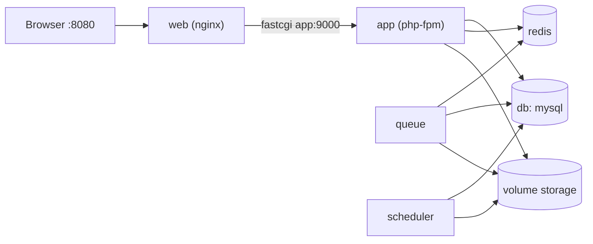

# Docker Compose

Aplikasi Laravel nyata terdiri dari beberapa proses: PHP-FPM, Nginx, MySQL, Redis, worker antrean, dan penjadwal. Menjalankan masing-masing dengan `docker run` panjang membosankan dan rawan salah. **Docker Compose** mendeskripsikan seluruh tumpukan dalam satu berkas `compose.yaml` dan menjalankannya dengan satu perintah.

!!! warning "Status verifikasi"
    Berkas `compose.yaml` pada sub bab ini **sintaksnya divalidasi** penulis dengan `docker compose config` (Docker Compose v5.6.1) pada mesin lokal, termasuk pemeriksaan variabel wajib. Namun daemon Docker tidak aktif di lingkungan penulis, sehingga `build`, `up`, koneksi antar-container, dan migrasi **belum pernah dijalankan**. Perlakukan isi sebagai titik awal yang perlu kamu uji.

## Tujuan Pembelajaran

- [ ] Menulis `compose.yaml` dengan layanan, jaringan, volume, dan `depends_on`.
- [ ] Menggunakan *anchor* YAML (`x-app`) untuk berbagi konfigurasi.
- [ ] Memisahkan variabel interpolasi Compose (`.env`) dari lingkungan aplikasi (`.env.app`).
- [ ] Menambahkan healthcheck dan menunggu database siap.
- [ ] Menjalankan migrasi, melihat log, dan mengelola siklus hidup (`up`, `down`, `logs`, `ps`).
- [ ] Mengikat port ke localhost dan menghindari paparan layanan internal.

## Prasyarat

- [Dockerfile for Laravel](10-14-dockerfile-for-laravel.md).
- Docker Compose v2+ (`docker compose version`).

## Pengantar

Rekan baru ingin menjalankan proyek: instal PHP, MySQL, Redis, atur versi, jalankan worker, jalankan penjadwal. Dengan Compose: salin dua berkas konfigurasi, jalankan `docker compose up -d --build`.

## Penjelasan Konsep

### Layanan dalam tumpukan

| Layanan | Image | Peran |
|---|---|---|
| `app` | Target `app` | PHP-FPM |
| `web` | Target `web` | Nginx, satu-satunya yang membuka port |
| `queue` | Image `app` | Worker antrean |
| `scheduler` | Image `app` | `schedule:work` |
| `db` | `mysql:8.4` | Database |
| `redis` | `redis:7-alpine` | Cache/antrean/sesi |

### `compose.yaml`

File: `compose.yaml`

```yaml
name: cms-artikel

x-app: &app
  build:
    context: .
    target: app
  image: cms-artikel-app:local
  restart: unless-stopped
  env_file:
    - .env.app
  environment:
    DB_HOST: db
    DB_PORT: 3306
    REDIS_HOST: redis
  volumes:
    - storage:/var/www/html/storage
  depends_on:
    db:
      condition: service_healthy
    redis:
      condition: service_started

services:
  app:
    <<: *app

  web:
    build:
      context: .
      target: web
    image: cms-artikel-web:local
    restart: unless-stopped
    ports:
      - "127.0.0.1:8080:80"
    depends_on:
      - app

  queue:
    <<: *app
    command: ["php", "artisan", "queue:work", "--queue=critical,default,bulk", "--sleep=3", "--tries=3", "--max-time=3600"]
    stop_grace_period: 1h

  scheduler:
    <<: *app
    command: ["php", "artisan", "schedule:work"]

  db:
    image: mysql:8.4
    restart: unless-stopped
    environment:
      MYSQL_DATABASE: ${DB_DATABASE:?isi DB_DATABASE di .env}
      MYSQL_USER: ${DB_USERNAME:?isi DB_USERNAME di .env}
      MYSQL_PASSWORD: ${DB_PASSWORD:?isi DB_PASSWORD di .env}
      MYSQL_ROOT_PASSWORD: ${DB_ROOT_PASSWORD:?isi DB_ROOT_PASSWORD di .env}
    volumes:
      - dbdata:/var/lib/mysql
    healthcheck:
      test: ["CMD", "mysqladmin", "ping", "-h", "127.0.0.1", "-uroot", "-p${DB_ROOT_PASSWORD}"]
      interval: 10s
      timeout: 5s
      retries: 10

  redis:
    image: redis:7-alpine
    restart: unless-stopped
    command: ["redis-server", "--appendonly", "yes"]
    volumes:
      - redisdata:/data

volumes:
  storage:
  dbdata:
  redisdata:
```

| Bagian | Penjelasan |
|---|---|
| `x-app: &app` dan `<<: *app` | Anchor YAML: `app`, `queue`, `scheduler` berbagi konfigurasi (satu image, perintah berbeda) |
| `env_file: .env.app` | Konfigurasi Laravel disuntik saat runtime; **tidak ada di image** |
| `environment: DB_HOST: db` | Nama layanan sebagai host; menimpa nilai di `.env.app` |
| `127.0.0.1:8080:80` | `web` hanya terbuka di localhost; di server nyata, terminasi TLS oleh proxy/Nginx host |
| `depends_on ... service_healthy` | Menunggu database siap (healthcheck) sebelum memulai aplikasi |
| `stop_grace_period: 1h` | Memberi worker waktu menyelesaikan job saat berhenti (selaras `stopwaitsecs`) |
| `volumes: storage` | Log/unggahan bertahan; dipakai bersama `app`, `queue`, `scheduler` |
| `${DB_PASSWORD:?pesan}` | Compose menolak jalan bila variabel kosong |
| `db`/`redis` tanpa `ports` | Tidak terbuka ke host: hanya terjangkau dalam jaringan Compose |

### Dua berkas lingkungan

| Berkas | Dibaca oleh | Isi |
|---|---|---|
| `.env` | Compose (interpolasi `${...}`) | Rahasia infrastruktur: `DB_DATABASE`, `DB_USERNAME`, `DB_PASSWORD`, `DB_ROOT_PASSWORD` |
| `.env.app` | Kontainer aplikasi (`env_file`) | Konfigurasi Laravel: `APP_KEY`, `APP_ENV`, `DB_*` (tanpa root password), dsb. |

Pemisahan ini mencegah **password root MySQL** ikut ke lingkungan kontainer aplikasi. Tambahkan keduanya ke `.gitignore`; sertakan `*.example` di repositori.

File: `.env.example` (untuk Compose)

```text
DB_DATABASE=cms_artikel
DB_USERNAME=cms_app
DB_PASSWORD=GANTI
DB_ROOT_PASSWORD=GANTI
```

File: `.env.app.example` (untuk Laravel)

```text
APP_NAME="CMS Artikel"
APP_ENV=production
APP_KEY=
APP_DEBUG=false
APP_URL=http://localhost:8080
LOG_CHANNEL=stderr
DB_CONNECTION=mysql
DB_DATABASE=cms_artikel
DB_USERNAME=cms_app
DB_PASSWORD=GANTI
CACHE_STORE=redis
QUEUE_CONNECTION=redis
SESSION_DRIVER=redis
```

`LOG_CHANNEL=stderr` menulis log ke stderr kontainer sehingga terbaca lewat `docker compose logs`. `APP_KEY` dibuat sekali (`php artisan key:generate --show` lewat container) dan diisi manual.

### Perintah harian

```bash
docker compose config -q                 # validasi sintaks & variabel
docker compose up -d --build             # bangun & jalankan
docker compose ps
docker compose logs -f web app queue
docker compose exec app php artisan about
docker compose run --rm app php artisan migrate --force
docker compose down                      # hentikan & hapus kontainer (volume tetap)
docker compose down -v                   # JUGA hapus volume (DATA HILANG)
```

Migrasi dijalankan sebagai langkah terpisah, bukan otomatis di tiap kontainer, agar beberapa replika tidak berebut migrasi.

### Pengembangan vs produksi

Berkas ini berorientasi produksi-mirip. Untuk pengembangan, buat `compose.override.yaml` dengan bind mount kode, `APP_DEBUG=true`, dan jangan memakainya di produksi. Compose otomatis menggabungkan `compose.override.yaml` bila ada.

### Keamanan

- Jangan menerbitkan port `db` dan `redis` ke host/publik.
- `.env`/`.env.app` tidak di Git; rahasia berbeda per lingkungan.
- Compose cocok untuk satu host; pada beberapa server pertimbangkan orkestrator (di luar cakupan).
- Perbarui image dan pindai kerentanan.
- Jangan mengekspos socket Docker ke kontainer.

## Cara Kerja



## Contoh Praktik

Kamu menyiapkan kedua berkas lingkungan, memvalidasi Compose, membangun dan menjalankan tumpukan, menjalankan migrasi, dan membuktikan antrean serta penjadwal berjalan.

## Penjelasan Kode

Validasi tanpa daemon:

```bash
docker compose config -q && echo "Sintaks OK"
```

Jika variabel wajib kosong, Compose menampilkan pesan yang kamu tulis (`isi DB_PASSWORD di .env`).

## Implementasi Langkah demi Langkah

### Langkah 1: siapkan berkas

Buat `compose.yaml`, `.env`, dan `.env.app` dari contoh (isi sandi acak dan kuat).

### Langkah 2: validasi

```bash
docker compose config -q && echo "Sintaks OK"
```

### Langkah 3: bangun dan jalankan

```bash
docker compose up -d --build
docker compose ps
```

### Langkah 4: kunci aplikasi dan migrasi

```bash
docker compose run --rm app php artisan key:generate --show
```

Salin keluaran ke `APP_KEY` di `.env.app`, lalu:

```bash
docker compose up -d
docker compose run --rm app php artisan migrate --force
```

### Langkah 5: periksa

```bash
curl -i http://127.0.0.1:8080/up
docker compose logs --tail=20 web app
```

### Langkah 6: antrean dan jadwal

```bash
docker compose logs --tail=20 queue scheduler
```

Picu aksi yang men-dispatch job dan lihat worker memprosesnya.

### Langkah 7: pastikan layanan internal tertutup

```bash
docker compose ps --format '{{.Name}} {{.Ports}}'
```

Hanya `web` yang mempublikasikan port (ke `127.0.0.1`).

### Langkah 8: hentikan

```bash
docker compose down
```

Jangan gunakan `-v` kecuali ingin menghapus data.

## Eksekusi dan Verifikasi

| Langkah | Hasil yang diharapkan |
|---|---|
| 2 | `Sintaks OK` (tervalidasi penulis pada contoh) |
| 5 | `/up` → `200` |
| 6 | Log worker menunjukkan job diproses; scheduler berjalan tiap menit |
| 7 | Hanya `web` memetakan port |

## Daftar periksa verifikasi

- [ ] `docker compose config -q` bersih.
- [ ] Semua layanan `running`/`healthy`.
- [ ] Migrasi sukses; `/up` 200.
- [ ] Antrean dan jadwal terbukti berjalan.
- [ ] Port db/redis tidak terbuka; berkas `.env*` tidak di Git.

## Hasil yang Diharapkan

Hanya sintaks yang divalidasi penulis; sisanya diturunkan dari dokumentasi Docker dan Laravel. Cocokkan dengan hasilmu.

## Kesalahan Umum dan Pemecahan Masalah

| Gejala | Penyebab | Cara mengenali | Solusi | Pencegahan |
|---|---|---|---|---|
| `required variable ... is missing` | `.env` belum diisi | Galat interpolasi | Isi variabel | `config -q` |
| `app` crash: `No application encryption key` | `APP_KEY` kosong | Log kontainer | Isi di `.env.app` | Langkah 4 |
| `SQLSTATE[HY000] [2002]` | DB belum siap / host salah | Log aplikasi | Healthcheck, `DB_HOST=db` | `depends_on` + healthcheck |
| 502 dari `web` | `app` mati / nama layanan salah | Log web | Periksa `app` dan `fastcgi_pass` | `docker compose ps` |
| Perubahan `.env.app` tak berlaku | Kontainer tidak dibuat ulang | Nilai lama | `docker compose up -d --force-recreate` | Pahami siklus |
| Data hilang | `down -v` | Database kosong | Pulihkan dari backup | Hindari `-v`, backup |
| Izin `storage` ditolak | Volume dimiliki root | Galat tulis | Pastikan `chown` di image; volume baru mewarisi | Uji |
| Port 8080 dipakai | Bentrok | Gagal start | Ganti port host | `ss -tlnp` |

## Latihan Praktik

### Latihan dasar

**D1. Baca konfigurasi**
- *Masalah:* paham anchor.
- *Persyaratan:* jelaskan fungsi `x-app` dan `<<: *app`.
- *Perilaku yang diharapkan:* konfigurasi dipakai ulang.
- *Tujuan belajar:* DRY di Compose.

### Latihan implementasi

**I1. Override pengembangan**
- *Masalah:* ingin bekerja dengan kode lokal.
- *Persyaratan:* tulis `compose.override.yaml` dengan bind mount `./:/var/www/html`, `APP_DEBUG=true`, dan jelaskan mengapa tidak untuk produksi.
- *Perilaku yang diharapkan:* perubahan kode langsung terlihat.
- *Tujuan belajar:* pemisahan lingkungan.

**I2. Healthcheck aplikasi**
- *Masalah:* ingin tahu apakah `app` sehat.
- *Persyaratan:* tambahkan healthcheck yang memanggil `/up` (melalui `web`) atau memeriksa proses FPM, dan jelaskan batasannya.
- *Perilaku yang diharapkan:* status `healthy`.
- *Tujuan belajar:* pemantauan kontainer.

### Latihan tantangan

**T1. Secrets**
- *Masalah:* tidak ingin rahasia di berkas `.env`.
- *Persyaratan:* baca fitur `secrets` Compose dan rancang cara menyuntikkan sandi DB lewat berkas rahasia, termasuk keterbatasannya.
- *Perilaku yang diharapkan:* rancangan benar.
- *Tujuan belajar:* manajemen rahasia kontainer.
- *Catatan:* kerjakan mandiri; tidak ada kunci jawaban.

## Uji Pemahaman

1. Mengapa `db` tidak memakai `ports`?
2. Mengapa dua berkas `.env`?
3. Apa fungsi healthcheck pada `db`?
4. Apa bedanya `down` dan `down -v`?

??? success "Kunci jawaban singkat"
    1. Agar tidak terbuka ke host/publik; hanya terjangkau di jaringan Compose.
    2. Memisahkan rahasia infrastruktur (root password) dari konfigurasi aplikasi.
    3. Aplikasi menunggu database siap.
    4. `-v` juga menghapus volume (data hilang).

## Ringkasan

- Compose mendefinisikan seluruh tumpukan di satu berkas dan satu perintah.
- Pisahkan rahasia, tutup layanan internal, jalankan migrasi terpisah.
- Validasi dengan `docker compose config`, uji `up`, dan backup sebelum `down -v`.

Selanjutnya: *CI/CD Fundamentals*.

## Referensi Resmi

- [Docker Compose: Overview](https://docs.docker.com/compose/)
- [Compose File Reference](https://docs.docker.com/reference/compose-file/)
- [Laravel: Deployment](https://laravel.com/docs/13.x/deployment)
