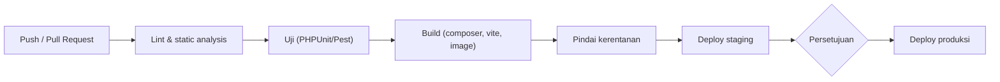
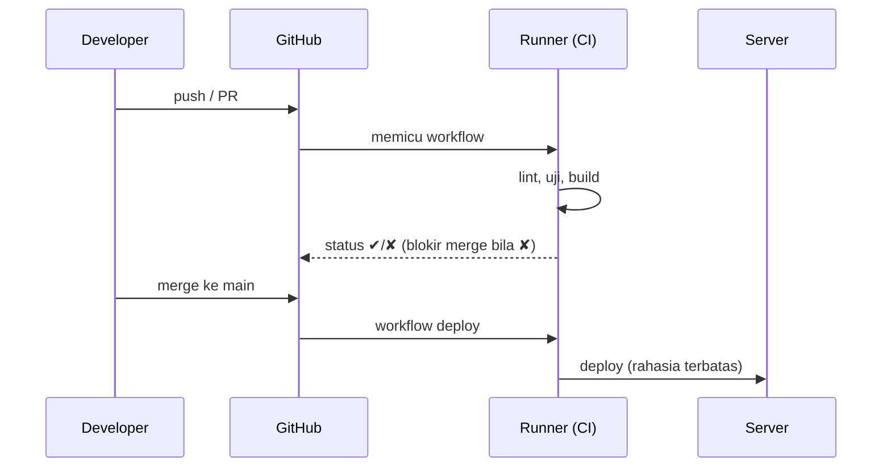

# CI/CD Fundamentals

Menjalankan uji dan deploy secara manual bergantung pada ingatan dan disiplin. **CI/CD** mengotomasi: setiap perubahan kode memicu build dan uji (*Continuous Integration*), dan perubahan yang lolos dapat dikirim ke server secara otomatis atau dengan persetujuan (*Continuous Delivery/Deployment*). Sub bab ini memberi konsep dan prinsip desain pipeline sebelum menulis workflow GitHub Actions.

## Tujuan Pembelajaran

- [ ] Menjelaskan CI, Continuous Delivery, dan Continuous Deployment.
- [ ] Menyusun tahap pipeline: lint, uji, build, pemindaian, deploy.
- [ ] Menjelaskan artefak, cache, matriks, dan lingkungan.
- [ ] Mengelola rahasia pipeline dengan aman.
- [ ] Menentukan strategi cabang dan gerbang persetujuan.
- [ ] Merancang rollback dan notifikasi kegagalan.

## Prasyarat

- Git/GitHub (Level 01), [Testing](../level-08/index.md), [Laravel Deployment](10-08-laravel-deployment.md), [Docker Compose](10-15-docker-compose.md).

## Pengantar

Rekan menggabungkan perubahan yang diam-diam merusak 12 uji. Karena tak ada yang menjalankan suite sebelum merge, bug baru ketahuan setelah rilis. Pipeline CI menolak merge bila uji gagal.

## Penjelasan Konsep

### Tiga istilah

| Istilah | Arti |
|---|---|
| Continuous Integration | Setiap push/PR dibangun & diuji otomatis |
| Continuous Delivery | Artefak selalu siap rilis; rilis dipicu manual (persetujuan) |
| Continuous Deployment | Setiap perubahan lolos otomatis sampai produksi |

Banyak tim memilih CI otomatis + deploy ke staging otomatis + deploy produksi dengan persetujuan.

### Tahap pipeline Laravel



| Tahap | Contoh |
|---|---|
| Lint | `./vendor/bin/pint --test` (bila Pint dipasang) |
| Analisis statis | PHPStan/Larastan (dependensi dev opsional) |
| Uji | `php artisan test` dengan SQLite memori atau layanan MySQL di CI |
| Audit dependensi | `composer audit`, `npm audit` |
| Build | `composer install --no-dev`, `npm run build`, `docker build` |
| Deploy | Skrip SSH, registry + pull di server |

### Prinsip desain

- **Cepat**: pipeline lambat diabaikan. Gunakan cache dependensi dan jalankan tahap paralel.
- **Deterministik**: versi PHP/Node tersemat; `composer.lock` dan `package-lock.json` di-commit.
- **Gagal cepat**: berhenti pada tahap pertama yang merah.
- **Satu artefak**: bangun sekali, deploy artefak yang sama ke staging dan produksi.
- **Infrastruktur sebagai kode**: pipeline disimpan di repositori dan di-review.

### Rahasia pipeline

Kunci SSH deploy, token registry, dan kredensial disimpan di fasilitas rahasia platform (mis. *GitHub Actions secrets*), bukan di repositori. Aturan:

- Beri **hak terkecil**: kunci deploy hanya untuk satu server/repositori, baca-saja bila memungkinkan.
- Jangan mencetak rahasia ke log; platform memaskernya tetapi bukan jaminan.
- Hati-hati dengan PR dari fork: rahasia umumnya tidak diberikan ke workflow dari fork (dan memang sebaiknya).
- Rotasi berkala dan saat anggota tim keluar.
- Pertimbangkan autentikasi OIDC ke penyedia awan (tanpa kunci jangka panjang) bila tersedia.

### Strategi cabang

| Strategi | Ciri |
|---|---|
| Trunk-based | Cabang pendek, merge ke `main` sering; fitur disembunyikan bendera |
| Git Flow | Cabang `develop`, `release`, `hotfix`; formal tetapi berat |
| GitHub Flow | `main` selalu siap deploy; fitur lewat PR |

Lindungi `main`: wajib PR, wajib uji lolos, wajib review.

### Gerbang dan lingkungan

Lingkungan `production` dengan **persetujuan wajib** mencegah deploy tak sengaja. Batasi cabang yang boleh mendeploy ke produksi (hanya `main`/tag).

### Rollback dan notifikasi

- Simpan artefak/rilis sebelumnya (10.08) agar rollback cepat.
- Tambahkan notifikasi (email/chat) saat pipeline gagal atau deploy selesai.
- Catat siapa mendeploy apa dan kapan (audit).

### Keamanan rantai pasok

- Sematkan versi aksi/dependensi pihak ketiga (versi tetap atau SHA) agar tidak berubah diam-diam.
- Tinjau izin `GITHUB_TOKEN` (hak minimal).
- Jalankan `composer audit` dan pindai image.
- Jangan menjalankan kode PR tak tepercaya dengan akses rahasia (`pull_request_target` berbahaya bila salah).

## Cara Kerja



## Contoh Praktik

Kamu merancang pipeline untuk `cms-artikel` di atas kertas: tahap, pemicu, rahasia, lingkungan, dan kebijakan cabang. Implementasi workflow nyata ada di 10.17.

## Penjelasan Kode

Sketsa deklaratif (belum workflow sungguhan):

```text
on: pull_request            → lint + uji (tanpa rahasia deploy)
on: push ke main            → lint + uji + build artefak + deploy staging
on: tag v*  (+ persetujuan) → deploy produksi
```

## Implementasi Langkah demi Langkah

### Langkah 1: daftar langkah manual

Tulis semua langkah yang kamu lakukan sekarang dari commit sampai produksi.

### Langkah 2: kelompokkan ke tahap

Pisahkan menjadi lint, uji, build, deploy; tandai mana otomatis.

### Langkah 3: tentukan pemicu

Tentukan peristiwa (PR, push `main`, tag) dan lingkungannya.

### Langkah 4: daftar rahasia

Tulis rahasia yang dibutuhkan, hak yang diperlukan, dan siapa pemiliknya.

### Langkah 5: kebijakan cabang

Tetapkan perlindungan `main` (PR, review, uji wajib).

### Langkah 6: rollback & notifikasi

Rancang cara rollback dan kanal notifikasi.

### Langkah 7: simpan dokumen

Tulis di `docs-deploy.md`.

## Eksekusi dan Verifikasi

| Langkah | Hasil yang diharapkan |
|---|---|
| 1–6 | Dokumen pipeline yang bisa dipakai untuk menulis workflow |

## Daftar periksa verifikasi

- [ ] Tahap, pemicu, dan lingkungan terdefinisi.
- [ ] Rahasia terdaftar dengan hak terkecil dan pemilik.
- [ ] `main` dilindungi; produksi butuh persetujuan.
- [ ] Rencana rollback & notifikasi ada.

## Hasil yang Diharapkan

Berupa rancangan; tidak ada kode dijalankan.

## Kesalahan Umum dan Pemecahan Masalah

| Gejala | Penyebab | Cara mengenali | Solusi | Pencegahan |
|---|---|---|---|---|
| Pipeline lambat | Tanpa cache, serial | Menit-menit | Cache & paralel | Ukur durasi |
| Uji lulus di CI, gagal di lokal | Versi/lingkungan beda | Perilaku beda | Sematkan versi | Samakan |
| Rahasia bocor di log | Dicetak oleh skrip | Terlihat di log | Cabut/putar; jangan cetak | Review skrip |
| Deploy produksi tak sengaja | Tanpa gerbang | Rilis tak diinginkan | Persetujuan wajib | Lingkungan terlindungi |
| Aksi pihak ketiga berubah | Versi tak tersemat | Perilaku tiba-tiba beda | Sematkan versi/SHA | Review pembaruan |
| Flaky test memblokir | Uji tak stabil | Gagal acak | Perbaiki, jangan ulangi buta | Karantina & perbaiki |

## Latihan Praktik

### Latihan dasar

**D1. Istilah**
- *Masalah:* memahami perbedaan.
- *Persyaratan:* bedakan Continuous Delivery dan Deployment dengan contoh.
- *Perilaku yang diharapkan:* persetujuan manual vs otomatis.
- *Tujuan belajar:* konsep.

### Latihan implementasi

**I1. Rancang pipeline**
- *Masalah:* belum ada pipeline.
- *Persyaratan:* gambar diagram tahap dan tulis tabel pemicu → tahap → lingkungan → rahasia.
- *Perilaku yang diharapkan:* rancangan lengkap.
- *Tujuan belajar:* merancang pipeline.

**I2. Matriks uji**
- *Masalah:* mendukung dua versi PHP.
- *Persyaratan:* rancang matriks (PHP 8.3, 8.4) dan bahas biaya serta kapan berguna.
- *Perilaku yang diharapkan:* keputusan beralasan.
- *Tujuan belajar:* matriks CI.

### Latihan tantangan

**T1. Model ancaman pipeline**
- *Masalah:* pipeline memegang kunci produksi.
- *Persyaratan:* daftar lima ancaman (fork berbahaya, aksi disusupi, rahasia bocor di log, token hak luas, dependensi disusupi) dan mitigasinya.
- *Perilaku yang diharapkan:* daftar beralasan.
- *Tujuan belajar:* keamanan rantai pasok.
- *Catatan:* kerjakan mandiri; tidak ada kunci jawaban.

## Uji Pemahaman

1. Apa beda CI dan CD?
2. Mengapa membangun satu artefak?
3. Bagaimana mengelola rahasia pipeline?
4. Mengapa melindungi cabang `main`?

??? success "Kunci jawaban singkat"
    1. CI membangun dan menguji; CD mengirim ke lingkungan.
    2. Yang diuji sama dengan yang dideploy.
    3. Di fasilitas rahasia dengan hak terkecil dan rotasi.
    4. Mencegah kode tak teruji/tak direview masuk.

## Ringkasan

- CI/CD mengotomasi uji, build, dan deploy.
- Rancang pipeline yang cepat, deterministik, dan aman; kelola rahasia dengan hak terkecil.
- Lindungi cabang, tambahkan persetujuan produksi, siapkan rollback.

Selanjutnya: *GitHub Actions*.

## Referensi Resmi

- [GitHub Docs: Understanding GitHub Actions](https://docs.github.com/en/actions/get-started/understanding-github-actions)
- [GitHub Docs: Security hardening for GitHub Actions](https://docs.github.com/en/actions/security-for-github-actions/security-guides/security-hardening-for-github-actions)
- [Laravel: Testing](https://laravel.com/docs/13.x/testing)
