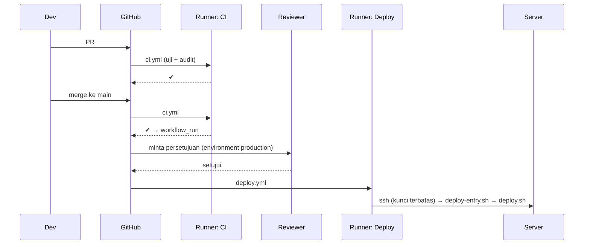

# GitHub Actions

GitHub Actions menjalankan *workflow* (berkas YAML di `.github/workflows/`) sebagai respons terhadap peristiwa repositori. Sub bab ini menulis dua workflow untuk `cms-artikel`: **CI** (uji dan audit pada setiap PR/push) dan **Deploy** (hanya setelah CI sukses di `main`, dengan persetujuan lingkungan produksi dan kunci SSH terbatas).

!!! warning "Status verifikasi"
    Kedua workflow di bawah **sintaks YAML-nya divalidasi** penulis (parsing YAML lokal; `actionlint` tidak tersedia). Workflow **tidak pernah dijalankan** di GitHub. Nama dan versi aksi (`actions/checkout@v4`, `shivammathur/setup-php@v2`, dst.) harus kamu periksa di dokumentasi/Marketplace dan sebaiknya disematkan pada SHA commit untuk keamanan lebih baik. Uji di repositori latihan.

## Tujuan Pembelajaran

- [ ] Membaca struktur workflow: `on`, `jobs`, `steps`, `uses`, `run`, `env`.
- [ ] Menulis workflow CI untuk Laravel (PHP, Composer, Node, uji, audit).
- [ ] Memakai cache, `concurrency`, `timeout-minutes`, dan `permissions` minimal.
- [ ] Mengelola *secrets* dan *environments* dengan persetujuan.
- [ ] Menyusun deploy aman lewat SSH dengan kunci terbatas.
- [ ] Mengenali risiko keamanan rantai pasok dan *script injection*.

## Prasyarat

- [CI/CD Fundamentals](10-16-ci-cd-fundamentals.md), [Laravel Deployment](10-08-laravel-deployment.md), [Testing](../level-08/index.md).
- Repositori di GitHub dan akses ke pengaturan repositori.

## Pengantar

Setiap PR kini otomatis diuji; PR yang merusak uji tidak bisa digabung. Deploy ke produksi berjalan hanya dari `main` setelah semua hijau dan disetujui pemilik lingkungan.

## Penjelasan Konsep

### Anatomi workflow

| Kunci | Arti |
|---|---|
| `name` | Nama tampilan |
| `on` | Pemicu (`pull_request`, `push`, `workflow_run`, `workflow_dispatch`) |
| `permissions` | Hak `GITHUB_TOKEN` (berikan minimal) |
| `concurrency` | Mencegah run berlebih/tumpang tindih |
| `jobs.<id>.runs-on` | Jenis runner |
| `steps` | Urutan langkah: `uses` (aksi) atau `run` (shell) |
| `environment` | Lingkungan dengan aturan (persetujuan, rahasia khusus) |

### Workflow CI

File: `.github/workflows/ci.yml`

```yaml
name: CI

on:
  pull_request:
  push:
    branches: [main]

permissions:
  contents: read

concurrency:
  group: ci-${{ github.ref }}
  cancel-in-progress: true

jobs:
  test:
    runs-on: ubuntu-latest
    timeout-minutes: 15

    steps:
      - name: Ambil kode
        uses: actions/checkout@v4

      - name: Siapkan PHP
        uses: shivammathur/setup-php@v2
        with:
          php-version: "8.3"
          extensions: mbstring, pdo_sqlite, intl, bcmath
          coverage: none

      - name: Cache Composer
        uses: actions/cache@v4
        with:
          path: ~/.composer/cache/files
          key: composer-${{ hashFiles('composer.lock') }}
          restore-keys: composer-

      - name: Pasang dependensi PHP
        run: composer install --prefer-dist --no-progress --no-interaction

      - name: Siapkan Node
        uses: actions/setup-node@v4
        with:
          node-version: 22
          cache: npm

      - name: Bangun aset
        run: |
          npm ci
          npm run build

      - name: Siapkan lingkungan uji
        run: |
          cp .env.example .env
          php artisan key:generate

      - name: Audit dependensi
        run: composer audit

      - name: Jalankan uji
        run: php artisan test
        env:
          DB_CONNECTION: sqlite
          DB_DATABASE: ":memory:"
```

| Bagian | Penjelasan |
|---|---|
| `permissions: contents: read` | `GITHUB_TOKEN` hanya baca (prinsip hak terkecil) |
| `concurrency` + `cancel-in-progress` | Membatalkan run lama pada branch yang sama saat ada push baru |
| `actions/cache` dengan `hashFiles('composer.lock')` | Cache berubah hanya bila dependensi berubah |
| `composer audit` | Memeriksa kerentanan dependensi PHP (gagal bila ada temuan) |
| `cp .env.example .env` | Tidak ada rahasia di CI untuk uji; `.env.example` aman |
| `DB_DATABASE: ":memory:"` | SQLite memori, cepat dan terisolasi |
| `timeout-minutes` | Mencegah job menggantung membuang kuota |

Bila uji butuh MySQL/Redis, tambahkan `services:` (kontainer layanan) pada job. Tambahkan langkah Pint/PHPStan hanya jika proyekmu memasangnya sebagai dependensi dev.

### Workflow Deploy

File: `.github/workflows/deploy.yml`

```yaml
name: Deploy

on:
  workflow_run:
    workflows: [CI]
    types: [completed]
    branches: [main]

permissions:
  contents: read

concurrency:
  group: deploy-production
  cancel-in-progress: false

jobs:
  deploy:
    if: ${{ github.event.workflow_run.conclusion == 'success' }}
    runs-on: ubuntu-latest
    environment: production
    timeout-minutes: 15

    steps:
      - name: Siapkan SSH
        env:
          DEPLOY_KEY: ${{ secrets.DEPLOY_KEY }}
          DEPLOY_KNOWN_HOSTS: ${{ secrets.DEPLOY_KNOWN_HOSTS }}
        run: |
          install -m 700 -d ~/.ssh
          printf '%s\n' "$DEPLOY_KEY" > ~/.ssh/id_ed25519
          chmod 600 ~/.ssh/id_ed25519
          printf '%s\n' "$DEPLOY_KNOWN_HOSTS" > ~/.ssh/known_hosts

      - name: Deploy
        env:
          DEPLOY_HOST: ${{ secrets.DEPLOY_HOST }}
          DEPLOY_USER: ${{ secrets.DEPLOY_USER }}
        run: ssh -o StrictHostKeyChecking=yes "$DEPLOY_USER@$DEPLOY_HOST" main
```

| Bagian | Penjelasan |
|---|---|
| `workflow_run` pada CI sukses | Deploy hanya setelah CI hijau di `main` |
| `environment: production` | Memicu aturan lingkungan (reviewer wajib, rahasia khusus lingkungan) |
| `concurrency` tanpa pembatalan | Dua deploy tak berjalan bersamaan |
| Rahasia lewat `env:` lalu `"$VAR"` | **Jangan** menyisipkan `${{ secrets.X }}` langsung ke dalam skrip `run` (celah injeksi dan kebocoran); lewat variabel lingkungan lebih aman |
| `DEPLOY_KNOWN_HOSTS` | Kunci host server disematkan sebagai rahasia/konfigurasi, bukan `ssh-keyscan` saat berjalan (menghindari serangan man-in-the-middle pada koneksi pertama) |
| `StrictHostKeyChecking=yes` | Menolak host yang tak dikenal |
| Perintah `main` | Argumen yang dibaca *forced command* di server (di bawah) |

### Kunci SSH terbatas di server

Buat pasangan kunci **khusus deploy** (`ssh-keygen -t ed25519 -C gha-deploy -f deploy_key -N ""`); kunci publik masuk ke `authorized_keys` pengguna `deploy` dengan pembatasan, kunci privat ke rahasia `DEPLOY_KEY`.

File: `/home/deploy/deploy-entry.sh`

```bash
#!/usr/bin/env bash
set -euo pipefail

case "${SSH_ORIGINAL_COMMAND:-}" in
  main) exec /home/deploy/deploy.sh main ;;
  *) echo "Perintah tidak diizinkan" >&2; exit 1 ;;
esac
```

File: `/home/deploy/.ssh/authorized_keys` (satu baris untuk kunci deploy)

```text
restrict,command="/home/deploy/deploy-entry.sh" ssh-ed25519 AAAA...kunci-publik... gha-deploy
```

`restrict` mematikan forwarding/pty; `command=` memaksa hanya skrip itu yang berjalan, dengan perintah yang diminta klien terbaca di `SSH_ORIGINAL_COMMAND`. Dengan begitu, kunci yang bocor hanya dapat memicu deploy cabang `main`, bukan shell bebas. Skrip `deploy.sh` berasal dari [Laravel Deployment](10-08-laravel-deployment.md).

### Secrets dan environments

Di GitHub: **Settings → Secrets and variables → Actions** untuk rahasia repositori, dan **Settings → Environments → production** untuk:

- *Required reviewers* (persetujuan sebelum job `deploy` berjalan).
- *Deployment branches* dibatasi ke `main`.
- Rahasia khusus lingkungan (`DEPLOY_KEY`, `DEPLOY_HOST`, `DEPLOY_USER`, `DEPLOY_KNOWN_HOSTS`).

Dapatkan nilai `DEPLOY_KNOWN_HOSTS` dari mesin tepercaya: `ssh-keyscan -t ed25519 contoh.com` lalu **verifikasi fingerprint** dengan konsol penyedia/server (`ssh-keygen -lf /etc/ssh/ssh_host_ed25519_key.pub` di server).

### Perlindungan cabang

Pada **Settings → Branches**: wajibkan PR, wajibkan status check `CI / test`, dan larang push langsung ke `main`.

### Keamanan rantai pasok

- Sematkan aksi pada SHA commit (mis. `actions/checkout@<sha>`) dan perbarui lewat Dependabot; tag mayor (`@v4`) dapat berpindah.
- Hindari `pull_request_target` dengan kode PR tak tepercaya.
- Jangan mencetak rahasia; jangan mengecho variabel.
- Aksi pihak ketiga yang menerima rahasia harus dipercaya dan ditinjau.

### Menjalankan dan memeriksa

Buka tab **Actions** di repositori; setiap run menampilkan log per langkah. Untuk menguji tanpa push, tambahkan pemicu `workflow_dispatch:` (jalankan manual).

## Cara Kerja



## Contoh Praktik

Kamu menambahkan `ci.yml`, membuat PR yang sengaja gagal uji (melihat blokir merge), memperbaikinya, lalu menyiapkan `deploy.yml` dengan lingkungan dan kunci terbatas untuk server staging.

## Penjelasan Kode

Validasi sintaks lokal sebelum push (mis. dengan Python):

```bash
python -c "import yaml,sys; [yaml.safe_load(open(f)) for f in sys.argv[1:]]; print('YAML OK')" .github/workflows/*.yml
```

Ini hanya memeriksa YAML, bukan semantik GitHub Actions; gunakan juga `actionlint` bila tersedia.

## Implementasi Langkah demi Langkah

### Langkah 1: tambah CI

Buat `.github/workflows/ci.yml` dan push ke cabang percobaan.

### Langkah 2: lihat hasil

Buka tab Actions, baca log; perbaiki galat (versi PHP, ekstensi, skrip npm).

### Langkah 3: uji kegagalan

Tulis uji yang gagal, buat PR, dan konfirmasi status merah memblokir merge (setelah mengaktifkan perlindungan cabang).

### Langkah 4: siapkan server staging

Buat `deploy-entry.sh`, kunci deploy khusus, dan baris `authorized_keys` terbatas.

### Langkah 5: rahasia dan lingkungan

Buat environment `staging` (atau `production`) dengan reviewer dan simpan rahasia.

### Langkah 6: tambah Deploy

Buat `deploy.yml`; picu lewat merge ke `main` (atau `workflow_dispatch` untuk uji).

### Langkah 7: verifikasi

Setelah persetujuan, periksa log deploy dan di server: `readlink current`, `/up`.

### Langkah 8: uji pembatasan kunci

Coba `ssh -i deploy_key deploy@host "bash"` dari mesinmu: harus ditolak ("Perintah tidak diizinkan").

### Langkah 9: catat di Git

```bash
git add .github
git commit -m "Tambah workflow CI dan deploy"
```

## Eksekusi dan Verifikasi

| Langkah | Hasil yang diharapkan |
|---|---|
| 2 | Job `test` hijau (setelah penyesuaian) |
| 3 | Merge diblokir saat uji gagal |
| 7 | Deploy hanya setelah persetujuan; `/up` 200 |
| 8 | Perintah selain `main` ditolak |

## Daftar periksa verifikasi

- [ ] CI berjalan pada PR dan `main`; PR gagal tidak dapat di-merge.
- [ ] `GITHUB_TOKEN` berhak minimal; aksi tersemat versi/SHA.
- [ ] Rahasia lewat `env`, tidak dicetak.
- [ ] Kunci deploy dibatasi (`restrict,command=`).
- [ ] Produksi butuh persetujuan dan cabang `main` saja.
- [ ] Kunci host diverifikasi, bukan di-scan buta.

## Hasil yang Diharapkan

Belum dijalankan di GitHub oleh penulis; galat penyesuaian (versi, ekstensi, skrip Vite) wajar dan perlu kamu perbaiki.

## Kesalahan Umum dan Pemecahan Masalah

| Gejala | Penyebab | Cara mengenali | Solusi | Pencegahan |
|---|---|---|---|---|
| Uji lulus lokal, gagal di CI | Ekstensi/versi/.env berbeda | Log CI | Samakan PHP, ekstensi, env | Sematkan versi |
| `npm run build` gagal | Skrip/konfigurasi hilang | Galat Vite | Periksa `package.json` | Jalankan lokal dulu |
| `Host key verification failed` | `known_hosts` salah/kosong | Galat SSH | Perbarui rahasia | Verifikasi fingerprint |
| `Permission denied (publickey)` | Kunci tak terpasang | Galat SSH | Periksa `authorized_keys` | Uji manual |
| Perintah ditolak | `SSH_ORIGINAL_COMMAND` tak cocok | "Perintah tidak diizinkan" | Samakan argumen | Uji langkah 8 |
| Deploy tak jalan | `workflow_run` tak terpicu / CI gagal | Tak ada run | Periksa nama workflow & branch | `workflow_dispatch` untuk uji |
| Rahasia tampil di log | Dicetak oleh skrip | Terlihat di log | Cabut & putar | Jangan `echo` rahasia |
| Aksi berubah perilaku | Tag bergeser | Hasil tiba-tiba beda | Sematkan SHA | Dependabot |

## Latihan Praktik

### Latihan dasar

**D1. Baca workflow**
- *Masalah:* paham pemicu.
- *Persyaratan:* jelaskan kapan `ci.yml` dan `deploy.yml` berjalan.
- *Perilaku yang diharapkan:* CI pada PR dan push `main`; Deploy setelah CI sukses di `main`.
- *Tujuan belajar:* pemicu.

### Latihan implementasi

**I1. Layanan MySQL di CI**
- *Masalah:* ingin menguji dengan MySQL.
- *Persyaratan:* tambahkan `services: mysql` dengan healthcheck dan atur `DB_*` pada langkah uji.
- *Perilaku yang diharapkan:* uji lulus pada MySQL.
- *Tujuan belajar:* layanan CI.

**I2. Matriks PHP**
- *Masalah:* ingin menguji dua versi PHP.
- *Persyaratan:* gunakan `strategy.matrix.php` dan jelaskan biaya waktu.
- *Perilaku yang diharapkan:* dua job paralel.
- *Tujuan belajar:* matriks.

**I3. Dependabot**
- *Masalah:* aksi dan dependensi perlu diperbarui.
- *Persyaratan:* tulis `.github/dependabot.yml` untuk `composer`, `npm`, dan `github-actions`.
- *Perilaku yang diharapkan:* PR pembaruan otomatis.
- *Tujuan belajar:* pemeliharaan rantai pasok.

### Latihan tantangan

**T1. Rilis berbasis tag dan rollback**
- *Masalah:* ingin deploy dari tag `v*` dan rollback satu klik.
- *Persyaratan:* rancang workflow `workflow_dispatch` dengan input tag/rilis dan jelaskan kontrol (reviewer, daftar nilai yang diizinkan).
- *Perilaku yang diharapkan:* rancangan aman.
- *Tujuan belajar:* rilis terkontrol.
- *Catatan:* kerjakan mandiri; tidak ada kunci jawaban.

## Uji Pemahaman

1. Apa fungsi `permissions: contents: read`?
2. Mengapa rahasia dilewatkan lewat `env`?
3. Apa fungsi `restrict,command=` di `authorized_keys`?
4. Mengapa menyematkan aksi pada SHA?

??? success "Kunci jawaban singkat"
    1. Membatasi `GITHUB_TOKEN` ke hak baca saja.
    2. Menghindari injeksi skrip dan memudahkan penyamaran di log.
    3. Membatasi kunci agar hanya menjalankan skrip deploy.
    4. Tag dapat berpindah; SHA tidak.

## Ringkasan

- CI menguji PR; deploy hanya dari `main` setelah CI hijau dan persetujuan.
- Hak minimal: token, kunci SSH terbatas, rahasia lewat `env`, kunci host diverifikasi.
- Sematkan versi aksi dan pantau dengan Dependabot.

Selanjutnya: *Application Backup*.

## Referensi Resmi

- [GitHub Docs: Workflow syntax](https://docs.github.com/en/actions/reference/workflows-and-actions/workflow-syntax)
- [GitHub Docs: Using secrets](https://docs.github.com/en/actions/security-for-github-actions/security-guides/using-secrets-in-github-actions)
- [GitHub Docs: Managing environments](https://docs.github.com/en/actions/managing-workflow-runs-and-deployments/managing-deployments/managing-environments-for-deployment)
- [setup-php](https://github.com/shivammathur/setup-php)
