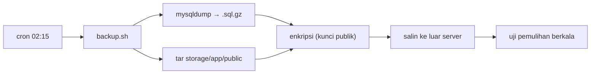

# Application Backup

Server bisa mati, disk bisa rusak, `DROP TABLE` bisa terketik di terminal yang salah, dan ransomware nyata. Backup adalah satu-satunya pertahanan terakhir. Aturan emas: **backup yang belum pernah diuji pemulihannya belum bisa disebut backup**. Sub bab ini merancang dan menulis backup database serta berkas dengan retensi, enkripsi, dan uji pemulihan.

!!! danger "Belum teruji penulis"
    Skrip diturunkan dari dokumentasi MySQL (`mysqldump`), Linux, dan Laravel; belum dijalankan penulis pada server nyata. **Uji pemulihan di server terpisah** sebelum mengandalkannya. Jangan menaruh sandi di baris perintah atau di repositori.

## Tujuan Pembelajaran

- [ ] Menentukan apa yang dibackup (database, `.env`, unggahan) dan apa yang tidak (kode, vendor).
- [ ] Menjelaskan RPO dan RTO serta aturan 3-2-1.
- [ ] Membuat backup database konsisten dengan `mysqldump --single-transaction`.
- [ ] Mengenkripsi, menyalin ke luar server, dan mengatur retensi.
- [ ] Mengotomasi dengan cron/penjadwal Laravel dan memantau keberhasilannya.
- [ ] Menguji pemulihan secara berkala.

## Prasyarat

- [MySQL Production Configuration](10-06-mysql-production-configuration.md), [Scheduler Configuration](10-11-scheduler-configuration.md), [File Storage](../level-07/07-16-file-storage.md).

## Pengantar

Karyawan menjalankan `php artisan migrate:fresh` di server produksi karena salah terminal. Tanpa backup terbaru, data pelanggan hilang. Dengan backup harian yang teruji, kerugian maksimum sehari.

## Penjelasan Konsep

### Apa yang dibackup?

| Aset | Backup? | Alasan |
|---|---|---|
| Database | **Ya** | Data utama |
| `storage/app` (unggahan) | **Ya** | Data pengguna |
| `.env` / rahasia | Ya, **dienkripsi & terpisah** | Perlu untuk memulihkan (terutama `APP_KEY`) |
| Kode, `vendor` | Tidak | Ada di Git / dapat dibangun ulang |
| Log, cache | Biasanya tidak | Dapat dibuat ulang |

Kehilangan `APP_KEY` membuat data terenkripsi (dan cookie) tak terbaca; simpan salinan aman.

### RPO, RTO, dan 3-2-1

| Istilah | Arti |
|---|---|
| RPO (*Recovery Point Objective*) | Berapa banyak data yang rela hilang (jarak antar-backup) |
| RTO (*Recovery Time Objective*) | Berapa lama pemulihan boleh memakan waktu |
| 3-2-1 | 3 salinan, 2 media berbeda, 1 di luar lokasi |

Backup harian berarti RPO ≈ 24 jam. Jika tidak cukup, tambah frekuensi atau pakai replikasi/binlog.

### Backup database

```bash
mysqldump --single-transaction --quick --routines --triggers \
  --defaults-extra-file=/home/deploy/.my.cnf-backup \
  cms_artikel | gzip > /var/backups/cms/db-$(date +%F-%H%M).sql.gz
```

| Opsi | Fungsi |
|---|---|
| `--single-transaction` | Snapshot konsisten untuk tabel InnoDB tanpa mengunci tabel |
| `--quick` | Membaca baris satu per satu (hemat memori) |
| `--routines --triggers` | Termasuk prosedur dan trigger |
| `--defaults-extra-file` | Kredensial dari berkas izin ketat, **bukan** di baris perintah (terlihat di daftar proses) |

File: `/home/deploy/.my.cnf-backup` (izin `600`)

```ini
[client]
user=cms_backup
password=GANTI_DENGAN_SANDI_ACAK
```

Buat akun MySQL khusus `cms_backup` dengan hak minimal (`SELECT, LOCK TABLES, SHOW VIEW, EVENT, TRIGGER`; sesuaikan versi MySQL). Jangan memakai root.

### Skrip backup

File: `/home/deploy/backup.sh`

```bash
#!/usr/bin/env bash
set -euo pipefail

APP=/var/www/contoh.com
DEST=/var/backups/cms
STAMP="$(date +%F-%H%M)"
KEEP_DAYS=14

umask 077
mkdir -p "$DEST"

# 1) Database
mysqldump --single-transaction --quick --routines --triggers \
  --defaults-extra-file=/home/deploy/.my.cnf-backup cms_artikel \
  | gzip > "$DEST/db-$STAMP.sql.gz"

# 2) Berkas unggahan
tar -czf "$DEST/storage-$STAMP.tar.gz" -C "$APP/shared" storage/app/public

# 3) Enkripsi (kunci publik age/GPG; kunci privat TIDAK di server ini)
# age -r "$(cat /home/deploy/backup-recipient.txt)" -o "$DEST/db-$STAMP.sql.gz.age" "$DEST/db-$STAMP.sql.gz"

# 4) Salin ke luar server (contoh rsync melalui SSH ke host backup)
# rsync -a --delete-after "$DEST/" backup@host-lain:/data/cms/

# 5) Retensi lokal
find "$DEST" -type f -mtime +"$KEEP_DAYS" -delete

echo "Backup selesai: $STAMP"
```

Bagian 3 dan 4 dikomentari sebagai kerangka: pilih alat enkripsi (mis. `age` atau `gpg`) dan tujuan luar-server milikmu. **Salinan yang hanya berada di server yang sama bukan backup yang tahan bencana.** `umask 077` membuat berkas hanya dapat dibaca pemilik. Catatan: tanda `--delete-after` pada rsync menyamakan tujuan dengan sumber; jangan arahkan ke direktori yang berisi hal lain.

### Enkripsi

Backup berisi data pelanggan. Enkripsi sebelum meninggalkan server, dengan **kunci publik** di server dan **kunci privat disimpan terpisah** (pengelola sandi/brankas). Dengan begitu penyerang yang masuk ke server tak dapat mendekripsi backup lama.

### Otomasi dan pemantauan

Cron:

```text
15 2 * * * /home/deploy/backup.sh >> /var/log/cms-backup.log 2>&1
```

Atau lewat penjadwal Laravel: `Schedule::exec('/home/deploy/backup.sh')->dailyAt('02:15')->onOneServer();`. Pantau bahwa backup **benar-benar terjadi**: periksa umur berkas terbaru dan ukuran wajar, kirim peringatan bila hilang (10.19). Backup yang diam-diam gagal sebulan adalah skenario klasik.

### Uji pemulihan

Backup tak teruji = harapan. Lakukan di mesin/server **terpisah**:

```bash
gunzip -c db-2026-11-07-0215.sql.gz | mysql -uroot -p cms_artikel_pulih
```

Lalu periksa jumlah baris tabel utama, jalankan aplikasi terhadap salinan itu, dan catat berapa lama (RTO sesungguhnya). Jadwalkan uji pemulihan berkala (mis. bulanan) dan setelah perubahan besar.

### Opsi tambahan

- Snapshot disk dari penyedia VPS: cepat, melengkapi, tetapi tidak menggantikan dump logis dan tidak selalu konsisten untuk DB aktif.
- Layanan database terkelola dengan *point-in-time recovery*.
- Backup binlog untuk RPO lebih kecil.
- Paket Laravel pihak ketiga (mis. `spatie/laravel-backup`) otomatis; menambah dependensi dan tidak termasuk daftar yang disetujui materi ini.

### Keamanan dan privasi

- Enkripsi, akses terbatas, retensi jelas (hapus sesuai kebijakan privasi/regulasi).
- Backup adalah target penyerang; lindungi seperti produksi.
- Jangan commit dump ke Git; jangan unggah ke penyimpanan publik.
- Hati-hati dengan data pribadi dalam salinan uji pemulihan.

## Cara Kerja



## Contoh Praktik

Kamu membuat akun MySQL backup, skrip backup, menjalankannya manual, memulihkan ke database lain, dan menjadwalkannya.

## Penjelasan Kode

`set -euo pipefail` membuat skrip berhenti saat `mysqldump` gagal, sehingga berkas `.sql.gz` kosong/rusak tidak dianggap sukses. Tanpa `pipefail`, kegagalan `mysqldump` di dalam pipa `| gzip` tidak terdeteksi.

## Implementasi Langkah demi Langkah

### Langkah 1: akun backup

Buat pengguna `cms_backup` dengan hak minimal dan berkas `.my.cnf-backup` izin `600`.

### Langkah 2: direktori

```bash
sudo mkdir -p /var/backups/cms && sudo chown deploy:deploy /var/backups/cms && sudo chmod 700 /var/backups/cms
```

### Langkah 3: skrip

Buat `backup.sh`, `chmod 700`, jalankan manual:

```bash
/home/deploy/backup.sh
ls -lh /var/backups/cms
```

### Langkah 4: uji pemulihan

Buat database `cms_artikel_pulih` dan impor dump terbaru; bandingkan hitungan baris:

```bash
mysql -uroot -p -e "SELECT COUNT(*) FROM cms_artikel.articles; SELECT COUNT(*) FROM cms_artikel_pulih.articles;"
```

### Langkah 5: enkripsi dan salinan luar

Aktifkan bagian 3–4 dengan alat dan tujuan pilihanmu; simpan kunci privat terpisah.

### Langkah 6: jadwalkan

Tambahkan entri cron dan verifikasi besoknya.

### Langkah 7: pantau

Tambahkan pemeriksaan umur berkas terbaru (10.19).

### Langkah 8: dokumentasi

Catat RPO/RTO, lokasi backup, siapa yang punya kunci, dan prosedur pemulihan.

## Eksekusi dan Verifikasi

| Langkah | Hasil yang diharapkan |
|---|---|
| 3 | Dua berkas dengan ukuran masuk akal |
| 4 | Jumlah baris sama |
| 6 | Berkas baru muncul tiap hari |

## Daftar periksa verifikasi

- [ ] Backup database dan unggahan berjalan otomatis.
- [ ] Salinan terenkripsi dan berada di luar server.
- [ ] Pemulihan pernah diuji dan dicatat (RTO).
- [ ] Peringatan bila backup tidak terjadi.
- [ ] `APP_KEY`/`.env` tersimpan aman terpisah.
- [ ] Retensi dan akses terdefinisi.

## Hasil yang Diharapkan

Belum dijalankan oleh penulis; ukuran dan waktu bergantung data dan server.

## Kesalahan Umum dan Pemecahan Masalah

| Gejala | Penyebab | Cara mengenali | Solusi | Pencegahan |
|---|---|---|---|---|
| Dump kosong/korup | `mysqldump` gagal diam-diam | Ukuran kecil | `pipefail`, cek kode keluar | Uji dan pantau |
| Backup tak bisa dipulihkan | Tak pernah diuji | Gagal saat darurat | Uji berkala | Jadwal uji pemulihan |
| Sandi terlihat di `ps` | Sandi di argumen | `ps aux` | `--defaults-extra-file` | Berkas izin 600 |
| Disk penuh | Tanpa retensi | `df -h` | `find -mtime -delete` | Retensi |
| Backup ikut hilang bersama server | Hanya lokal | Server rusak, backup hilang | Salinan luar | Aturan 3-2-1 |
| Data terenkripsi tak terbaca | `APP_KEY` hilang | Dekripsi gagal | Pulihkan kunci | Cadangan kunci |
| Backup berisi data pribadi bocor | Tak dienkripsi | Akses tak sah | Enkripsi + akses terbatas | Kebijakan |

## Latihan Praktik

### Latihan dasar

**D1. Hitung RPO/RTO**
- *Masalah:* memahami istilah.
- *Persyaratan:* untuk backup harian pukul 02.15 dan pemulihan 45 menit, tentukan RPO terburuk dan RTO.
- *Perilaku yang diharapkan:* RPO ≈ 24 jam; RTO ≈ 45 menit.
- *Tujuan belajar:* RPO/RTO.

### Latihan implementasi

**I1. Uji pemulihan terdokumentasi**
- *Masalah:* ingin bukti pemulihan.
- *Persyaratan:* tulis prosedur langkah demi langkah dan lakukan; catat waktu dan temuan.
- *Perilaku yang diharapkan:* dokumen prosedur terverifikasi.
- *Tujuan belajar:* menguji backup.

**I2. Pemeriksa kesegaran**
- *Masalah:* backup bisa berhenti tanpa terlihat.
- *Persyaratan:* skrip yang gagal bila berkas backup terbaru lebih tua dari 26 jam atau lebih kecil dari ambang.
- *Perilaku yang diharapkan:* peringatan bila basi.
- *Tujuan belajar:* memantau backup.

### Latihan tantangan

**T1. Pemulihan dari insiden**
- *Masalah:* ransomware mengenkripsi server termasuk backup lokal.
- *Persyaratan:* rancang perlindungan (salinan luar tak dapat ditulis ulang/immutable, akun terpisah, kunci terpisah) dan rencana pemulihan.
- *Perilaku yang diharapkan:* rancangan tahan insiden.
- *Tujuan belajar:* ketahanan.
- *Catatan:* kerjakan mandiri; tidak ada kunci jawaban.

## Uji Pemahaman

1. Apa itu RPO?
2. Mengapa `--single-transaction`?
3. Mengapa backup harus di luar server?
4. Mengapa menguji pemulihan?

??? success "Kunci jawaban singkat"
    1. Jumlah data (waktu) maksimum yang rela hilang.
    2. Snapshot konsisten InnoDB tanpa mengunci tabel.
    3. Agar selamat saat server rusak atau diretas.
    4. Backup belum terbukti sampai berhasil dipulihkan.

## Ringkasan

- Backup database dan unggahan secara otomatis, terenkripsi, dan di luar server.
- Tentukan RPO/RTO, retensi, dan pantau keberhasilan.
- Uji pemulihan secara berkala; jaga `APP_KEY`.

Selanjutnya: *Production Monitoring*.

## Referensi Resmi

- [MySQL: mysqldump](https://dev.mysql.com/doc/refman/8.4/en/mysqldump.html)
- [Laravel: Task Scheduling](https://laravel.com/docs/13.x/scheduling)
- [age (enkripsi berkas)](https://github.com/FiloSottile/age)
