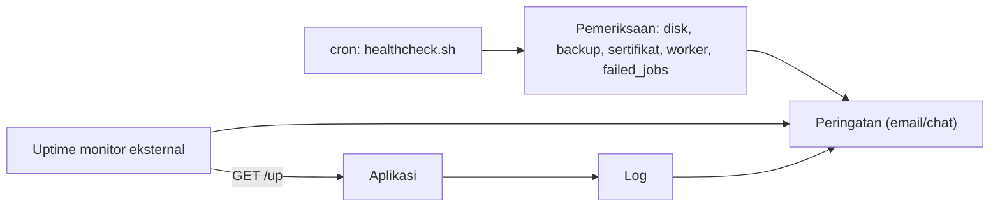

# Production Monitoring

Di produksi kamu tidak duduk di depan layar. Monitoring memberi tahu **sebelum pengguna mengeluh**: situs mati, galat naik, disk hampir penuh, antrean macet, sertifikat akan kedaluwarsa, backup tidak jalan. Sub bab ini memetakan apa yang dipantau, memakai health check Laravel, log, pemeriksaan sederhana, dan peringatan.

!!! danger "Belum teruji penulis"
    Skrip dan konfigurasi diturunkan dari dokumentasi Laravel 13.x dan praktik umum; belum dijalankan penulis pada server nyata. Layanan pemantau pihak ketiga yang disebut hanyalah contoh kategori; memakainya berarti mengirim data ke pihak lain, jadi nilai privasinya.

## Tujuan Pembelajaran

- [ ] Membedakan pemantauan ketersediaan, performa, sumber daya, dan bisnis.
- [ ] Memakai route `/up` dan event `DiagnosingHealth` untuk health check bermakna.
- [ ] Membaca dan merotasi log (aplikasi, Nginx, PHP-FPM, MySQL, Supervisor).
- [ ] Menulis pemeriksa sederhana (disk, antrean, backup, sertifikat) dengan peringatan.
- [ ] Menentukan ambang peringatan yang dapat ditindaklanjuti (hindari alarm palsu).
- [ ] Mengenali alat tambahan (uptime monitor, Pulse, APM, agregator log) beserta kompromi.

## Prasyarat

- [Profiling dan Monitoring](../level-09/09-12-profiling-and-monitoring.md), [Logging](../level-07/07-18-logging.md), [Application Backup](10-18-application-backup.md), [SSL dan HTTPS](10-12-ssl-and-https.md).

## Pengantar

Sertifikat kedaluwarsa pukul 03.00 Sabtu. Tidak ada yang tahu sampai Senin. Semua pengguna melihat peringatan keamanan selama 48 jam. Satu pemeriksaan sederhana dengan peringatan 14 hari sebelumnya mencegahnya.

## Penjelasan Konsep

### Empat lapisan

| Lapisan | Contoh pertanyaan | Alat |
|---|---|---|
| Ketersediaan | Apakah situs merespons? | Uptime monitor memanggil `/up` |
| Aplikasi | Berapa galat 5xx, latensi p95, job gagal? | Log, Pulse/APM, metrik |
| Sumber daya | CPU, RAM, disk, koneksi DB | `df`, `free`, agen metrik |
| Bisnis/operasional | Apakah backup berjalan? Antrean menumpuk? Sertifikat? | Pemeriksa kustom |

### Health check Laravel

Menurut dokumentasi, `/up` mengembalikan 200 bila aplikasi boot tanpa pengecualian dan memicu `DiagnosingHealth`; listener boleh melempar pengecualian bila ada masalah (mis. database mati).

File: `app/Listeners/CheckDependencies.php`

```php
<?php

namespace App\Listeners;

use Illuminate\Foundation\Events\DiagnosingHealth;
use Illuminate\Support\Facades\Cache;
use Illuminate\Support\Facades\DB;

class CheckDependencies
{
    public function handle(DiagnosingHealth $event): void
    {
        DB::select('select 1');                 // lempar pengecualian jika DB mati
        Cache::store()->get('health-probe');    // cache dapat dijangkau
    }
}
```

Listener ditemukan otomatis (07.08). Jaga pemeriksaan **ringan** (dipanggil sering) dan jangan membocorkan detail di respons publik. Pertimbangkan membedakan *liveness* (aplikasi hidup) dan *readiness* (siap melayani); `/up` bawaan mendekati liveness.

### Log

| Log | Lokasi umum | Isi |
|---|---|---|
| Aplikasi | `storage/logs/laravel-*.log` | Galat, peringatan Laravel |
| Nginx | `/var/log/nginx/{access,error}.log` | Permintaan, 4xx/5xx, upstream |
| PHP-FPM | `/var/log/php8.3-fpm.log` | Proses, slowlog |
| MySQL | `/var/log/mysql/` | Galat, slow query |
| Supervisor | `/var/log/supervisor/` + log worker | Status worker |
| Sistem | `journalctl` | Layanan, OOM, SSH |

Rotasi dengan `logrotate` (umumnya sudah ada untuk Nginx/MySQL). Untuk log aplikasi pakai channel `daily` dengan `days`. Pertimbangkan agregasi terpusat bila server banyak.

### Pemeriksa sederhana

File: `/home/deploy/healthcheck.sh`

```bash
#!/usr/bin/env bash
set -uo pipefail

APP=/var/www/contoh.com
DOMAIN=contoh.com
problems=()

# 1) Aplikasi hidup
curl -fsS -m 10 "https://$DOMAIN/up" >/dev/null || problems+=("situs tidak sehat (/up)")

# 2) Disk
use=$(df --output=pcent / | tail -1 | tr -dc '0-9')
[ "$use" -lt 85 ] || problems+=("disk ${use}% terpakai")

# 3) Backup segar (< 26 jam)
latest=$(find /var/backups/cms -name 'db-*.sql.gz' -mmin -1560 | head -1)
[ -n "$latest" ] || problems+=("backup database terbaru lebih dari 26 jam")

# 4) Sertifikat (> 14 hari)
end=$(echo | openssl s_client -connect "$DOMAIN:443" -servername "$DOMAIN" 2>/dev/null | openssl x509 -noout -enddate | cut -d= -f2)
days=$(( ( $(date -d "$end" +%s) - $(date +%s) ) / 86400 ))
[ "$days" -gt 14 ] || problems+=("sertifikat kedaluwarsa dalam ${days} hari")

# 5) Worker berjalan
supervisorctl status 'laravel-worker:*' 2>/dev/null | grep -qv RUNNING && problems+=("ada worker tidak RUNNING")

# 6) Job gagal
failed=$(cd "$APP/current" && php artisan tinker --execute="echo DB::table('failed_jobs')->count();" 2>/dev/null | tail -1)
[ "${failed:-0}" -lt 10 ] || problems+=("failed_jobs = ${failed}")

if [ "${#problems[@]}" -gt 0 ]; then
  printf 'MASALAH:\n- %s\n' "${problems[@]}"
  exit 1
fi
echo "OK"
```

Jadwalkan tiap 5 menit dan kirim keluaran masalah ke kanal peringatan (email, chat webhook). `set -u` tanpa `-e` agar satu pemeriksaan gagal tidak menghentikan lainnya. Perintah `supervisorctl` mungkin memerlukan hak; sesuaikan. Skrip ini adalah **kerangka**: sesuaikan ambang dan pastikan setiap pemeriksaan berfungsi di servermu sebelum percaya.

### Peringatan yang baik

| Prinsip | Alasan |
|---|---|
| Dapat ditindaklanjuti | Setiap peringatan ada tindakannya (runbook) |
| Berbasis gejala pengguna | "Situs gagal" lebih penting daripada "CPU 71%" |
| Ambang dengan durasi | "5xx > 1% selama 5 menit", hindari lonjakan sesaat |
| Eskalasi | Peringatan yang tak ditanggapi diteruskan |
| Sedikit tetapi tepercaya | Terlalu banyak alarm palsu membuat semua diabaikan |

### Alat tambahan

| Kategori | Contoh | Catatan |
|---|---|---|
| Uptime monitor | Layanan yang memanggil `/up` dari luar | Eksternal, mendeteksi masalah jaringan/DNS |
| Dasbor aplikasi | Laravel Pulse | Paket resmi, tidak termasuk dependensi yang disetujui materi ini; batasi akses |
| APM/error tracking | Sentry, Nightwatch, dsb. | Layanan pihak ketiga; data galat keluar sistem, saring data pribadi |
| Metrik server | Prometheus + Grafana, agen penyedia | Lebih kompleks; berguna untuk banyak server |

### Keamanan dan privasi

- `/up` harus ringan dan tidak membocorkan detail internal.
- Dasbor pemantauan harus terotentikasi dan tidak publik.
- Saring data pribadi/rahasia sebelum mengirim log atau galat ke layanan luar.
- Webhook peringatan adalah rahasia (jangan di repositori).

## Cara Kerja



## Contoh Praktik

Kamu menambah listener health check, skrip pemeriksa, menjadwalkannya, mensimulasikan masalah (menghentikan worker), dan melihat peringatan.

## Penjelasan Kode

Setiap pemeriksaan menambahkan pesan ke larik `problems`; di akhir, bila ada masalah, skrip keluar dengan kode 1 dan mencetak daftar yang dapat dikirim ke kanal peringatan.

## Implementasi Langkah demi Langkah

### Langkah 1: listener health

Buat `CheckDependencies` dan uji `curl https://contoh.com/up` (200). Matikan MySQL sementara di staging dan lihat `/up` gagal (500), lalu nyalakan lagi.

### Langkah 2: skrip pemeriksa

Buat `healthcheck.sh`, `chmod 700`, jalankan manual:

```bash
/home/deploy/healthcheck.sh; echo "kode keluar: $?"
```

### Langkah 3: simulasikan masalah

Hentikan worker (`supervisorctl stop 'laravel-worker:*'`) dan jalankan lagi: harus melaporkan masalah. Nyalakan kembali.

### Langkah 4: kanal peringatan

Kirim keluaran ke email/chat webhook dengan `curl` ke URL rahasia yang disimpan di berkas ber-izin ketat.

### Langkah 5: jadwalkan

```text
*/5 * * * * /home/deploy/healthcheck.sh >> /var/log/cms-health.log 2>&1 || /home/deploy/kirim-peringatan.sh
```

### Langkah 6: uptime monitor eksternal

Daftarkan `/up` pada layanan pilihanmu (perhatikan privasi) dengan interval wajar.

### Langkah 7: runbook

Tulis dokumen singkat: untuk tiap peringatan, apa artinya dan langkah pertama (lihat 10.20).

## Eksekusi dan Verifikasi

| Langkah | Hasil yang diharapkan |
|---|---|
| 1 | `/up` 200 normal; 500 saat DB mati |
| 3 | Skrip melaporkan worker tidak RUNNING dan keluar kode 1 |
| 4 | Peringatan sampai ke kanal |

## Daftar periksa verifikasi

- [ ] `/up` memeriksa dependensi kritis dengan ringan.
- [ ] Log dirotasi; lokasi log dicatat.
- [ ] Ada pemeriksa untuk disk, backup, sertifikat, worker, `failed_jobs`.
- [ ] Peringatan terkirim dan dapat ditindaklanjuti (runbook).
- [ ] Data pribadi tidak bocor ke layanan luar.

## Hasil yang Diharapkan

Belum dijalankan oleh penulis; perintah (`date -d`, `df --output`) khusus GNU/Linux dan perlu disesuaikan.

## Kesalahan Umum dan Pemecahan Masalah

| Gejala | Penyebab | Cara mengenali | Solusi | Pencegahan |
|---|---|---|---|---|
| Alarm palsu terus-menerus | Ambang terlalu sensitif | Peringatan diabaikan | Tambah durasi, ubah ambang | Tinjau berkala |
| Tidak ada peringatan saat server mati | Pemantau berada di server yang sama | Sunyi | Pemantau eksternal | Uptime monitor luar |
| `/up` lambat | Pemeriksaan berat | Timeout monitor | Ringankan | Pemeriksaan sederhana |
| Skrip gagal diam-diam | Perintah tak tersedia | Hasil tak masuk akal | Uji tiap pemeriksaan | Simulasikan masalah |
| Disk penuh oleh log | Tanpa rotasi | `df -h` | Rotasi | `logrotate` |
| Webhook bocor | Di repositori | Rahasia terbuka | Putar & simpan aman | Pemindaian rahasia |

## Latihan Praktik

### Latihan dasar

**D1. Pilih ambang**
- *Masalah:* menentukan peringatan.
- *Persyaratan:* usulkan ambang dan durasi untuk disk, 5xx, dan panjang antrean.
- *Perilaku yang diharapkan:* ambang dengan alasan.
- *Tujuan belajar:* peringatan terukur.

### Latihan implementasi

**I1. Pemeriksa antrean**
- *Masalah:* antrean bisa menumpuk.
- *Persyaratan:* tambahkan pemeriksaan jumlah job `jobs` > 1.000 atau usia job tertua > 10 menit.
- *Perilaku yang diharapkan:* peringatan saat melebihi.
- *Tujuan belajar:* memantau antrean.

**I2. Runbook**
- *Masalah:* peringatan tanpa panduan.
- *Persyaratan:* tulis runbook untuk tiga peringatan pertama (gejala, kemungkinan penyebab, langkah, eskalasi).
- *Perilaku yang diharapkan:* dokumen praktis.
- *Tujuan belajar:* respons insiden.

### Latihan tantangan

**T1. Rencana observabilitas**
- *Masalah:* aplikasi tumbuh ke 3 server.
- *Persyaratan:* rancang log terpusat, metrik, pelacakan galat, dan biaya/privasi; pilih apa yang dibangun vs dibeli.
- *Perilaku yang diharapkan:* rencana beralasan.
- *Tujuan belajar:* skala monitoring.
- *Catatan:* kerjakan mandiri; tidak ada kunci jawaban.

## Uji Pemahaman

1. Mengapa pemantau eksternal diperlukan?
2. Apa fungsi `DiagnosingHealth`?
3. Apa ciri peringatan yang baik?
4. Mengapa menyaring data sebelum mengirim ke layanan luar?

??? success "Kunci jawaban singkat"
    1. Mendeteksi masalah saat server sendiri mati.
    2. Menambah pemeriksaan kustom pada route `/up`.
    3. Dapat ditindaklanjuti, berbasis gejala, dengan ambang dan durasi.
    4. Melindungi data pribadi dan rahasia.

## Ringkasan

- Pantau ketersediaan, aplikasi, sumber daya, dan operasional (backup, sertifikat, antrean).
- Gunakan `/up` + `DiagnosingHealth`, log terotasi, dan pemeriksa sederhana dengan peringatan.
- Peringatan harus dapat ditindaklanjuti; jaga privasi dan akses dasbor.

Selanjutnya: *Deployment Troubleshooting*.

## Referensi Resmi

- [Laravel: Deployment, The Health Route](https://laravel.com/docs/13.x/deployment#the-health-route)
- [Laravel: Logging](https://laravel.com/docs/13.x/logging)
- [Laravel: Pulse](https://laravel.com/docs/13.x/pulse)
