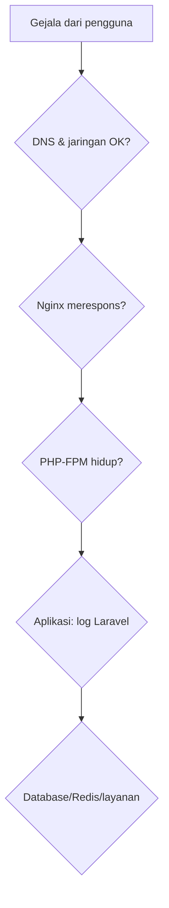
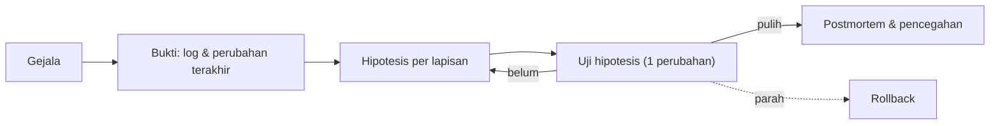

# Deployment Troubleshooting

Deploy yang gagal atau situs yang tiba-tiba error membutuhkan diagnosis berurutan, bukan mengubah acak. Sub bab ini memberi **peta gejala → lapisan → pemeriksaan** untuk tumpukan Nginx + PHP-FPM + MySQL + Supervisor + Docker, serta kebiasaan yang mengurangi kerusakan saat panik.

!!! danger "Belum teruji penulis"
    Daftar gejala dan perintah diturunkan dari dokumentasi dan pengalaman umum; tidak seluruhnya direproduksi di server nyata oleh penulis. Setiap perbaikan yang mengubah sistem produksi harus dipikirkan dua kali dan, bila mungkin, dicoba di staging dulu.

## Tujuan Pembelajaran

- [ ] Menerapkan alur diagnosis berlapis: DNS/jaringan → Nginx → PHP-FPM → aplikasi → database/layanan.
- [ ] Membaca log yang tepat untuk tiap gejala (502, 500, 404, 419, 403).
- [ ] Mengenali penyebab umum pasca-deploy (cache, izin, `.env`, migrasi, OPcache).
- [ ] Mendiagnosis worker, jadwal, dan Docker bermasalah.
- [ ] Melakukan rollback terkontrol dan membuat catatan insiden.
- [ ] Menyusun kebiasaan respons insiden (tenang, ukur, satu perubahan, catat).

## Prasyarat

- Seluruh sub bab Level 10 sebelumnya, [Debugging dan Diagnosis Error](../level-08/08-14-debugging-and-error-diagnosis.md).

## Pengantar

Deploy selesai, situs menampilkan 500. Naluri: ubah sesuatu. Disiplin: *baca log dulu*. Lebih dari separuh insiden terjawab di tiga berkas log.

## Penjelasan Konsep

### Alur diagnosis berlapis



Periksa dari luar ke dalam, dan baca log di tiap lapisan sebelum menyimpulkan.

### Log pertama yang dibaca

```bash
sudo tail -n 50 /var/log/nginx/error.log
tail -n 50 /var/www/contoh.com/current/storage/logs/laravel.log     # atau shared/storage/logs
sudo journalctl -u php8.3-fpm -n 50 --no-pager
sudo journalctl -u mysql -n 50 --no-pager
sudo supervisorctl status
```

### Peta gejala

| Gejala | Lapisan | Penyebab umum | Pemeriksaan | Perbaikan |
|---|---|---|---|---|
| Situs tak terbuka sama sekali | DNS/jaringan/firewall | DNS salah, UFW, Nginx mati | `dig`, `curl -I`, `ufw status`, `systemctl status nginx` | Perbaiki DNS/port/layanan |
| **502 Bad Gateway** | Nginx → FPM | FPM mati, soket tak cocok, `max_children` habis | `error.log`, `systemctl status php8.3-fpm`, path soket | Start FPM, samakan soket, naikkan `pm.max_children` sesuai memori |
| **504 Gateway Timeout** | FPM lambat | Query/API lambat, timeout kecil | slowlog FPM, slow query log | Optimasi; sesuaikan timeout seperlunya |
| **404 di semua route** kecuali `/` | Nginx | `try_files` salah | Konfigurasi server block | Perbaiki `try_files` |
| **403 Forbidden** | Nginx/izin | `root` salah, izin direktori | `error.log`, `namei -l` path | Perbaiki root & izin |
| **500** tanpa pesan | Aplikasi | Galat PHP/Laravel | `laravel.log`, `error.log` | Sesuai pesan |
| **500** + `No application encryption key` | Konfigurasi | `APP_KEY` kosong | `.env` | `key:generate` / isi nilai |
| **500** + `Permission denied` | Izin | `storage` tak bisa ditulis | `laravel.log`, `ls -l` | 10.09 |
| **500** + `SQLSTATE[HY000] [1045]` | Database | Kredensial salah | `.env`, tes `mysql -u` | Perbaiki kredensial |
| **500** + `[2002] Connection refused` | Database | MySQL mati / host salah | `systemctl status mysql` | Start; periksa `DB_HOST` |
| **419 Page Expired** | Aplikasi | CSRF/sesi (cookie `Secure` tanpa HTTPS, domain) | Cookie di DevTools, `APP_URL`, `SESSION_*` | Perbaiki HTTPS/domain |
| Halaman lama setelah deploy | Cache | OPcache / config cache / CDN | `php artisan about`, header | Reload FPM, `config:cache`, purge CDN |
| Perubahan `.env` tak berlaku | Cache | `config:cache` lama | — | `config:cache` ulang |
| CSS/JS 404 | Aset | Build belum jalan / salah path | Network tab | Bangun aset; periksa `public/build` |
| Gambar unggahan 404 | Penyimpanan | `storage:link` belum | `ls -l public/storage` | `php artisan storage:link` |
| Email tak terkirim | Antrean/mailer | Worker mati, kredensial salah | `supervisorctl`, `failed_jobs`, log | Jalankan worker; perbaiki |
| Jadwal tak jalan | Cron | Entri hilang/pengguna salah | `grep CRON /var/log/syslog` | 10.11 |
| Worker kode lama | Worker | Tidak di-reload | `supervisorctl status`, usia proses | `php artisan reload`/restart |
| Migrasi gagal saat deploy | Database | Hak kurang, konflik skema | Log deploy | Perbaiki; rollback kode; jangan paksa |
| Sertifikat peringatan | TLS | Kedaluwarsa/renew gagal | `openssl s_client` | `certbot renew` |
| Kehabisan memori (OOM) | Sumber daya | `max_children` besar, worker bocor | `journalctl -k`, cari kata `oom` | Turunkan; `--max-time` |
| Disk penuh | Sumber daya | Log/backup menumpuk | `df -h`, `du` | Rotasi & bersihkan |

### Spesifik Docker/Compose

| Gejala | Pemeriksaan | Penyebab umum |
|---|---|---|
| Kontainer langsung berhenti | `docker compose ps -a`, `logs` | Variabel kosong, `APP_KEY`, kesalahan perintah |
| `web` 502 | `docker compose logs web app` | `app` crash / nama layanan `fastcgi_pass` salah |
| DB menolak sambungan | `logs db`, healthcheck | Belum siap, kredensial berbeda dari volume lama |
| Kredensial DB berubah tak berlaku | — | Volume `dbdata` sudah terinisialisasi; variabel `MYSQL_*` hanya berlaku saat pertama |
| Perubahan konfigurasi tak terbaca | `docker compose up -d --force-recreate` | Kontainer tidak dibuat ulang |
| Disk Docker penuh | `docker system df` | Image/volume menumpuk; bersihkan dengan hati-hati |

### Kebiasaan saat insiden

1. **Tenang dan komunikasikan** (siapa memimpin, siapa mengabari pengguna).
2. **Tangkap bukti** sebelum mengubah (log, waktu mulai, perubahan terakhir).
3. **Cari perubahan terakhir** (deploy? konfigurasi? sertifikat? trafik?).
4. **Pulihkan layanan dulu**: rollback ke rilis stabil sering lebih cepat daripada memperbaiki di tempat.
5. **Satu perubahan sekali**, catat.
6. **Pasca-insiden**: tulis postmortem tanpa menyalahkan individu, buat pencegahan (uji, alarm, runbook).

### Rollback

Dari 10.08: alihkan `current` ke rilis sebelumnya, reload FPM dan worker. Ingat migrasi tidak mundur otomatis; migrasi harus kompatibel mundur. Untuk kerusakan data, gunakan backup (10.18) dan hati-hati menimpa data terbaru.

### Keamanan saat darurat

- Jangan menurunkan keamanan "sementara" (`chmod 777`, matikan firewall, `APP_DEBUG=true`) lalu lupa; bila terpaksa, catat dan kembalikan.
- Jangan menempelkan log berisi rahasia/PII ke forum, chat publik, atau alat luar tanpa menyaring.
- Gunakan sesi SSH pribadi, bukan berbagi kredensial.

## Cara Kerja



## Contoh Praktik

Di server staging kamu sengaja memunculkan lima kerusakan (satu per satu, lalu diperbaiki): socket FPM salah, izin `storage`, `.env` rusak, MySQL mati, dan worker mati. Kamu mendiagnosis tiap kasus hanya dengan log.

## Penjelasan Kode

Skenario 502: ubah `fastcgi_pass unix:/run/php/php8.3-fpm.sock` menjadi `.../salah.sock`, `nginx -t && reload`, lalu `tail error.log` menunjukkan `connect() to unix:... failed (2: No such file or directory)`. Kembalikan.

## Implementasi Langkah demi Langkah

### Langkah 1: siapkan catatan

Buat `docs-deploy.md` bagian "Insiden" dengan kolom waktu, gejala, penyebab, perbaikan.

### Langkah 2: kerusakan 1 (502)

Salah-konfigurasikan soket FPM (di staging), diagnosis lewat `error.log`, perbaiki.

### Langkah 3: kerusakan 2 (izin)

`chmod 755 shared/storage/logs`, muat halaman, baca `laravel.log`, perbaiki dengan izin benar (10.09).

### Langkah 4: kerusakan 3 (`.env`)

Ubah `DB_PASSWORD` ke nilai salah, muat halaman, baca galat 1045, `config:cache` ulang setelah perbaikan.

### Langkah 5: kerusakan 4 (MySQL mati)

`sudo systemctl stop mysql`, lihat `/up` gagal dan log, `start` kembali.

### Langkah 6: kerusakan 5 (worker)

`supervisorctl stop 'laravel-worker:*'`, kirim job, amati antrean menumpuk dan skrip health melaporkan, `start`.

### Langkah 7: rollback

Lakukan deploy dengan bug buatan, lalu rollback ke rilis sebelumnya dan catat waktu.

### Langkah 8: postmortem

Tulis postmortem singkat untuk satu kasus.

## Eksekusi dan Verifikasi

| Langkah | Hasil yang diharapkan |
|---|---|
| 2–6 | Setiap kerusakan dapat dikenali dari log tertentu dan diperbaiki |
| 7 | Rollback memulihkan layanan dalam hitungan menit |

## Daftar periksa verifikasi

- [ ] Kamu hafal tiga log pertama yang dibaca.
- [ ] Setiap gejala di tabel dapat dipetakan ke lapisan.
- [ ] Rollback pernah dilatih.
- [ ] Ada postmortem dan runbook.
- [ ] Tidak ada pengaturan "sementara" yang terlupa.

## Hasil yang Diharapkan

Pesan log persis bergantung versi; belum direproduksi penulis. Gunakan kerusakan buatan di staging.

## Kesalahan Umum dan Pemecahan Masalah

| Gejala | Penyebab | Cara mengenali | Solusi | Pencegahan |
|---|---|---|---|---|
| Berputar-putar tanpa kemajuan | Mengubah banyak hal | Tak tahu mana efektif | Satu perubahan, catat | Disiplin |
| Memperbaiki di produksi tanpa rollback | Panik | Insiden memanjang | Rollback dulu | Latihan |
| Log tidak ditemukan | Lokasi tak diketahui | Tak ada bukti | Daftar lokasi log | Dokumentasi |
| Perbaikan sementara terlupa | Tak dicatat | `777`, debug aktif | Catat & kembalikan | Daftar periksa pasca-insiden |
| Insiden berulang | Tak ada pencegahan | Gejala sama | Postmortem + alarm + uji | Tindak lanjut |
| Rahasia bocor di tiket | Menyalin log mentah | Rahasia di tiket | Saring, putar | Pedoman |

## Latihan Praktik

### Latihan dasar

**D1. Petakan gejala**
- *Masalah:* memetakan.
- *Persyaratan:* untuk 502, 504, 419, dan 403, sebut lapisan dan log pertama yang dibaca.
- *Perilaku yang diharapkan:* sesuai tabel.
- *Tujuan belajar:* diagnosis berlapis.

### Latihan implementasi

**I1. Runbook**
- *Masalah:* butuh panduan cepat.
- *Persyaratan:* tulis runbook satu halaman "Situs 500" dengan langkah berurutan.
- *Perilaku yang diharapkan:* dapat diikuti orang lain.
- *Tujuan belajar:* dokumentasi operasional.

**I2. Latihan hari-H**
- *Masalah:* tim belum pernah berlatih.
- *Persyaratan:* rancang *game day*: skenario, peran, tujuan, kriteria sukses, dan cara aman di staging.
- *Perilaku yang diharapkan:* rencana latihan.
- *Tujuan belajar:* kesiapan insiden.

### Latihan tantangan

**T1. Postmortem tanpa menyalahkan**
- *Masalah:* deploy menyebabkan 40 menit downtime.
- *Persyaratan:* tulis postmortem (kronologi, dampak, akar penyebab bertingkat, apa yang berjalan baik, tindakan pencegahan dengan pemilik dan tenggat).
- *Perilaku yang diharapkan:* dokumen konstruktif.
- *Tujuan belajar:* budaya belajar.
- *Catatan:* kerjakan mandiri; tidak ada kunci jawaban.

## Uji Pemahaman

1. Dari lapisan mana diagnosis dimulai?
2. Apa arti 502 dan log mana pertama yang dibaca?
3. Mengapa rollback sering lebih baik daripada memperbaiki di tempat?
4. Mengapa mencatat perbaikan sementara?

??? success "Kunci jawaban singkat"
    1. Dari luar ke dalam: DNS/jaringan, Nginx, FPM, aplikasi, database.
    2. Nginx tak dapat menjangkau FPM; `nginx/error.log`.
    3. Memulihkan layanan lebih cepat dan aman.
    4. Agar tidak terlupa dan membuka celah keamanan.

## Ringkasan

- Diagnosis dari luar ke dalam, baca log dulu, ubah satu hal.
- Peta gejala membantu menemukan lapisan; latih rollback.
- Tulis runbook dan postmortem; jangan menurunkan keamanan secara diam-diam.

Selanjutnya: proyek penutup, *Deploy Laravel ke VPS dengan Nginx, PHP-FPM, MySQL, dan Docker*.

## Referensi Resmi

- [Laravel: Deployment](https://laravel.com/docs/13.x/deployment)
- [Laravel: Errors](https://laravel.com/docs/13.x/errors)
- [Nginx: Debugging](https://nginx.org/en/docs/debugging_log.html)
