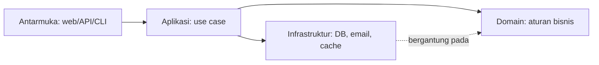

# Dasar Arsitektur Perangkat Lunak

Arsitektur adalah keputusan yang mahal diubah: bagaimana kode dibagi, siapa boleh bergantung pada siapa, dan di mana batasnya. Aplikasi `cms-artikel` kini cukup besar sehingga keputusan itu menentukan apakah fitur baru terasa mudah atau menyakitkan. Sub bab ini memberi kosakata dan cara berpikir; tidak ada satu arsitektur yang "benar".

## Tujuan Pembelajaran

- [ ] Menjelaskan arsitektur, kualitas (*quality attributes*), dan *trade-off*.
- [ ] Mengenali gejala arsitektur yang membusuk (*big ball of mud*).
- [ ] Menjelaskan kohesi, kopling, dan arah ketergantungan.
- [ ] Membandingkan monolit berlapis, monolit modular, dan layanan terdistribusi.
- [ ] Mencatat keputusan dengan ADR (*Architecture Decision Record*).
- [ ] Menilai arsitektur Laravel bawaan dan kapan perlu melampauinya.

## Prasyarat

- Bab utama Level 01–10, khususnya [Service Layer](../level-07/07-07-service-layer-pattern.md).

## Pengantar

Fitur "terbitkan artikel" menyentuh controller, model, event, notifikasi, cache, dan API. Tanpa batas yang jelas, mengubah satu aturan memaksa menyunting belasan berkas di banyak folder.

## Penjelasan Konsep

### Kualitas yang saling tarik-menarik

| Kualitas | Pertanyaan |
|---|---|
| Keterpeliharaan | Seberapa mudah mengubah? |
| Keterujian | Seberapa mudah menguji? |
| Kinerja | Seberapa cepat? |
| Keamanan | Seberapa tahan serangan? |
| Skalabilitas | Seberapa mudah ditumbuhkan? |
| Biaya & kecepatan rilis | Berapa lama dan mahal? |

Menaikkan satu sering menurunkan yang lain (mis. memecah ke layanan terpisah menaikkan skalabilitas tetapi menurunkan kesederhanaan). Arsitektur = memilih *trade-off* dengan sadar.

### Kohesi dan kopling

- **Kohesi tinggi**: isi satu modul saling terkait kuat (semua tentang artikel).
- **Kopling rendah**: modul sedikit tahu tentang modul lain, lewat antarmuka kecil.

Tujuan: kohesi tinggi, kopling rendah. Arah ketergantungan sebaiknya menuju hal yang stabil (aturan bisnis), bukan detail yang berubah (kerangka kerja, database).

### Membusuk

Gejala: perubahan kecil merusak tempat jauh; semua class memanggil semua class; logika bisnis di controller dan Blade; tak ada yang berani refaktor; uji lambat atau tidak ada.

### Gaya umum

| Gaya | Ciri | Cocok bila |
|---|---|---|
| Monolit berlapis (MVC + service) | Satu kode, lapisan teknis | Tim kecil, domain sederhana |
| **Monolit modular** | Satu deploy, modul per domain dengan batas tegas | Domain tumbuh, tim kecil–menengah |
| Layanan terdistribusi (microservices) | Banyak deploy, jaringan antar layanan | Tim besar independen, beban sangat berbeda |

Mulai sederhana. Monolit modular sering titik tengah terbaik; layanan terdistribusi membawa biaya besar (jaringan, konsistensi data, observabilitas), dibahas di 11.12.

### Arsitektur bawaan Laravel

Laravel mendorong MVC + service container + event, dan itu sudah cukup untuk banyak aplikasi. Ia tidak memaksa struktur; folder `app/` tumbuh sesuai disiplinmu. Pertanyaannya bukan "framework siapa" tetapi "di mana aturan bisnis hidup dan siapa boleh memanggilnya".

### ADR

Catatan singkat per keputusan arsitektur: konteks, opsi, keputusan, konsekuensi. Contoh `docs/adr/0001-monolit-modular.md`. Berguna agar alasan tidak hilang saat orang berganti.

### Keamanan

Arsitektur menentukan di mana kontrol keamanan ditegakkan. Prinsip: otorisasi di satu titik per aksi (Policy), validasi di batas masuk, dan jangan menyebar pemeriksaan hak di banyak tempat.

## Cara Kerja



## Contoh Praktik

Kamu memetakan ketergantungan `cms-artikel` saat ini, menandai hotspot kopling, dan menulis ADR pertama.

## Penjelasan Kode

Peta cepat jumlah `use` lintas folder:

```bash
grep -rhn "^use App\\\\" app | sed 's/.*use //' | sort | uniq -c | sort -rn | head -15
```

Class yang diimpor di mana-mana adalah calon pusat kopling.

## Implementasi Langkah demi Langkah

### Langkah 1: gambar peta

Daftar domain: Artikel, Komentar, Pengguna/Peran, Notifikasi, Media.

### Langkah 2: temukan kopling

Jalankan perintah di atas; catat 5 class paling banyak diimpor.

### Langkah 3: tulis ADR

Buat `docs/adr/0001-struktur-aplikasi.md` (konteks, opsi: berlapis/modular/layanan, keputusan, konsekuensi).

### Langkah 4: tetapkan aturan

Tulis 3 aturan ketergantungan (mis. "modul Komentar tidak mengimpor model Pengguna langsung").

### Langkah 5: commit

```bash
git add docs/adr
git commit -m "Tambah ADR struktur aplikasi"
```

## Eksekusi dan Verifikasi

| Langkah | Hasil yang diharapkan |
|---|---|
| 2 | Daftar class paling sering diimpor |
| 3 | ADR terisi dengan konsekuensi nyata |

## Hasil yang Diharapkan

Berupa dokumen analisis; tidak ada kode aplikasi berubah.

## Kesalahan Umum dan Pemecahan Masalah

| Gejala | Penyebab | Cara mengenali | Solusi | Pencegahan |
|---|---|---|---|---|
| Over-engineering | Pola tanpa masalah nyata | Banyak lapisan kosong | Sederhanakan | Mulai dari kebutuhan |
| Pindah ke microservices dini | Ikut tren | Kompleksitas melonjak | Monolit modular | Ukur kebutuhan |
| Aturan tak ditegakkan | Hanya lisan | Pelanggaran muncul | Uji/alat arsitektur | Otomasi |
| Keputusan terlupa | Tanpa ADR | Debat berulang | Tulis ADR | Kebiasaan |

## Latihan Praktik

### Latihan dasar

**D1. Kohesi atau kopling?**
- *Masalah:* mengklasifikasi.
- *Persyaratan:* nilai "controller memanggil 9 model berbeda" dan "class `ArticleSlug` hanya mengurus slug".
- *Perilaku yang diharapkan:* kopling tinggi/kohesi rendah; kohesi tinggi.
- *Tujuan belajar:* membedakan.

### Latihan implementasi

**I1. ADR**
- *Masalah:* butuh keputusan tercatat.
- *Persyaratan:* tulis ADR "cache di service, bukan di controller" dengan konsekuensi.
- *Perilaku yang diharapkan:* ADR lengkap.
- *Tujuan belajar:* mencatat keputusan.

### Latihan tantangan

**T1. Pilih gaya**
- *Masalah:* tim 4 orang, 3 domain.
- *Persyaratan:* pilih gaya arsitektur dan jelaskan trade-off.
- *Perilaku yang diharapkan:* alasan jelas.
- *Tujuan belajar:* keputusan arsitektur.
- *Catatan:* kerjakan mandiri; tidak ada kunci jawaban.

## Uji Pemahaman

1. Apa itu trade-off arsitektur?
2. Apa tujuan kohesi tinggi dan kopling rendah?
3. Kapan monolit modular cocok?
4. Apa fungsi ADR?

??? success "Kunci jawaban singkat"
    1. Menaikkan satu kualitas sering menurunkan yang lain.
    2. Perubahan terlokalisasi dan modul mandiri.
    3. Domain tumbuh dengan tim kecil–menengah.
    4. Mencatat alasan keputusan.

## Ringkasan

- Arsitektur adalah pilihan trade-off, bukan resep tunggal.
- Kejar kohesi tinggi, kopling rendah; mulai sederhana.
- Catat keputusan dengan ADR.

Selanjutnya: *Clean Code*.

## Referensi Resmi

- [Laravel: Structure](https://laravel.com/docs/13.x/structure)
- [Architecture Decision Records](https://adr.github.io/)
