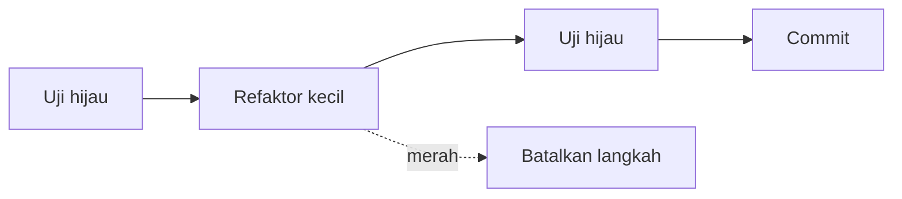

# Clean Code

Kode dibaca jauh lebih sering daripada ditulis. *Clean code* bukan estetika, melainkan kode yang mudah dipahami, diubah, dan diuji. Sub bab ini mengajarkan kebiasaan praktis dengan contoh PHP/Laravel: penamaan, fungsi kecil, mengurangi kedalaman bersarang, menghindari angka ajaib, dan refaktor aman dengan uji.

## Tujuan Pembelajaran

- [ ] Memberi nama yang mengungkapkan maksud.
- [ ] Menulis fungsi kecil dengan satu tanggung jawab.
- [ ] Mengurangi percabangan bersarang dengan *guard clause* dan `match`.
- [ ] Mengganti angka/string ajaib dengan konstanta atau enum.
- [ ] Memakai tipe, `readonly`, dan DTO untuk kejelasan.
- [ ] Merefaktor dengan aman memakai uji dan alat format (Pint).

## Prasyarat

- [Unit Testing](../level-08/08-04-unit-testing.md), [Dasar Arsitektur](11-01-software-architecture-fundamentals.md).

## Pengantar

Metode `process()` sepanjang 120 baris dengan lima tingkat `if`. Tidak ada yang berani mengubahnya. Pemecahan bertahap menjadikan setiap bagian bisa dibaca dan diuji.

## Penjelasan Konsep

### Penamaan

| Buruk | Baik | Alasan |
|---|---|---|
| `$d`, `$tmp` | `$publishedAt` | Mengungkapkan isi |
| `handle2()` | `publishScheduledArticles()` | Mengungkapkan tindakan |
| `$flag` | `$isFeatured` | Boolean berbentuk pertanyaan |
| `Manager`, `Helper` | `ArticlePublisher` | Peran jelas |

### Fungsi kecil, satu tujuan

```php
// Sebelum
public function publish(Article $a, User $u)
{
    if ($u->role->value === 'admin' || $u->id === $a->user_id) {
        if ($a->published_at === null) {
            if (strlen($a->body) > 100) {
                $a->published_at = now();
                $a->save();
                // kirim notifikasi ...
            }
        }
    }
}
```

```php
// Sesudah
public function publish(Article $article, User $actor): void
{
    $this->ensureCanPublish($article, $actor);
    $this->ensurePublishable($article);

    $article->update(['published_at' => now()]);
    ArticlePublished::dispatch($article);
}

private function ensurePublishable(Article $article): void
{
    if ($article->published_at !== null) {
        throw new ArticleAlreadyPublished($article);
    }

    if (mb_strlen($article->body) <= self::MIN_BODY_LENGTH) {
        throw new ArticleTooShort($article);
    }
}
```

*Guard clause* (periksa kondisi gagal lebih dulu, keluar cepat) menghilangkan kedalaman bersarang. Pengecualian bernama menjelaskan alasan kegagalan.

### Angka ajaib dan enum

```php
private const MIN_BODY_LENGTH = 100;

enum ArticleStatus: string
{
    case Draft = 'draft';
    case Published = 'published';
}
```

`match` menggantikan `if/elseif` panjang dan memaksa semua kasus tertangani:

```php
return match ($status) {
    ArticleStatus::Draft => 'Draf',
    ArticleStatus::Published => 'Terbit',
};
```

### Tipe, `readonly`, DTO

```php
final readonly class PublishArticleData
{
    public function __construct(
        public int $articleId,
        public int $actorId,
        public ?\DateTimeImmutable $at = null,
    ) {}
}
```

Objek data bertipe lebih jelas daripada array berkunci string; kesalahan ketik terdeteksi IDE dan analisis statis.

### Komentar

Tulis kode yang tak butuh komentar "apa"; komentar menjelaskan **mengapa** (alasan bisnis, kompromi). Komentar basi lebih buruk daripada tidak ada.

### Duplikasi

DRY berlaku untuk **pengetahuan**, bukan kebetulan kemiripan. Menggabungkan dua kode yang kebetulan serupa tetapi berubah karena alasan berbeda menciptakan kopling.

### Alat

```bash
./vendor/bin/pint --test      # periksa gaya (Laravel Pint, ada di skeleton sebagai dev dependency)
./vendor/bin/pint             # perbaiki otomatis
```

Pint ada di skeleton Laravel terbaru; periksa `composer.json` proyekmu. Analisis statis (PHPStan/Larastan) adalah dependensi dev opsional.

### Refaktor aman

1. Pastikan ada uji (jaring pengaman).
2. Ubah kecil-kecil, jalankan uji setiap langkah.
3. Jangan mencampur refaktor dan perubahan perilaku dalam satu commit.

### Keamanan

Kode jernih memudahkan audit. Hindari "kode pintar" pada jalur sensitif (otorisasi, sanitasi). Pengecualian bernama jangan membocorkan data sensitif di pesan.

## Cara Kerja



## Contoh Praktik

Kamu merefaktor satu metode panjang di proyek menjadi fungsi kecil dengan guard clause, enum, dan pengecualian bernama, dijaga uji.

## Penjelasan Kode

Versi sesudah memisahkan *apa* (`publish`) dari *aturan* (`ensure*`). Konstruktor `PublishArticleData` hanya membawa data.

## Implementasi Langkah demi Langkah

### Langkah 1: pilih target

Cari metode terpanjang: `grep -c "" app/Services/*.php` atau tinjau manual.

### Langkah 2: tulis uji karakterisasi

Uji perilaku sekarang apa adanya, termasuk kasus gagal.

### Langkah 3: refaktor bertahap

Ekstrak aturan jadi metode privat, ganti `if` bersarang dengan guard clause, ganti angka ajaib.

### Langkah 4: jalankan uji dan Pint

```bash
php artisan test
./vendor/bin/pint --test
```

### Langkah 5: commit terpisah

```bash
git add -A && git commit -m "Refaktor ArticlePublisher: guard clause dan pengecualian bernama"
```

## Eksekusi dan Verifikasi

| Langkah | Hasil yang diharapkan |
|---|---|
| 4 | Uji tetap hijau; Pint bersih |

## Hasil yang Diharapkan

Belum dijalankan penulis; hasil bergantung kodemu.

## Kesalahan Umum dan Pemecahan Masalah

| Gejala | Penyebab | Cara mengenali | Solusi | Pencegahan |
|---|---|---|---|---|
| Uji pecah setelah refaktor | Perilaku berubah | Uji merah | Kembalikan langkah | Langkah kecil |
| Abstraksi prematur | Terlalu banyak class | Sulit dilacak | Gabung kembali | Aturan tiga |
| Nama menyesatkan | Perilaku berubah, nama tidak | Kebingungan | Ganti nama | Review |
| Komentar basi | Kode berubah | Komentar salah | Hapus/perbarui | Tulis "mengapa" |

## Latihan Praktik

### Latihan dasar

**D1. Ganti nama**
- *Masalah:* nama buruk.
- *Persyaratan:* perbaiki `$d`, `proc()`, `$flag`, `DataManager`.
- *Perilaku yang diharapkan:* nama mengungkapkan maksud.
- *Tujuan belajar:* penamaan.

### Latihan implementasi

**I1. Guard clause**
- *Masalah:* `if` bersarang 4 tingkat.
- *Persyaratan:* ratakan dengan guard clause dan uji.
- *Perilaku yang diharapkan:* perilaku sama, lebih datar.
- *Tujuan belajar:* mengurangi nesting.

### Latihan tantangan

**T1. Kapan DRY berbahaya?**
- *Masalah:* dua validasi mirip.
- *Persyaratan:* jelaskan kapan jangan digabung.
- *Perilaku yang diharapkan:* alasan perubahan berbeda.
- *Tujuan belajar:* menilai duplikasi.
- *Catatan:* kerjakan mandiri; tidak ada kunci jawaban.

## Uji Pemahaman

1. Apa itu guard clause?
2. Mengapa enum lebih baik dari string ajaib?
3. Apa isi komentar yang baik?
4. Mengapa refaktor butuh uji?

??? success "Kunci jawaban singkat"
    1. Memeriksa kondisi gagal dulu dan keluar cepat.
    2. Aman tipe dan terpusat.
    3. Alasan ("mengapa"), bukan terjemahan kode.
    4. Memastikan perilaku tidak berubah.

## Ringkasan

- Nama jelas, fungsi kecil, nesting rendah, tanpa angka ajaib.
- Pakai tipe/enum/DTO dan Pint.
- Refaktor kecil-kecil dengan uji hijau.

Selanjutnya: *SOLID Principles*.

## Referensi Resmi

- [Laravel: Pint](https://laravel.com/docs/13.x/pint)
- [PHP: Enumerations](https://www.php.net/manual/en/language.enumerations.php)
