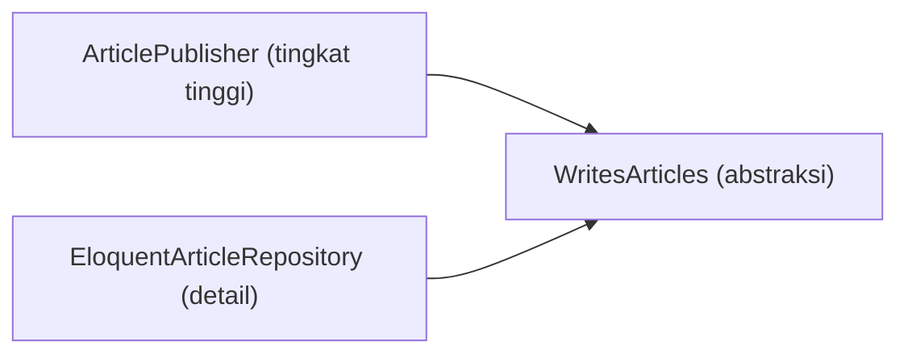

# SOLID Principles

SOLID adalah lima pedoman desain berorientasi objek yang membantu kode tetap fleksibel saat berubah. Bukan hukum; ia heuristik. Sub bab ini menjelaskan tiap prinsip dengan contoh dari `cms-artikel`, termasuk tanda-tanda pelanggaran dan penerapan yang berlebihan.

## Tujuan Pembelajaran

- [ ] Menjelaskan S, O, L, I, D dengan contoh.
- [ ] Mengenali pelanggaran lewat gejala di kode.
- [ ] Menerapkan SRP dengan memecah class.
- [ ] Menerapkan OCP/DIP lewat interface dan container Laravel.
- [ ] Memahami LSP dan ISP pada hierarki dan interface.
- [ ] Menilai kapan SOLID berlebihan.

## Prasyarat

- [Clean Code](11-02-clean-code.md), [Contracts](../level-07/07-04-contracts-and-interfaces.md), [Dependency Injection](../level-07/07-03-dependency-injection.md).

## Pengantar

Menambah metode pembayaran baru memaksa menyunting `if/elseif` raksasa di `CheckoutService`, dan setiap edit berisiko merusak metode lain. SOLID memberi arah untuk menghindarinya.

## Penjelasan Konsep

### S: Single Responsibility

Satu class, satu alasan berubah.

```php-inline
// Melanggar: mengurus validasi, simpan, email, dan format
class ArticleManager { public function publishAndEmailAndFormat(...) {} }

// Memisahkan: ArticlePublisher (aturan), ArticleMailer (email), ArticleFormatter (tampilan)
```

Gejala: nama berakhiran `Manager`/`Helper`, banyak `use` tak terkait, metode tak saling memakai properti.

### O: Open/Closed

Terbuka untuk ekstensi, tertutup untuk modifikasi: tambah perilaku tanpa mengubah kode lama.

```php-inline
interface ExcerptStrategy { public function make(string $body): string; }

class PlainExcerpt implements ExcerptStrategy { /* ... */ }
class MarkdownExcerpt implements ExcerptStrategy { /* ... */ }
```

Menambah `HtmlExcerpt` cukup membuat class baru dan mengikatnya; pemakai tidak berubah. Gejala pelanggaran: `switch/if` berdasarkan tipe yang bertambah tiap fitur.

### L: Liskov Substitution

Subtipe harus dapat menggantikan tipe induk tanpa merusak perilaku.

```php-inline
class ReadOnlyArticleRepository extends ArticleRepository
{
    public function save(Article $a): void
    {
        throw new LogicException('read-only'); // melanggar kontrak induk
    }
}
```

Pemakai yang memanggil `save()` pada tipe induk kini meledak. Perbaiki dengan interface terpisah (`ReadsArticles`, `WritesArticles`). Gejala: subclass melempar "tidak didukung" atau mengosongkan metode.

### I: Interface Segregation

Banyak interface kecil lebih baik daripada satu besar.

```php-inline
interface ReadsArticles { public function findBySlug(string $slug): ?Article; }
interface WritesArticles { public function save(Article $article): void; }
```

Class pembaca hanya bergantung pada `ReadsArticles`. Gejala: implementasi dengan metode kosong.

### D: Dependency Inversion

Modul tingkat tinggi tidak bergantung pada detail tingkat rendah; keduanya bergantung pada abstraksi.

```php-inline
class ArticlePublisher
{
    public function __construct(private WritesArticles $articles, private PengirimPesan $notifier) {}
}
```

Container Laravel mengikat abstraksi ke implementasi (07.01–07.04). Gejala: `new` konkret atau Facade infrastruktur di dalam logika bisnis.

### Kapan berlebihan?

Interface untuk setiap class, satu metode per class, atau lapisan tanpa variasi nyata menambah beban tanpa manfaat. Terapkan saat ada **tekanan nyata**: banyak implementasi, perubahan sering, atau kebutuhan uji.

### Keamanan

DIP memudahkan mengganti implementasi sensitif (penyimpanan rahasia, pengirim) dan mengujinya dengan fake. SRP memisahkan kode otorisasi dari logika lain sehingga lebih mudah diaudit.

## Cara Kerja



## Contoh Praktik

Kamu menemukan satu class yang melanggar SRP/OCP di proyek dan memecahnya dengan interface, lalu memverifikasi lewat uji.

## Penjelasan Kode

Pengikatan di provider:

```php-inline
$this->app->bind(WritesArticles::class, EloquentArticleRepository::class);
$this->app->bind(ReadsArticles::class, EloquentArticleRepository::class);
```

Satu implementasi memenuhi dua interface kecil.

## Implementasi Langkah demi Langkah

### Langkah 1: audit

Cari class > 300 baris atau `switch` bertipe.

### Langkah 2: pilih satu

Tulis uji karakterisasi.

### Langkah 3: pecah

Ekstrak interface kecil dan class pelaksana.

### Langkah 4: ikat

Daftarkan binding di provider.

### Langkah 5: uji dan commit

```bash
php artisan test
git commit -am "Pisahkan tanggung jawab dengan interface kecil"
```

## Eksekusi dan Verifikasi

| Langkah | Hasil yang diharapkan |
|---|---|
| 5 | Uji hijau; menambah varian baru tidak mengubah kode lama |

## Hasil yang Diharapkan

Belum dijalankan penulis; bergantung kodemu.

## Kesalahan Umum dan Pemecahan Masalah

| Gejala | Penyebab | Cara mengenali | Solusi | Pencegahan |
|---|---|---|---|---|
| Interface satu implementasi dimana-mana | Abstraksi prematur | Banyak interface kosong makna | Hapus yang tak perlu | Tunggu tekanan nyata |
| Subclass melempar "tidak didukung" | Pelanggaran LSP | Pengecualian | Pecah interface | Rancang kontrak |
| Class dewa | Melanggar SRP | Ratusan baris | Pecah | Review ukuran |
| `new` konkret di logika | Melanggar DIP | Sulit diuji | Injeksi | Container |

## Latihan Praktik

### Latihan dasar

**D1. Prinsip mana?**
- *Masalah:* mencocokkan gejala.
- *Persyaratan:* petakan: (a) `switch` tipe bertambah, (b) subclass melempar error, (c) class membuat `new Mailer`.
- *Perilaku yang diharapkan:* OCP, LSP, DIP.
- *Tujuan belajar:* mengenali pelanggaran.

### Latihan implementasi

**I1. Strategi**
- *Masalah:* tiga format ekspor.
- *Persyaratan:* ganti `switch` dengan strategi dan binding berbasis konfigurasi.
- *Perilaku yang diharapkan:* format baru tanpa ubah kode lama.
- *Tujuan belajar:* OCP.

### Latihan tantangan

**T1. SOLID berlebihan**
- *Masalah:* tim membuat 40 interface.
- *Persyaratan:* tulis kriteria menahan abstraksi.
- *Perilaku yang diharapkan:* kriteria beralasan.
- *Tujuan belajar:* pragmatisme.
- *Catatan:* kerjakan mandiri; tidak ada kunci jawaban.

## Uji Pemahaman

1. Apa arti SRP?
2. Apa gejala pelanggaran OCP?
3. Apa itu LSP?
4. Bagaimana DIP terwujud di Laravel?

??? success "Kunci jawaban singkat"
    1. Satu alasan berubah per class.
    2. Percabangan bertipe yang terus bertambah.
    3. Subtipe dapat menggantikan induk tanpa merusak perilaku.
    4. Bergantung pada interface yang diikat di container.

## Ringkasan

- SOLID = lima heuristik untuk kode yang mudah berubah.
- Terapkan saat ada tekanan nyata; jangan berlebihan.
- Laravel container mendukung DIP.

Selanjutnya: *Design Patterns*.

## Referensi Resmi

- [Laravel: Service Container](https://laravel.com/docs/13.x/container)
- [Laravel: Contracts](https://laravel.com/docs/13.x/contracts)
