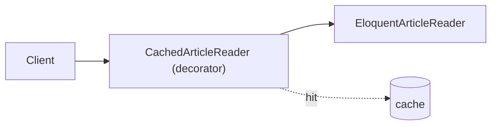

# Design Patterns

*Design pattern* adalah solusi berulang untuk masalah desain yang sering muncul. Laravel sendiri penuh pola: Facade, Factory, Observer (event), Strategy (driver), Pipeline (middleware), Repository. Sub bab ini memilih pola yang paling bermanfaat di aplikasi Laravel, dengan kapan memakai dan kapan tidak.

## Tujuan Pembelajaran

- [ ] Menjelaskan tujuan pola desain dan risiko memakainya berlebihan.
- [ ] Menerapkan Strategy, Factory, Decorator, Observer, dan Pipeline.
- [ ] Mengenali pola yang sudah dipakai Laravel.
- [ ] Memilih pola dari masalah, bukan sebaliknya.
- [ ] Menghindari pola yang menambah kompleksitas tanpa manfaat.

## Prasyarat

- [SOLID Principles](11-03-solid-principles.md), [Events dan Listeners](../level-07/07-08-events-and-listeners.md).

## Pengantar

Pola adalah kosakata bersama: menyebut "ini Strategy" mengomunikasikan struktur dalam satu kata. Bahayanya memakai pola karena ingin, bukan karena perlu.

## Penjelasan Konsep

### Strategy: perilaku yang dapat ditukar

```php
interface SlugGenerator { public function make(string $title): string; }

class AsciiSlug implements SlugGenerator {
    public function make(string $title): string { return \Illuminate\Support\Str::slug($title); }
}
```

Dipilih lewat konfigurasi/binding. Laravel: driver cache, mail, queue.

### Factory: membuat objek dengan aturan

```php
class ExporterFactory
{
    public function make(string $format): Exporter
    {
        return match ($format) {
            'csv' => new CsvExporter(),
            'json' => new JsonExporter(),
            default => throw new \InvalidArgumentException("Format tidak didukung: $format"),
        };
    }
}
```

Validasi di sini mencegah input liar membuat objek sembarang. (Bukan factory Eloquent untuk data uji, yang konsepnya serupa tetapi tujuannya berbeda.)

### Decorator: menambah perilaku tanpa mengubah class

```php
class CachedArticleReader implements ReadsArticles
{
    public function __construct(private ReadsArticles $inner, private \Illuminate\Contracts\Cache\Repository $cache) {}

    public function findBySlug(string $slug): ?Article
    {
        return $this->cache->remember("article:$slug", 300, fn () => $this->inner->findBySlug($slug));
    }
}
```

Ikat `ReadsArticles` ke decorator yang membungkus implementasi Eloquent. Pemakai tidak berubah. Laravel: sebagian besar middleware pada dasarnya membungkus.

### Observer: reaksi terhadap kejadian

Event dan listener (07.08), serta observer model. Cocok untuk efek samping terpisah; hati-hati logika wajib yang tersembunyi.

### Pipeline: rangkaian langkah

Laravel memakai `Illuminate\Pipeline\Pipeline` untuk middleware; kamu dapat memakainya untuk rangkaian transformasi:

```php
use Illuminate\Pipeline\Pipeline;

$hasil = app(Pipeline::class)->send($artikel)
    ->through([
        \App\Pipes\StripDangerousHtml::class,
        \App\Pipes\GenerateExcerpt::class,
        \App\Pipes\ComputeReadingTime::class,
    ])
    ->thenReturn();
```

Setiap pipe punya `handle($payload, Closure $next)`. Cocok untuk langkah berurutan yang bisa ditambah/diatur ulang.

### Pola di Laravel

| Pola | Contoh di Laravel |
|---|---|
| Facade | `Cache::get()` |
| Strategy | Driver cache/queue/mail |
| Observer | Event, model observer |
| Pipeline | Middleware |
| Builder | Query Builder, `Mail::to()->cc()` |
| Repository | Eloquent (sebagian) |
| Factory | `Model::factory()` |

### Anti-pola umum

| Anti-pola | Masalah |
|---|---|
| Singleton sebagai variabel global | Status tersembunyi, sulit diuji |
| God object | Satu class melakukan semuanya |
| Service Locator berlebihan | Ketergantungan tersembunyi |
| Pola tanpa masalah | Kompleksitas tanpa manfaat |

### Keamanan

Factory/Strategy yang memilih kelas dari input harus memakai **allow-list** (seperti `match` di atas). Jangan menginstansiasi kelas dari string pengguna.

## Cara Kerja



## Contoh Praktik

Kamu menerapkan Decorator cache pada pembaca artikel dan Pipeline untuk memproses isi artikel sebelum disimpan.

## Penjelasan Kode

Binding decorator:

```php
$this->app->bind(ReadsArticles::class, fn ($app) => new CachedArticleReader(
    $app->make(EloquentArticleReader::class),
    $app->make(\Illuminate\Contracts\Cache\Repository::class),
));
```

## Implementasi Langkah demi Langkah

### Langkah 1: pilih masalah

Misal: pembaca artikel lambat → decorator cache.

### Langkah 2: tulis decorator

Buat `CachedArticleReader`.

### Langkah 3: ikat

Ubah binding di provider.

### Langkah 4: uji

Tulis uji dengan fake cache yang membuktikan pemanggilan kedua tidak menyentuh implementasi dalam.

### Langkah 5: Pipeline

Buat dua pipe dan uji urutannya.

### Langkah 6: commit

```bash
git add -A && git commit -m "Tambah decorator cache dan pipeline pemrosesan artikel"
```

## Eksekusi dan Verifikasi

| Langkah | Hasil yang diharapkan |
|---|---|
| 4 | Pemanggilan kedua melayani dari cache |
| 5 | Pipe berjalan sesuai urutan |

## Hasil yang Diharapkan

Belum dijalankan penulis.

## Kesalahan Umum dan Pemecahan Masalah

| Gejala | Penyebab | Cara mengenali | Solusi | Pencegahan |
|---|---|---|---|---|
| Cache basi | Decorator tanpa invalidasi | Data lama | Hapus kunci saat berubah | Rancang invalidasi |
| Pipe tak jalan | Lupa `$next($payload)` | Rantai berhenti | Panggil `$next` | Uji urutan |
| Kelas dari input | Tanpa allow-list | Kelas sembarang | `match`/daftar | Review |
| Pola dipaksakan | Tidak ada masalah | Kompleksitas | Hapus | Mulai dari masalah |

## Latihan Praktik

### Latihan dasar

**D1. Kenali pola**
- *Masalah:* memetakan.
- *Persyaratan:* sebut pola di balik middleware, driver cache, dan `Cache::get`.
- *Perilaku yang diharapkan:* Pipeline, Strategy, Facade.
- *Tujuan belajar:* mengenali.

### Latihan implementasi

**I1. Decorator logging**
- *Masalah:* ingin mencatat durasi.
- *Persyaratan:* decorator yang mencatat waktu pemanggilan ke log (tanpa data sensitif).
- *Perilaku yang diharapkan:* log tercatat.
- *Tujuan belajar:* menambah perilaku.

### Latihan tantangan

**T1. Pola tidak perlu**
- *Masalah:* tim menambah Factory untuk satu class.
- *Persyaratan:* jelaskan mengapa berlebihan.
- *Perilaku yang diharapkan:* alasan jelas.
- *Tujuan belajar:* menahan diri.
- *Catatan:* kerjakan mandiri; tidak ada kunci jawaban.

## Uji Pemahaman

1. Apa fungsi Decorator?
2. Mengapa Factory perlu allow-list?
3. Apa itu Pipeline?
4. Sebut dua pola yang ada di Laravel.

??? success "Kunci jawaban singkat"
    1. Menambah perilaku tanpa mengubah class.
    2. Mencegah pembuatan objek dari input sembarang.
    3. Rangkaian langkah yang meneruskan payload.
    4. Facade dan Observer/Strategy.

## Ringkasan

- Pola = kosakata solusi; pilih dari masalah nyata.
- Strategy, Factory, Decorator, Observer, Pipeline paling berguna di Laravel.
- Allow-list untuk factory; hindari kompleksitas tanpa manfaat.

Selanjutnya: *Modular Application Architecture*.

## Referensi Resmi

- [Laravel: Facades](https://laravel.com/docs/13.x/facades)
- [Laravel: Events](https://laravel.com/docs/13.x/events)
- [Refactoring Guru: Design Patterns](https://refactoring.guru/design-patterns)
