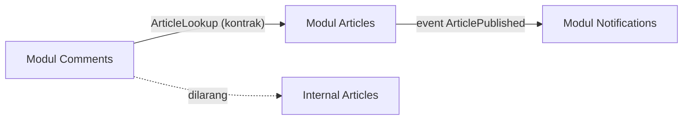

# Modular Application Architecture

Folder `app/Models`, `app/Http/Controllers`, `app/Services` mengelompokkan kode menurut **jenis teknis**. Saat aplikasi tumbuh, fitur "Artikel" tersebar di sepuluh folder. Arsitektur modular mengelompokkan menurut **domain bisnis**: semua yang berkaitan dengan Artikel hidup bersama, dengan batas tegas terhadap modul lain.

## Tujuan Pembelajaran

- [ ] Menjelaskan monolit modular dan manfaatnya.
- [ ] Menyusun struktur modul di `app/Modules` (atau `modules/`) tanpa paket tambahan.
- [ ] Mendaftarkan provider, route, migrasi, dan view per modul.
- [ ] Menetapkan antarmuka publik modul dan aturan ketergantungan.
- [ ] Menegakkan batas modul dengan uji arsitektur sederhana.
- [ ] Mengenali risiko (modul terlalu kecil, ketergantungan melingkar).

## Prasyarat

- [Dasar Arsitektur](11-01-software-architecture-fundamentals.md), [Service Providers](../level-07/07-02-service-providers.md), [Contracts](../level-07/07-04-contracts-and-interfaces.md).

## Pengantar

Tim Komentar ingin mengubah skema komentar, tetapi `ArticleController` membaca tabel komentar langsung. Setiap perubahan memengaruhi tim lain. Modul dengan antarmuka publik menutup celah ini.

## Penjelasan Konsep

### Struktur

```text
app/Modules/
  Articles/
    Domain/            (model, enum, aturan)
    Application/       (use case/service)
    Http/              (controller, request, resource)
    Infrastructure/    (repository Eloquent)
    Database/Migrations/
    routes.php
    ArticlesServiceProvider.php
    Contracts/         (antarmuka publik untuk modul lain)
  Comments/
    ...
```

Autoload PSR-4 `App\` sudah mencakup `app/Modules` (namespace `App\Modules\Articles\...`), sehingga tidak perlu paket pihak ketiga.

### Provider modul

File: `app/Modules/Articles/ArticlesServiceProvider.php`

```php
<?php

namespace App\Modules\Articles;

use App\Modules\Articles\Contracts\ArticleLookup;
use App\Modules\Articles\Infrastructure\EloquentArticleLookup;
use Illuminate\Support\Facades\Route;
use Illuminate\Support\ServiceProvider;

class ArticlesServiceProvider extends ServiceProvider
{
    public function register(): void
    {
        $this->app->bind(ArticleLookup::class, EloquentArticleLookup::class);
    }

    public function boot(): void
    {
        $this->loadMigrationsFrom(__DIR__.'/Database/Migrations');

        Route::middleware('web')->group(__DIR__.'/routes.php');
    }
}
```

Daftarkan di `bootstrap/providers.php`. `loadMigrationsFrom` membuat `php artisan migrate` ikut menjalankan migrasi modul.

### Antarmuka publik

Modul lain **hanya** boleh memakai isi `Contracts/` dan DTO publik:

```php-inline
namespace App\Modules\Articles\Contracts;

interface ArticleLookup
{
    public function exists(int $articleId): bool;
    public function titleOf(int $articleId): ?string;
}
```

Modul Komentar bergantung pada `ArticleLookup`, bukan model `Article`. Relasi lintas modul lewat ID, bukan relasi Eloquent langsung, agar skema bisa berubah independen.

### Aturan ketergantungan

| Aturan | Alasan |
|---|---|
| Modul hanya mengimpor `Contracts` dan DTO modul lain | Batas jelas |
| Tidak ada ketergantungan melingkar | Dapat dipahami & dipisah |
| Komunikasi sebab-akibat lewat event | Kopling longgar |
| Infrastruktur tidak diimpor domain | Domain murni |

### Uji arsitektur sederhana

Uji yang memindai impor terlarang:

```php-inline
public function test_comments_module_does_not_import_article_internals(): void
{
    $files = \Illuminate\Support\Facades\File::allFiles(app_path('Modules/Comments'));

    foreach ($files as $file) {
        $this->assertDoesNotMatchRegularExpression(
            '/use App\\\\Modules\\\\Articles\\\\(Domain|Infrastructure|Http)\\\\/',
            $file->getContents(),
            "{$file->getPathname()} mengimpor internal modul Articles"
        );
    }
}
```

Alat khusus (Pest Arch, Deptrac) lebih lengkap tetapi menambah dependensi dev; uji regex ini sederhana dan cukup untuk belajar.

### Migrasi ke modular secara bertahap

1. Pilih satu domain yang jelas batasnya.
2. Pindahkan kode, pertahankan perilaku (uji hijau).
3. Ganti akses langsung antar-domain dengan kontrak/event.
4. Ulangi; jangan memindahkan semuanya sekaligus.

### Trade-off

Modul menambah boilerplate dan kurva belajar. Manfaatnya muncul saat tim/domain tumbuh. Modul terlalu kecil (satu model) tidak sepadan.

### Keamanan

Batas modul membantu menegakkan otorisasi di satu tempat per domain. Pastikan route modul tetap melewati middleware `web`/`auth`/`throttle` yang sama; modul tidak boleh membuka route tanpa kontrol.

## Cara Kerja



## Contoh Praktik

Kamu memindahkan fitur Komentar ke modul sendiri dengan kontrak `ArticleLookup`, mendaftarkan provider, dan menulis uji batas.

## Penjelasan Kode

`Route::middleware('web')->group(__DIR__.'/routes.php')` memberi route modul grup middleware yang sama dengan route aplikasi.

## Implementasi Langkah demi Langkah

### Langkah 1: kerangka

Buat folder `app/Modules/Comments` dan `app/Modules/Articles` dengan subfolder di atas.

### Langkah 2: kontrak

Buat `ArticleLookup` dan implementasinya di Articles.

### Langkah 3: pindahkan Komentar

Pindahkan model, controller, request, migrasi ke modul Comments; sesuaikan namespace.

### Langkah 4: daftar provider

Tambahkan kedua provider ke `bootstrap/providers.php`; `composer dump-autoload`.

### Langkah 5: ganti ketergantungan

Di Komentar, ganti `Article::find` dengan `ArticleLookup`.

### Langkah 6: uji

```bash
php artisan route:list | grep -i komentar
php artisan test
```

### Langkah 7: uji batas dan commit

Tambahkan uji regex; `git commit`.

## Eksekusi dan Verifikasi

| Langkah | Hasil yang diharapkan |
|---|---|
| 6 | Route modul terdaftar; uji hijau |
| 7 | Uji batas lulus; gagal bila impor terlarang ditambahkan |

## Hasil yang Diharapkan

Belum dijalankan penulis; bergantung struktur proyekmu.

## Kesalahan Umum dan Pemecahan Masalah

| Gejala | Penyebab | Cara mengenali | Solusi | Pencegahan |
|---|---|---|---|---|
| `Class not found` setelah pindah | Namespace belum diubah | Galat class | Perbarui namespace | `dump-autoload` |
| Route modul hilang | Provider belum terdaftar | `route:list` kosong | Daftarkan | Cek providers |
| Migrasi ganda | Berkas ada di dua tempat | Galat tabel ada | Hapus salinan lama | Pindah bukan salin |
| Ketergantungan melingkar | A↔B | Sulit dipisah | Event/kontrak ketiga | Aturan arah |
| Relasi Eloquent lintas modul | Kopling skema | Perubahan merambat | ID + kontrak | Uji batas |

## Latihan Praktik

### Latihan dasar

**D1. Boleh atau tidak?**
- *Masalah:* menilai impor.
- *Persyaratan:* nilai: Comments mengimpor `Articles\Contracts\ArticleLookup`; Comments mengimpor `Articles\Domain\Article`.
- *Perilaku yang diharapkan:* boleh; dilarang.
- *Tujuan belajar:* aturan batas.

### Latihan implementasi

**I1. Modul Notifikasi**
- *Masalah:* notifikasi artikel terbit.
- *Persyaratan:* modul Notifications mendengarkan `ArticlePublished` tanpa mengimpor internal Articles (event sebagai kontrak publik).
- *Perilaku yang diharapkan:* berjalan.
- *Tujuan belajar:* komunikasi lewat event.

### Latihan tantangan

**T1. Kapan memecah modul?**
- *Masalah:* modul tumbuh besar.
- *Persyaratan:* tulis tanda-tanda perlu dipecah dan risiko memecah dini.
- *Perilaku yang diharapkan:* kriteria jelas.
- *Tujuan belajar:* menilai ukuran modul.
- *Catatan:* kerjakan mandiri; tidak ada kunci jawaban.

## Uji Pemahaman

1. Apa beda pengelompokan teknis dan domain?
2. Apa isi antarmuka publik modul?
3. Mengapa relasi lintas modul lewat ID?
4. Bagaimana menegakkan batas?

??? success "Kunci jawaban singkat"
    1. Teknis per jenis file; domain per fitur bisnis.
    2. Kontrak dan DTO/event yang boleh dipakai modul lain.
    3. Agar skema tiap modul berubah independen.
    4. Uji yang memeriksa impor terlarang.

## Ringkasan

- Monolit modular: kelompokkan per domain dengan batas tegas.
- Modul punya provider, migrasi, route, dan kontrak publik.
- Tegakkan aturan dengan uji; migrasi bertahap.

Selanjutnya: *Domain-Driven Design Fundamentals*.

## Referensi Resmi

- [Laravel: Service Providers](https://laravel.com/docs/13.x/providers)
- [Laravel: Packages (konsep loadMigrationsFrom)](https://laravel.com/docs/13.x/packages)
