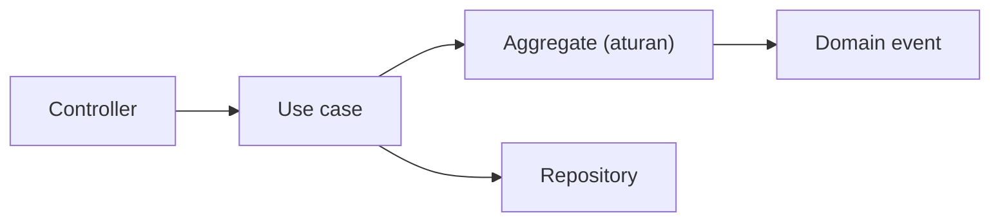

# Domain-Driven Design Fundamentals

*Domain-Driven Design* (DDD) menempatkan **bahasa dan aturan bisnis** di pusat desain. Ia berguna saat domain rumit dan kesalahpahaman antara pengembang dan pakar bisnis mahal. Sub bab ini memperkenalkan konsep inti (bukan seluruh DDD) dan menunjukkan penerapan ringan di Laravel, termasuk kapan DDD tidak perlu.

## Tujuan Pembelajaran

- [ ] Menjelaskan *ubiquitous language* dan *bounded context*.
- [ ] Membedakan Entity, Value Object, Aggregate, dan Domain Service.
- [ ] Menempatkan aturan bisnis di domain, bukan di controller/Eloquent callback.
- [ ] Memakai Value Object dan event domain di Laravel.
- [ ] Menilai kapan DDD berlebihan untuk CRUD sederhana.
- [ ] Menjelaskan hubungan DDD dengan modul (11.05).

## Prasyarat

- [Modular Application Architecture](11-05-modular-application-architecture.md), [SOLID](11-03-solid-principles.md).

## Pengantar

Tim bisnis berkata "artikel *dijadwalkan*", pengembang menulis `status = 2`. Saat aturan berubah ("artikel terjadwal tidak boleh dihapus"), pengetahuan itu tersebar. DDD mengajak memakai kata yang sama di percakapan dan kode.

## Penjelasan Konsep

### Ubiquitous language dan bounded context

Satu istilah bisa berbeda arti antar-konteks: "Pengguna" di konteks *Autentikasi* (kredensial) berbeda dari "Pengguna" di *Penulisan* (penulis dengan bio). Tiap **bounded context** punya model dan bahasanya sendiri; batasnya sering sejajar dengan modul.

Buat glosarium: istilah, arti, konteks.

### Blok bangunan

| Konsep | Arti | Contoh |
|---|---|---|
| Entity | Punya identitas, berubah seiring waktu | `Article` (id) |
| Value Object | Ditentukan nilainya, tak berubah (immutable) | `Slug`, `Money`, `DateRange` |
| Aggregate | Gugus entity/VO dengan satu akar yang menjaga invarian | `Article` + `Revision` |
| Domain Service | Aturan yang bukan milik satu entity | `ArticleScheduler` |
| Domain Event | Fakta yang terjadi | `ArticlePublished` |
| Repository | Mengambil/menyimpan aggregate | `ArticleRepository` |

### Value Object

```php-inline
final readonly class Slug
{
    private function __construct(public string $value) {}

    public static function fromTitle(string $title): self
    {
        $slug = \Illuminate\Support\Str::slug($title);
        if ($slug === '') {
            throw new \InvalidArgumentException('Judul tidak menghasilkan slug');
        }

        return new self($slug);
    }
}
```

Nilai selalu valid sejak dibuat (invarian terjaga); tidak ada string slug liar.

### Aggregate dan invarian

Akar aggregate menjaga aturan: perubahan hanya lewat metode akar.

```php-inline
class Article extends Model
{
    public function schedule(\DateTimeImmutable $at): void
    {
        if ($this->published_at !== null) {
            throw new ArticleAlreadyPublished($this);
        }
        if ($at <= new \DateTimeImmutable()) {
            throw new \DomainException('Jadwal harus di masa depan');
        }

        $this->scheduled_at = $at;
    }

    public function publish(): void
    {
        $this->published_at = now();
        $this->scheduled_at = null;
    }
}
```

Aturan "tidak boleh dijadwalkan di masa lalu" hidup **di satu tempat**, bukan di tiga controller. Model Eloquent boleh menjadi entity (kompromi pragmatis); DDD murni memisahkan persistensi, tetapi itu memerlukan pemetaan tambahan yang jarang sepadan di aplikasi biasa.

### Application layer (use case)

Use case mengorkestrasi: muat aggregate, panggil metode domain, simpan, publikasikan event.

```php-inline
class SchedulePublication
{
    public function __construct(private ArticleRepository $articles) {}

    public function __invoke(int $articleId, \DateTimeImmutable $at): void
    {
        $article = $this->articles->get($articleId);
        $article->schedule($at);
        $this->articles->save($article);
    }
}
```

Controller hanya menerjemahkan HTTP ke use case.

### Event domain

`ArticleScheduled`, `ArticlePublished`: nama bentuk lampau, membawa fakta. Modul lain bereaksi (07.08).

### Kapan DDD berlebihan?

| DDD berguna | DDD berlebihan |
|---|---|
| Aturan bisnis kompleks & sering berubah | CRUD murni tanpa aturan |
| Banyak pakar & istilah ambigu | Prototipe/aplikasi kecil |
| Tim besar, banyak konteks | Tim satu orang, domain sederhana |

Ambil yang murah: bahasa bersama, Value Object, aturan di entity, use case. Lewatkan seremoni (lapisan pemetaan penuh) bila tidak perlu.

### Keamanan

Invarian domain adalah garis pertahanan: nilai tidak valid tidak bisa dibuat. Otorisasi tetap di Policy pada batas aplikasi, bukan di entity.

## Cara Kerja



## Contoh Praktik

Kamu menambah fitur "jadwalkan penerbitan" dengan aturan di entity, Value Object `Slug`, use case, dan event domain.

## Penjelasan Kode

Aturan penjadwalan diuji unit tanpa HTTP/database (aturan murni), sementara use case diuji dengan repository palsu.

## Implementasi Langkah demi Langkah

### Langkah 1: glosarium

Tulis `docs/glosarium.md` (Artikel, Draf, Terjadwal, Terbit, Arsip).

### Langkah 2: Value Object

Buat `Slug` dengan uji unit (judul kosong → pengecualian).

### Langkah 3: metode domain

Tambahkan `schedule()`/`publish()` ke model dengan uji.

### Langkah 4: use case

Buat `SchedulePublication` dan uji dengan repository palsu.

### Langkah 5: event

Dispatch `ArticleScheduled` setelah simpan.

### Langkah 6: uji dan commit

```bash
php artisan test
git add -A && git commit -m "Tambah penjadwalan penerbitan dengan aturan di domain"
```

## Eksekusi dan Verifikasi

| Langkah | Hasil yang diharapkan |
|---|---|
| 3 | Penjadwalan di masa lalu ditolak |
| 6 | Uji hijau |

## Hasil yang Diharapkan

Belum dijalankan penulis.

## Kesalahan Umum dan Pemecahan Masalah

| Gejala | Penyebab | Cara mengenali | Solusi | Pencegahan |
|---|---|---|---|---|
| Model anemik | Semua logika di service | Entity hanya getter/setter | Pindahkan aturan ke entity | Review |
| DDD untuk CRUD | Seremoni tak perlu | Banyak kelas kosong | Sederhanakan | Nilai kebutuhan |
| Value Object bisa diubah | Tidak `readonly` | Nilai berubah | `final readonly` | Immutable |
| Istilah beda antar tim | Tanpa glosarium | Salah paham | Tulis glosarium | Bahasa bersama |
| Aggregate terlalu besar | Semua dalam satu | Transaksi lambat | Kecilkan | Batas konsistensi |

## Latihan Praktik

### Latihan dasar

**D1. Entity atau Value Object?**
- *Masalah:* klasifikasi.
- *Persyaratan:* klasifikasikan Artikel, Slug, Rentang Tanggal, Pengguna.
- *Perilaku yang diharapkan:* Entity, VO, VO, Entity.
- *Tujuan belajar:* membedakan.

### Latihan implementasi

**I1. Value Object Email**
- *Masalah:* email divalidasi di banyak tempat.
- *Persyaratan:* buat VO `EmailAddress` yang memvalidasi dan menormalkan huruf kecil, dengan uji.
- *Perilaku yang diharapkan:* nilai tak valid ditolak saat dibuat.
- *Tujuan belajar:* invarian.

### Latihan tantangan

**T1. Bounded context**
- *Masalah:* "Pengguna" punya banyak arti.
- *Persyaratan:* petakan tiga konteks dan model "Pengguna" masing-masing serta cara berkomunikasi.
- *Perilaku yang diharapkan:* peta konteks.
- *Tujuan belajar:* batas konteks.
- *Catatan:* kerjakan mandiri; tidak ada kunci jawaban.

## Uji Pemahaman

1. Apa itu ubiquitous language?
2. Beda Entity dan Value Object?
3. Apa tugas aggregate root?
4. Kapan DDD berlebihan?

??? success "Kunci jawaban singkat"
    1. Istilah yang sama di bisnis dan kode.
    2. Entity punya identitas; VO ditentukan nilainya.
    3. Menjaga invarian aggregate.
    4. Pada CRUD sederhana tanpa aturan kompleks.

## Ringkasan

- DDD memusatkan bahasa dan aturan bisnis di domain.
- Ambil bagian yang murah: glosarium, Value Object, aturan di entity, use case, event.
- Hindari seremoni untuk domain sederhana.

Selanjutnya: *Laravel Package Development*.

## Referensi Resmi

- [Domain-Driven Design Reference (Evans)](https://www.domainlanguage.com/ddd/reference/)
- [Laravel: Eloquent](https://laravel.com/docs/13.x/eloquent)
