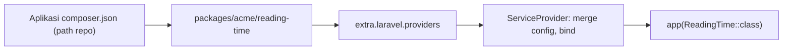

# Laravel Package Development

Kode yang berguna di banyak proyek layak dibungkus sebagai **package**: paket Composer yang dapat dipasang dan diperbarui. Sub bab ini membuat package kecil lokal (`acme/reading-time`) untuk menghitung estimasi waktu baca: struktur, `composer.json`, service provider, auto-discovery, konfigurasi yang dapat dipublikasikan, dan memasangnya lewat *path repository*. Tidak ada paket yang dipublikasikan ke publik.

## Tujuan Pembelajaran

- [ ] Menyusun struktur package (`src/`, `config/`, `composer.json`).
- [ ] Menulis `composer.json` dengan PSR-4 dan `extra.laravel.providers`.
- [ ] Membuat service provider dengan `mergeConfigFrom` dan `publishes`.
- [ ] Memasang package lokal lewat repositori `path`.
- [ ] Menguji package dan mengelola versi semantik.
- [ ] Memahami pertimbangan keamanan dan lisensi sebelum publikasi.

## Prasyarat

- [Service Providers](../level-07/07-02-service-providers.md), Composer dasar (Level 01).

## Pengantar

Kamu menulis penghitung waktu baca dan menyalinnya ke tiga proyek. Perbaikan bug harus diterapkan tiga kali. Package menjadikan satu sumber.

## Penjelasan Konsep

### Struktur

```text
packages/acme/reading-time/
  composer.json
  config/reading-time.php
  src/
    ReadingTime.php
    ReadingTimeServiceProvider.php
  tests/
  LICENSE
  README.md
```

### `composer.json` package

```json
{
    "name": "acme/reading-time",
    "description": "Estimasi waktu baca teks",
    "type": "library",
    "license": "MIT",
    "require": {
        "php": "^8.3",
        "illuminate/support": "^13.0"
    },
    "autoload": {
        "psr-4": {
            "Acme\\ReadingTime\\": "src/"
        }
    },
    "extra": {
        "laravel": {
            "providers": [
                "Acme\\ReadingTime\\ReadingTimeServiceProvider"
            ]
        }
    }
}
```

Menurut dokumentasi Packages, `extra.laravel.providers` membuat Laravel mendaftarkan provider otomatis (*package discovery*). Nama `acme/...` hanya contoh: gunakan vendor milikmu. Batas versi `illuminate/support` sesuaikan dengan versi yang kamu dukung.

### Kode package

File: `src/ReadingTime.php`

```php
<?php

namespace Acme\ReadingTime;

final class ReadingTime
{
    public function __construct(private int $wordsPerMinute = 200) {}

    public function minutes(string $text): int
    {
        $words = str_word_count(strip_tags($text));

        return max(1, (int) ceil($words / max(1, $this->wordsPerMinute)));
    }
}
```

File: `config/reading-time.php`

```php
<?php

return [
    'words_per_minute' => 200,
];
```

File: `src/ReadingTimeServiceProvider.php`

```php
<?php

namespace Acme\ReadingTime;

use Illuminate\Support\ServiceProvider;

class ReadingTimeServiceProvider extends ServiceProvider
{
    public function register(): void
    {
        $this->mergeConfigFrom(__DIR__.'/../config/reading-time.php', 'reading-time');

        $this->app->singleton(ReadingTime::class, fn ($app) => new ReadingTime(
            (int) $app['config']->get('reading-time.words_per_minute', 200)
        ));
    }

    public function boot(): void
    {
        if ($this->app->runningInConsole()) {
            $this->publishes([
                __DIR__.'/../config/reading-time.php' => config_path('reading-time.php'),
            ], 'reading-time-config');
        }
    }
}
```

`mergeConfigFrom` menggabungkan konfigurasi bawaan package dengan yang dipublikasikan pengguna; `publishes` memungkinkan `php artisan vendor:publish --tag=reading-time-config`. Package dapat juga memuat route, migrasi, view, dan terjemahan (`loadRoutesFrom`, `loadMigrationsFrom`, `loadViewsFrom`, `loadTranslationsFrom`).

### Memasang dari path lokal

Di `composer.json` aplikasi:

```json
"repositories": [
    { "type": "path", "url": "packages/acme/reading-time", "options": { "symlink": true } }
],
```

```bash
composer require acme/reading-time:@dev
```

Composer membuat symlink ke folder package sehingga perubahan langsung terlihat. Provider otomatis ditemukan.

### Pemakaian

```php
use Acme\ReadingTime\ReadingTime;

$menit = app(ReadingTime::class)->minutes($article->body);
```

### Pengujian

Uji unit murni untuk `ReadingTime` dengan PHPUnit. Menguji integrasi Laravel di dalam package biasanya memakai **Orchestra Testbench** (dependensi dev di package, bukan di aplikasi); materi ini tidak mewajibkannya, tetapi mengenalkannya sebagai praktik umum.

### Versi dan rilis

Gunakan *Semantic Versioning*: `MAJOR.MINOR.PATCH` (perubahan merusak → MAJOR). Tag Git `v1.0.0`. Menerbitkan ke Packagist (publik) berarti kode terbuka dan tanggung jawab pemeliharaan; di luar cakupan latihan ini.

### Keamanan dan lisensi

- Package yang kamu pasang menjalankan kodenya di aplikasimu: periksa sumber, pemelihara, dan `composer audit`.
- Jangan menaruh rahasia di package; ambil dari konfigurasi aplikasi.
- Pilih lisensi (MIT dll.) dan cantumkan `LICENSE`.
- Hati-hati `post-install-cmd`/skrip Composer pada package pihak ketiga.
- Validasi input; package dipakai konteks yang tak kamu kontrol.

## Cara Kerja



## Contoh Praktik

Kamu membuat package, memasangnya lewat path repository, memakai layanannya di tampilan artikel, dan mempublikasikan konfigurasi.

## Penjelasan Kode

Singleton dengan nilai dari konfigurasi memastikan satu instance; perhatikan Octane (09.11): objek ini tanpa status permintaan sehingga aman.

## Implementasi Langkah demi Langkah

### Langkah 1: buat struktur

```bash
mkdir -p packages/acme/reading-time/{src,config,tests}
```

### Langkah 2: isi berkas

Buat `composer.json`, kelas, provider, dan konfigurasi di atas.

### Langkah 3: pasang

Tambahkan repositori `path` dan jalankan `composer require acme/reading-time:@dev`.

### Langkah 4: verifikasi discovery

```bash
php artisan package:discover
php artisan tinker --execute="echo app(Acme\ReadingTime\ReadingTime::class)->minutes(str_repeat('kata ', 450));"
```

Harapan: `3`.

### Langkah 5: publikasikan konfigurasi

```bash
php artisan vendor:publish --tag=reading-time-config
```

### Langkah 6: uji

Tulis uji unit untuk `minutes()` (kosong → 1, 450 kata → 3).

### Langkah 7: commit

```bash
git add packages composer.json composer.lock config
git commit -m "Tambah package lokal acme/reading-time"
```

## Eksekusi dan Verifikasi

| Langkah | Hasil yang diharapkan |
|---|---|
| 4 | `3` tercetak |
| 5 | `config/reading-time.php` muncul |

## Hasil yang Diharapkan

Belum dijalankan penulis; periksa batas versi `illuminate/support` dengan versi Laravel yang terpasang.

## Kesalahan Umum dan Pemecahan Masalah

| Gejala | Penyebab | Cara mengenali | Solusi | Pencegahan |
|---|---|---|---|---|
| `Could not find package` | Repositori path salah | Galat Composer | Periksa path & nama | `composer validate` |
| Provider tak terdaftar | `extra.laravel.providers` salah | Layanan tak ada | Perbaiki, `package:discover` | Uji tinker |
| `Class not found` | Namespace/PSR-4 salah | Galat autoload | Samakan namespace, `dump-autoload` | Konvensi |
| Konfigurasi tak terbaca | Lupa `mergeConfigFrom` | Nilai null | Tambah | Uji |
| Konflik versi | Batas `require` sempit | Composer menolak | Longgarkan dengan alasan | Uji matriks |
| Rahasia di package | Salah desain | Kredensial di kode | Ambil dari config | Review |

## Latihan Praktik

### Latihan dasar

**D1. SemVer**
- *Masalah:* menentukan versi.
- *Persyaratan:* tentukan versi berikutnya dari 1.2.3 untuk (a) perbaikan bug, (b) fitur baru kompatibel, (c) mengubah tanda tangan metode.
- *Perilaku yang diharapkan:* 1.2.4, 1.3.0, 2.0.0.
- *Tujuan belajar:* versi semantik.

### Latihan implementasi

**I1. Facade dan Blade directive**
- *Masalah:* ingin `@readingTime($text)`.
- *Persyaratan:* daftarkan Blade directive di `boot()` provider package dan uji di tampilan.
- *Perilaku yang diharapkan:* directive bekerja.
- *Tujuan belajar:* integrasi Blade.

### Latihan tantangan

**T1. Siap publik?**
- *Masalah:* ingin merilis ke Packagist.
- *Persyaratan:* daftar periksa (lisensi, README, uji, CI, SemVer, keamanan, kebijakan dukungan).
- *Perilaku yang diharapkan:* daftar lengkap.
- *Tujuan belajar:* kesiapan rilis.
- *Catatan:* kerjakan mandiri; tidak ada kunci jawaban.

## Uji Pemahaman

1. Apa fungsi `extra.laravel.providers`?
2. Apa beda `mergeConfigFrom` dan `publishes`?
3. Bagaimana memasang package lokal?
4. Mengapa SemVer penting?

??? success "Kunci jawaban singkat"
    1. Auto-discovery provider.
    2. `mergeConfigFrom` menggabungkan bawaan; `publishes` menyalin ke aplikasi.
    3. Repositori `path` di Composer.
    4. Pengguna tahu dampak pembaruan.

## Ringkasan

- Package membungkus kode yang dipakai ulang dengan `composer.json`, provider, dan config.
- Pasang lokal lewat path repository; uji; ikuti SemVer.
- Periksa keamanan dan lisensi.

Selanjutnya: *Custom Artisan Commands*.

## Referensi Resmi

- [Laravel: Package Development](https://laravel.com/docs/13.x/packages)
- [Composer: Repositories (path)](https://getcomposer.org/doc/05-repositories.md#path)
- [Semantic Versioning](https://semver.org/lang/id/)
