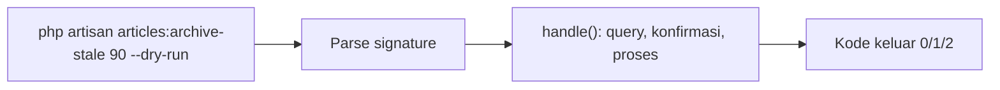

# Custom Artisan Commands

Artisan bukan hanya alat bawaan; kamu bisa menulis perintah sendiri untuk tugas operasional: impor data, pembersihan, laporan, migrasi data, atau tugas terjadwal. Perintah yang baik punya argumen/opsi jelas, keluaran informatif, kode keluar benar, dan aman dijalankan ulang.

## Tujuan Pembelajaran

- [ ] Membuat command dengan `make:command` dan mendefinisikan `$signature`.
- [ ] Memakai argumen, opsi, nilai bawaan, dan validasi input.
- [ ] Menampilkan keluaran (info, tabel, bilah kemajuan) dan meminta konfirmasi.
- [ ] Mengembalikan kode keluar (`SUCCESS`, `FAILURE`) dan menangani galat.
- [ ] Merancang command idempoten, aman, dan dapat diuji.
- [ ] Menguji command dengan `$this->artisan()`.

## Prasyarat

- [Task Scheduling](../level-07/07-11-task-scheduling.md), [Laravel Filesystem](../level-07/07-17-laravel-filesystem.md), [Clean Code](11-02-clean-code.md).

## Pengantar

Tim operasional butuh perintah "arsipkan artikel draf lebih dari 90 hari" yang bisa dicoba dulu (*dry run*) sebelum benar-benar menghapus, dan yang aman bila terpicu dua kali.

## Penjelasan Konsep

### Membuat

```bash
php artisan make:command ArchiveStaleDrafts
```

File dibuat di `app/Console/Commands`; menurut dokumentasi, command di direktori itu otomatis terdaftar.

### Contoh

File: `app/Console/Commands/ArchiveStaleDrafts.php`

```php
<?php

namespace App\Console\Commands;

use App\Models\Article;
use Illuminate\Console\Command;

class ArchiveStaleDrafts extends Command
{
    protected $signature = 'articles:archive-stale
                            {days=90 : Usia minimum draf (hari)}
                            {--dry-run : Tampilkan saja tanpa mengubah data}
                            {--limit=500 : Maksimum artikel diproses}';

    protected $description = 'Arsipkan draf yang tidak disentuh dalam N hari';

    public function handle(): int
    {
        $days = (int) $this->argument('days');
        $limit = (int) $this->option('limit');

        if ($days < 1 || $limit < 1) {
            $this->error('days dan limit harus ≥ 1');

            return self::INVALID;
        }

        $query = Article::query()
            ->whereNull('published_at')
            ->where('updated_at', '<', now()->subDays($days))
            ->orderBy('id')
            ->limit($limit);

        $total = (clone $query)->count();
        $this->info("Ditemukan {$total} draf usang.");

        if ($total === 0) {
            return self::SUCCESS;
        }

        if ($this->option('dry-run')) {
            $this->table(['id', 'judul'], $query->get(['id', 'title'])->map(fn ($a) => [$a->id, $a->title])->all());

            return self::SUCCESS;
        }

        if ($this->input->isInteractive() && ! $this->confirm("Arsipkan {$total} draf?")) {
            $this->warn('Dibatalkan.');

            return self::FAILURE;
        }

        $bar = $this->output->createProgressBar($total);
        $bar->start();

        $query->get()->each(function (Article $a) use ($bar) {
            $a->delete();               // soft delete
            $bar->advance();
        });

        $bar->finish();
        $this->newLine();
        $this->info('Selesai.');

        return self::SUCCESS;
    }
}
```

| Bagian | Fungsi |
|---|---|
| `{days=90 : ...}` | Argumen dengan nilai bawaan dan deskripsi |
| `{--dry-run}` | Opsi boolean |
| `{--limit=500}` | Opsi dengan nilai |
| `self::INVALID`, `SUCCESS`, `FAILURE` | Kode keluar standar (berguna untuk skrip dan CI) |
| `confirm()` hanya bila interaktif | Mendukung dijalankan dari cron (`--no-interaction`) |
| `limit` dan `orderBy` | Batas dampak, bekerja bertahap |
| Soft delete | Dapat dipulihkan |

Dokumentasi Artisan menjelaskan format signature (`{user}`, `{--queue}`, `{--queue=}`, array, deskripsi). Gunakan metode `$this->components` / helper `Laravel\Prompts` untuk antarmuka lebih kaya (opsional).

### Desain command yang baik

| Prinsip | Alasan |
|---|---|
| `--dry-run` untuk operasi destruktif | Aman dicoba |
| Idempoten | Dua kali jalan = sama dengan sekali |
| Batas/`limit` dan bertahap | Tidak membebani |
| Kode keluar benar | Cron/CI mendeteksi gagal |
| Logika di service, command tipis | Dapat diuji dan dipakai ulang |
| Tanpa rahasia di argumen | Argumen terlihat di daftar proses & riwayat shell |

### Menguji

```php-inline
public function test_dry_run_does_not_delete(): void
{
    Article::factory()->create(['published_at' => null, 'updated_at' => now()->subDays(120)]);

    $this->artisan('articles:archive-stale', ['--dry-run' => true])
        ->expectsOutputToContain('Ditemukan 1 draf usang')
        ->assertExitCode(0);

    $this->assertDatabaseCount('articles', 1);
}
```

`$this->artisan()` dan `expectsOutputToContain`, `expectsConfirmation`, `assertExitCode` tersedia di dokumentasi Console Tests.

### Menjadwalkan

`Schedule::command('articles:archive-stale 120 --limit=200 --no-interaction')->weekly()->onOneServer();`

### Keamanan

- Command berjalan dengan hak penuh aplikasi: jangan menerima input yang menjadi SQL/shell mentah.
- Validasi argumen/opsi; batasi jangkauan (limit).
- Hati-hati command yang membaca path berkas: validasi agar tidak keluar dari folder yang diizinkan.
- Catat siapa menjalankan operasi destruktif (log).

## Cara Kerja



## Contoh Praktik

Kamu membuat command arsip draf dengan `--dry-run`, menjalankannya, menulis uji, dan menjadwalkannya mingguan.

## Penjelasan Kode

`(clone $query)->count()` menghitung tanpa mengubah `$query` (karena `limit` ikut memengaruhi `count`, sesuaikan bila ingin total tanpa batas).

## Implementasi Langkah demi Langkah

### Langkah 1: buat command

```bash
php artisan make:command ArchiveStaleDrafts
```

### Langkah 2: isi

Salin kode dan sesuaikan nama kolom.

### Langkah 3: lihat bantuan

```bash
php artisan articles:archive-stale --help
php artisan list articles
```

### Langkah 4: dry run

```bash
php artisan articles:archive-stale 90 --dry-run
echo "kode keluar: $?"
```

### Langkah 5: jalankan sungguhan

```bash
php artisan articles:archive-stale 90 --limit=50
```

### Langkah 6: uji otomatis

Tambah uji dry-run dan uji eksekusi nyata.

### Langkah 7: jadwal dan commit

Tambahkan ke `routes/console.php`, lalu `git commit`.

## Eksekusi dan Verifikasi

| Langkah | Hasil yang diharapkan |
|---|---|
| 4 | Tabel draf; tidak ada data berubah; kode keluar 0 |
| 5 | Progress bar; draf terarsip (soft delete) |
| 6 | Uji hijau |

## Hasil yang Diharapkan

Belum dijalankan penulis; format keluaran bergantung versi.

## Kesalahan Umum dan Pemecahan Masalah

| Gejala | Penyebab | Cara mengenali | Solusi | Pencegahan |
|---|---|---|---|---|
| Command tak ditemukan | Salah signature/namespace | `list` tak memuat | Periksa lokasi | `artisan list` |
| Cron macet menunggu input | `confirm()` tanpa cek interaktif | Proses menggantung | `--no-interaction`/cek interaktif | Desain |
| Kode keluar selalu 0 | Tidak mengembalikan int | CI tak mendeteksi gagal | Kembalikan konstanta | Uji `assertExitCode` |
| Menghapus terlalu banyak | Tanpa limit/dry-run | Data hilang | `--dry-run`, soft delete | Batas dampak |
| Logika sulit diuji | Semua di `handle()` | Command gemuk | Ekstrak ke service | Command tipis |

## Latihan Praktik

### Latihan dasar

**D1. Baca signature**
- *Masalah:* memahami sintaks.
- *Persyaratan:* jelaskan `{user}`, `{--force}`, `{--queue=}`.
- *Perilaku yang diharapkan:* argumen wajib, opsi boolean, opsi bernilai.
- *Tujuan belajar:* signature.

### Latihan implementasi

**I1. Laporan CSV**
- *Masalah:* ekspor artikel per bulan.
- *Persyaratan:* command `articles:report {month}` yang memvalidasi format `YYYY-MM`, menulis CSV ke disk privat, dan mengembalikan kode keluar sesuai.
- *Perilaku yang diharapkan:* berkas tercipta; format salah ditolak.
- *Tujuan belajar:* validasi input.

### Latihan tantangan

**T1. Command aman untuk produksi**
- *Masalah:* operasi destruktif.
- *Persyaratan:* tulis daftar periksa (dry-run, limit, log audit, konfirmasi, idempoten, uji) dan terapkan pada command-mu.
- *Perilaku yang diharapkan:* command memenuhi daftar.
- *Tujuan belajar:* operasi aman.
- *Catatan:* kerjakan mandiri; tidak ada kunci jawaban.

## Uji Pemahaman

1. Apa fungsi `$signature`?
2. Mengapa kode keluar penting?
3. Mengapa `--dry-run` berguna?
4. Bagaimana menguji command?

??? success "Kunci jawaban singkat"
    1. Mendefinisikan nama, argumen, dan opsi.
    2. Skrip, cron, dan CI membaca keberhasilan/kegagalan.
    3. Melihat dampak sebelum mengubah data.
    4. `$this->artisan(...)` dengan asersi keluaran dan kode keluar.

## Ringkasan

- Command kustom mengotomasi tugas operasional dengan argumen/opsi jelas.
- Kembalikan kode keluar, sediakan dry-run, batasi dampak, dan idempoten.
- Command tipis, logika di service, dan diuji.

Selanjutnya: *Custom Middleware*.

## Referensi Resmi

- [Laravel: Artisan Console](https://laravel.com/docs/13.x/artisan)
- [Laravel: Console Tests](https://laravel.com/docs/13.x/console-tests)
