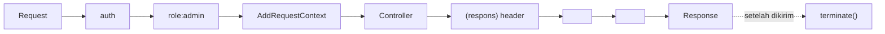

# Custom Middleware

Middleware adalah lapisan yang membungkus permintaan: autentikasi, CSRF, pembatasan laju, lokalisasi, logging. Kamu sudah memakainya; sekarang kamu merancang sendiri middleware yang bersih, dengan parameter, urutan tepat, `terminate()` untuk pekerjaan setelah respons, dan uji.

## Tujuan Pembelajaran

- [ ] Membuat middleware dengan `make:middleware` dan menulis `handle()`.
- [ ] Mendaftarkan global, grup, dan alias di `bootstrap/app.php`.
- [ ] Menambahkan parameter middleware (`role:admin,editor`).
- [ ] Memodifikasi request dan response (sebelum/sesudah `$next`).
- [ ] Memakai `terminate()` untuk pekerjaan pasca-respons.
- [ ] Mengatur urutan dan mengujinya.

## Prasyarat

- [Middleware Level 03](../level-03/index.md) dan [Pola Pipeline](11-04-design-patterns.md), RBAC (Level 05).

## Pengantar

Kamu butuh pembatasan akses berdasarkan peran, header `X-Request-Id` di semua respons, dan penandaan "mode baca-saja" saat pemeliharaan. Tiga kebutuhan lintas-fitur: tempat ideal untuk middleware.

## Penjelasan Konsep

### Membuat

```bash
php artisan make:middleware EnsureUserHasRole
```

File: `app/Http/Middleware/EnsureUserHasRole.php`

```php
<?php

namespace App\Http\Middleware;

use Closure;
use Illuminate\Http\Request;
use Symfony\Component\HttpFoundation\Response;

class EnsureUserHasRole
{
    public function handle(Request $request, Closure $next, string ...$roles): Response
    {
        $user = $request->user();

        if ($user === null) {
            abort(401);
        }

        if (! in_array($user->role->value, $roles, true)) {
            abort(403);
        }

        return $next($request);
    }
}
```

Parameter setelah `$next` berasal dari penggunaan `role:admin,editor`. Pemeriksaan `in_array` ketat (`true`).

### Mendaftarkan (Laravel 13)

Di `bootstrap/app.php`, menurut dokumentasi middleware:

```php-inline
->withMiddleware(function (Middleware $middleware): void {
    $middleware->alias([
        'role' => \App\Http\Middleware\EnsureUserHasRole::class,
    ]);

    $middleware->web(append: [\App\Http\Middleware\AddRequestContext::class]);
    $middleware->api(prepend: [\App\Http\Middleware\ForceJsonResponse::class]);
})
```

| Cara | Efek |
|---|---|
| `alias` | Nama pendek untuk route (`->middleware('role:admin')`) |
| `append/prepend` pada `web`/`api` | Menambah ke grup |
| `append`/`use` global | Berlaku untuk semua permintaan |

### Sebelum dan sesudah

```php-inline
public function handle(Request $request, Closure $next): Response
{
    // SEBELUM controller
    $request->headers->set('X-Locale', app()->getLocale());

    $response = $next($request);

    // SESUDAH controller
    $response->headers->set('X-Content-Type-Options', 'nosniff');

    return $response;
}
```

### Contoh: memaksa JSON untuk API

```php-inline
class ForceJsonResponse
{
    public function handle(Request $request, Closure $next): Response
    {
        $request->headers->set('Accept', 'application/json');

        return $next($request);
    }
}
```

Membuat galat selalu berformat JSON bagi klien yang lupa header `Accept`.

### `terminate()`

Dijalankan **setelah** respons dikirim ke klien; cocok untuk logging berat atau metrik tanpa memperlambat pengguna:

```php-inline
public function terminate(Request $request, Response $response): void
{
    logger()->info('selesai', ['path' => $request->path(), 'status' => $response->getStatusCode()]);
}
```

Catatan: instance middleware untuk `handle` dan `terminate` bisa berbeda kecuali didaftarkan sebagai singleton di container; jangan mengandalkan properti yang diisi di `handle`. Pada server tertentu (mis. PHP-FPM) `terminate` berjalan setelah `fastcgi_finish_request`.

### Urutan

Middleware berjalan berurutan ke dalam, dan kebalikannya ke luar (seperti bawang). Urutan penting: `auth` harus sebelum `role`; `throttle` sebelum pekerjaan mahal. Dokumentasi menyediakan `$middleware->priority([...])` untuk mengurutkan middleware non-global. Verifikasi dengan:

```bash
php artisan route:list -v
```

### Middleware vs alternatif

| Kebutuhan | Pilihan |
|---|---|
| Aturan lintas banyak route | Middleware |
| Otorisasi per sumber daya | Policy (bukan middleware) |
| Validasi input satu aksi | Form Request |
| Logika bisnis | Service/use case |

Middleware `role` cocok untuk gerbang kasar (halaman admin); keputusan "boleh mengubah artikel ini?" tetap di Policy.

### Keamanan

- Pemeriksaan keamanan di middleware harus **gagal tertutup** (tolak bila ragu).
- Jangan percaya header dari klien untuk keputusan keamanan (mis. `X-Role`).
- Hati-hati `terminate()` menyimpan data pribadi ke log.
- Jangan membuat middleware menelan pengecualian secara diam-diam.

## Cara Kerja



## Contoh Praktik

Kamu membuat `EnsureUserHasRole`, memasangnya pada route admin, dan menulis uji untuk tiga peran dan tamu.

## Penjelasan Kode

`string ...$roles` menerima daftar peran dari parameter route. `abort(401)` untuk tamu, `abort(403)` untuk peran salah.

## Implementasi Langkah demi Langkah

### Langkah 1: buat middleware

Jalankan `make:middleware` dan isi.

### Langkah 2: alias

Daftarkan alias `role` di `bootstrap/app.php`.

### Langkah 3: pasang di route

```php-inline
Route::middleware(['auth', 'role:admin,editor'])->prefix('admin')->group(function () {
    // ...
});
```

### Langkah 4: uji

```php-inline
public function test_author_cannot_open_admin_panel(): void
{
    $author = User::factory()->create(['role' => UserRole::Author]);

    $this->actingAs($author)->get('/admin/pengguna')->assertForbidden();
}
```

### Langkah 5: periksa urutan

`php artisan route:list -v` dan pastikan `auth` mendahului `role`.

### Langkah 6: commit

```bash
git add -A && git commit -m "Tambah middleware peran"
```

## Eksekusi dan Verifikasi

| Langkah | Hasil yang diharapkan |
|---|---|
| 4 | Penulis mendapat 403; tamu dialihkan/401 |
| 5 | Urutan `auth` lalu `role` |

## Hasil yang Diharapkan

Belum dijalankan penulis.

## Kesalahan Umum dan Pemecahan Masalah

| Gejala | Penyebab | Cara mengenali | Solusi | Pencegahan |
|---|---|---|---|---|
| `Target class [role] does not exist` | Alias belum terdaftar | Galat | Daftarkan alias | Cek `bootstrap/app.php` |
| `$request->user()` null | `role` sebelum `auth` | Error null | Urutkan `auth` dulu | `route:list -v` |
| Header tak muncul | Menambah sebelum `$next` | Respons tanpa header | Setelah `$next` | Pahami alur |
| `terminate` tak membawa status | Properti dari `handle` | Nilai kosong | Pakai argumen `terminate` | Jangan simpan status |
| Pengecualian ditelan | `try/catch` kosong | Galat hilang | Biarkan naik/log | Review |

## Latihan Praktik

### Latihan dasar

**D1. Urutan**
- *Masalah:* menentukan urutan.
- *Persyaratan:* urutkan `throttle`, `role`, `auth` untuk route admin dan jelaskan.
- *Perilaku yang diharapkan:* `throttle`, `auth`, `role`.
- *Tujuan belajar:* urutan.

### Latihan implementasi

**I1. Mode baca-saja**
- *Masalah:* saat pemeliharaan, tolak metode penulisan.
- *Persyaratan:* middleware yang mengembalikan 503 untuk non-`GET/HEAD` bila `config('app.read_only')` aktif.
- *Perilaku yang diharapkan:* `POST` ditolak, `GET` normal.
- *Tujuan belajar:* middleware gerbang.

### Latihan tantangan

**T1. Middleware atau Policy?**
- *Masalah:* tim memeriksa kepemilikan artikel di middleware.
- *Persyaratan:* jelaskan mengapa Policy lebih tepat.
- *Perilaku yang diharapkan:* alasan jelas.
- *Tujuan belajar:* memilih lapisan.
- *Catatan:* kerjakan mandiri; tidak ada kunci jawaban.

## Uji Pemahaman

1. Apa fungsi `$next($request)`?
2. Bagaimana parameter diteruskan ke middleware?
3. Kapan `terminate()` berjalan?
4. Mengapa middleware keamanan harus gagal tertutup?

??? success "Kunci jawaban singkat"
    1. Meneruskan ke lapisan berikutnya.
    2. Setelah titik dua di nama alias, dipisah koma.
    3. Setelah respons dikirim.
    4. Agar kesalahan tidak membuka akses.

## Ringkasan

- Middleware = lapisan lintas-fitur; daftarkan alias/grup di `bootstrap/app.php`.
- Perhatikan urutan, parameter, dan `terminate()`.
- Gerbang kasar di middleware, keputusan per sumber daya di Policy.

Selanjutnya: *Multi-Tenancy Concepts*.

## Referensi Resmi

- [Laravel: Middleware](https://laravel.com/docs/13.x/middleware)
