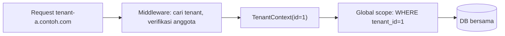

# Multi-Tenancy Concepts

Satu aplikasi melayani banyak pelanggan (*tenant*) yang datanya harus terisolasi: setiap penerbit melihat artikelnya sendiri. Sub bab ini memperkenalkan **konsep** dan pilihan desain, lalu menerapkan satu pendekatan sederhana (database tunggal, kolom `tenant_id`) dengan *global scope*. Kesalahan isolasi data adalah salah satu bug keamanan paling serius.

## Tujuan Pembelajaran

- [ ] Menjelaskan multi-tenancy dan model isolasinya.
- [ ] Membandingkan: kolom `tenant_id`, skema terpisah, database terpisah.
- [ ] Mengidentifikasi tenant dari subdomain/header/sesi.
- [ ] Menerapkan global scope dan pengisian otomatis `tenant_id`.
- [ ] Menguji isolasi dan kebocoran lintas tenant.
- [ ] Mengenali tantangan (antrean, cache, berkas, migrasi, uji).

## Prasyarat

- [Modular Architecture](11-05-modular-application-architecture.md), [Custom Middleware](11-09-custom-middleware.md), global scope Eloquent (Level 04).

## Pengantar

Penerbit A dan B memakai aplikasi yang sama. Satu query lupa filter `tenant_id`, dan A melihat artikel B. Isolasi harus **dijamin oleh desain**, bukan oleh disiplin tiap pengembang.

## Penjelasan Konsep

### Tiga model isolasi

| Model | Isolasi | Biaya/Kompleksitas | Cocok |
|---|---|---|---|
| Satu DB, kolom `tenant_id` | Logis | Terendah | Banyak tenant kecil |
| Skema/DB terpisah per tenant | Kuat | Sedang–tinggi (migrasi per tenant) | Kebutuhan isolasi/regulasi |
| Instans aplikasi terpisah | Terkuat | Tertinggi | Pelanggan besar |

Pilih berdasarkan kebutuhan isolasi, jumlah tenant, dan kapasitas operasi. Paket seperti Tenancy for Laravel atau Spatie Multitenancy ada; materi ini tidak memasangnya (dependensi tambahan) dan hanya mengajarkan konsep serta model sederhana.

### Mengidentifikasi tenant

| Sumber | Catatan |
|---|---|
| Subdomain (`penerbit-a.contoh.com`) | Umum, jelas |
| Header/token (API) | Tenant dari klaim token terpercaya, bukan header bebas |
| Sesi pengguna | Tenant pengguna login |

**Jangan** memercayai nilai tenant dari input klien tanpa memverifikasi bahwa pengguna anggota tenant itu.

### Konteks tenant

```php
final class TenantContext
{
    private ?int $id = null;

    public function set(int $id): void { $this->id = $id; }
    public function id(): int
    {
        return $this->id ?? throw new \RuntimeException('Tenant belum ditetapkan');
    }
    public function has(): bool { return $this->id !== null; }
}
```

Daftarkan sebagai `scoped` (bukan `singleton`) agar tidak bocor lintas permintaan, terutama di Octane (07.01, 09.11).

### Middleware penentu tenant

```php
public function handle(Request $request, Closure $next, TenantContext $ctx): Response
{
    $tenant = Tenant::where('subdomain', explode('.', $request->getHost())[0])->first();
    abort_if($tenant === null, 404);

    abort_unless($request->user()?->tenant_id === $tenant->id, 403);

    $ctx->set($tenant->id);

    return $next($request);
}
```

(Untuk middleware dengan dependensi injeksi, ambil dari container di constructor.) Verifikasi bahwa pengguna milik tenant itu mencegah akses lintas tenant.

### Global scope + trait

```php
trait BelongsToTenant
{
    protected static function bootBelongsToTenant(): void
    {
        static::addGlobalScope('tenant', function (\Illuminate\Database\Eloquent\Builder $q) {
            if (app(TenantContext::class)->has()) {
                $q->where($q->getModel()->getTable().'.tenant_id', app(TenantContext::class)->id());
            }
        });

        static::creating(function ($model) {
            $model->tenant_id ??= app(TenantContext::class)->id();
        });
    }
}
```

Tambahkan `use BelongsToTenant;` pada model tenant-scoped (Artikel, Komentar, Kategori). Perhatikan: scope di atas **melewatkan** filter bila tenant belum ditetapkan, yang berisiko; lebih aman gagal tertutup (lempar pengecualian) kecuali di konteks yang disengaja (CLI admin). Pertimbangkan itu sebagai keputusan desain eksplisit.

### Titik bocor yang sering terlupa

| Area | Risiko | Mitigasi |
|---|---|---|
| Query mentah / `DB::table` | Melewati global scope | Hindari/tulis filter manual, uji |
| `withoutGlobalScopes()` | Sengaja melewati | Batasi pemakaian, review |
| Cache | Kunci sama antar tenant | Awali kunci dengan tenant |
| Antrean/job | Konteks tenant hilang | Bawa `tenant_id` di job, set ulang saat dijalankan |
| Berkas | Path bersama | Folder per tenant |
| Unique constraint | `slug` unik global vs per tenant | Unik komposit `(tenant_id, slug)` |
| Log/metrik | Data lintas tenant | Sertakan tenant, jaga akses |
| Pencarian/indeks | Hasil lintas tenant | Filter tenant |
| Binding route | `{article}` menemukan milik tenant lain | Scope tetap berlaku pada route model binding |

### Uji isolasi

```php
public function test_tenant_cannot_see_other_tenants_articles(): void
{
    [$a, $b] = Tenant::factory()->count(2)->create();
    $artikelB = Article::withoutGlobalScopes()->create([...data..., 'tenant_id' => $b->id]);

    app(TenantContext::class)->set($a->id);

    $this->assertNull(Article::find($artikelB->id));
}
```

Tulis uji serupa untuk setiap model tenant dan setiap endpoint (IDOR lintas tenant).

### Migrasi data dan skala

Satu DB dengan `tenant_id` memerlukan indeks yang diawali `tenant_id`. Untuk DB per tenant, migrasi harus dijalankan untuk setiap tenant dan dipantau. Rencanakan penghapusan dan ekspor data tenant (privasi).

### Keamanan

Isolasi data tenant adalah kontrol keamanan utama: gagal tertutup, uji otomatis, audit penggunaan `withoutGlobalScopes`, dan jangan pernah memakai tenant dari input yang tak diverifikasi.

## Cara Kerja



## Contoh Praktik

Kamu menambah `tenant_id` ke artikel, trait `BelongsToTenant`, middleware penentu tenant, dan uji isolasi.

## Penjelasan Kode

`creating` mengisi `tenant_id` otomatis agar pengembang tidak lupa. Kombinasi scope + creating menjamin baca dan tulis terkunci pada tenant aktif.

## Implementasi Langkah demi Langkah

### Langkah 1: tabel tenant

Migrasi `tenants` (`id`, `name`, `subdomain` unik) dan tambah `tenant_id` + indeks ke tabel artikel, komentar, kategori.

### Langkah 2: konteks dan trait

Buat `TenantContext` (daftarkan `scoped`) dan `BelongsToTenant`.

### Langkah 3: middleware

Tentukan tenant dari subdomain dan verifikasi keanggotaan.

### Langkah 4: pasang trait

Terapkan pada model.

### Langkah 5: uji

Tulis uji isolasi baca, tulis, route-binding, dan IDOR.

### Langkah 6: audit

```bash
grep -rn "withoutGlobalScopes\|DB::table" app | head
```

Tinjau tiap temuan.

### Langkah 7: commit

```bash
git add -A && git commit -m "Tambah multi-tenancy sederhana dengan global scope"
```

## Eksekusi dan Verifikasi

| Langkah | Hasil yang diharapkan |
|---|---|
| 5 | Tenant A tidak bisa membaca/mengubah data B |
| 6 | Setiap pelewatan scope dipertanggungjawabkan |

## Hasil yang Diharapkan

Belum dijalankan penulis; ini model dasar, bukan solusi produksi lengkap.

## Kesalahan Umum dan Pemecahan Masalah

| Gejala | Penyebab | Cara mengenali | Solusi | Pencegahan |
|---|---|---|---|---|
| Data bocor antar tenant | Query melewati scope | Uji isolasi gagal | Terapkan scope/uji | Uji per endpoint |
| Job memakai tenant salah | Konteks tak dibawa | Data campur | Kirim `tenant_id`, set di job | Desain job |
| Cache campur | Kunci tanpa tenant | Data tenant lain muncul | Awali kunci | Konvensi |
| Slug bentrok | Unik global | Error duplikat | Unik `(tenant_id, slug)` | Skema |
| `scoped` tidak dipakai | Singleton bocor di Octane | Tenant tertukar | `scoped` | Audit |

## Latihan Praktik

### Latihan dasar

**D1. Pilih model**
- *Masalah:* memilih isolasi.
- *Persyaratan:* pilih model untuk (a) 5.000 tenant kecil, (b) 3 klien korporat dengan regulasi ketat.
- *Perilaku yang diharapkan:* (a) kolom `tenant_id`, (b) DB/instans terpisah.
- *Tujuan belajar:* kompromi.

### Latihan implementasi

**I1. Cache per tenant**
- *Masalah:* cache beranda bocor.
- *Persyaratan:* bungkus `Cache::remember` agar kunci otomatis berawalan tenant.
- *Perilaku yang diharapkan:* tidak ada data campur.
- *Tujuan belajar:* isolasi cache.

**I2. Job sadar tenant**
- *Masalah:* job kehilangan konteks.
- *Persyaratan:* buat trait/middleware job yang menyimpan dan memulihkan `tenant_id`.
- *Perilaku yang diharapkan:* job bekerja pada tenant benar.
- *Tujuan belajar:* konteks asinkron.

### Latihan tantangan

**T1. Ancaman lintas tenant**
- *Masalah:* audit keamanan.
- *Persyaratan:* daftar 8 titik kebocoran potensial dan uji yang menutup masing-masing.
- *Perilaku yang diharapkan:* daftar beralasan.
- *Tujuan belajar:* berpikir sebagai penyerang.
- *Catatan:* kerjakan mandiri; tidak ada kunci jawaban.

## Uji Pemahaman

1. Apa itu multi-tenancy?
2. Mengapa `scoped`, bukan `singleton`, untuk konteks tenant?
3. Apa risiko `withoutGlobalScopes`?
4. Mengapa tenant tidak boleh dari input mentah?

??? success "Kunci jawaban singkat"
    1. Satu aplikasi melayani banyak pelanggan dengan data terisolasi.
    2. Agar tidak bocor lintas permintaan.
    3. Melewati isolasi sehingga data tenant lain terlihat.
    4. Klien bisa memalsukan sehingga mengakses tenant lain.

## Ringkasan

- Pilih model isolasi sesuai kebutuhan; mulai dari `tenant_id` untuk banyak tenant kecil.
- Global scope + pengisian otomatis + verifikasi keanggotaan; gagal tertutup.
- Waspadai cache, job, berkas, query mentah, dan uji isolasi.

Selanjutnya: *Event-Driven Architecture*.

## Referensi Resmi

- [Laravel: Eloquent, Global Scopes](https://laravel.com/docs/13.x/eloquent#global-scopes)
- [Laravel: Routing, Subdomain Routing](https://laravel.com/docs/13.x/routing#route-group-subdomain-routing)
