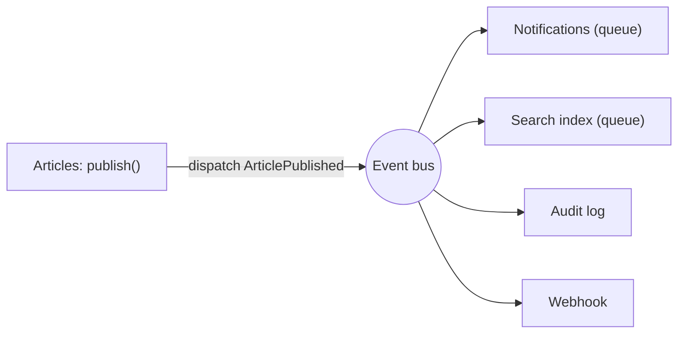

# Event-Driven Architecture

Dalam arsitektur berbasis peristiwa, komponen berkomunikasi dengan **mengumumkan fakta** ("artikel diterbitkan") alih-alih memanggil satu sama lain langsung. Penerbit tidak tahu siapa yang mendengar. Ini mengurangi kopling antar-modul dan memudahkan menambah reaksi baru, dengan harga: alur lebih sulit dilacak dan konsistensi menjadi *eventual*.

## Tujuan Pembelajaran

- [ ] Membedakan event domain, perintah (*command*), dan kueri.
- [ ] Merancang event: nama lampau, payload kecil, versi.
- [ ] Menghubungkan modul lewat event tanpa kopling langsung.
- [ ] Menangani keandalan: antrean, percobaan ulang, idempotensi, urutan.
- [ ] Memakai *outbox pattern* (konsep) untuk konsistensi dengan database.
- [ ] Mengenali kapan event-driven berlebihan.

## Prasyarat

- [Events dan Listeners](../level-07/07-08-events-and-listeners.md), [Queue Optimization](../level-09/09-09-queue-optimization.md), [Modular Architecture](11-05-modular-application-architecture.md).

## Pengantar

Saat artikel terbit: perbarui indeks pencarian, kirim notifikasi, hapus cache, catat audit, dan tembak webhook. Jika `ArticlePublisher` memanggil kelimanya, ia mengenal terlalu banyak. Dengan event, ia mengumumkan sekali.

## Penjelasan Konsep

### Event vs command vs query

| Jenis | Arti | Penerima | Contoh |
|---|---|---|---|
| Event | Sesuatu **telah terjadi** | Nol atau banyak | `ArticlePublished` |
| Command | Perintah **lakukan ini** | Tepat satu | `PublishArticle` |
| Query | Minta informasi | Satu | `GetArticle` |

Penamaan: event bentuk lampau; command imperatif.

### Merancang event

```php-inline
final class ArticlePublished
{
    public function __construct(
        public readonly int $articleId,
        public readonly int $authorId,
        public readonly string $slug,
        public readonly \DateTimeImmutable $occurredAt = new \DateTimeImmutable(),
    ) {}
}
```

| Prinsip | Alasan |
|---|---|
| Bawa ID & fakta kecil, bukan model utuh | Payload stabil & aman diserialisasi |
| `readonly` / immutable | Fakta tidak berubah |
| Sertakan `occurredAt` | Urutan & audit |
| Jangan memuat rahasia/PII berlebih | Event masuk antrean & log |
| Anggap event sebagai kontrak publik | Mengubahnya dapat merusak pendengar |

### Menghubungkan modul

Modul Articles men-*dispatch* `ArticlePublished` (kontrak publik). Modul Notifications, Search, dan Audit masing-masing memiliki listener. Penambahan modul baru tidak mengubah Articles.

### Keandalan

| Masalah | Mitigasi |
|---|---|
| Listener lambat | `ShouldQueue` (07.08–07.09) |
| Listener gagal | `#[Tries]`, `#[Backoff]`, `failed()` |
| Pengiriman ganda | Listener **idempoten** (kunci unik) |
| Event sebelum commit | `ShouldDispatchAfterCommit` / `afterCommit()` |
| Urutan tidak terjamin antar-listener | Jangan bergantung pada urutan |
| Debug sulit | Log dengan `event_id`/`correlation_id` |

### Idempotensi

```php-inline
public function handle(ArticlePublished $e): void
{
    $key = "notified:article:{$e->articleId}";

    if (! \Illuminate\Support\Facades\Cache::add($key, true, now()->plus(days: 7))) {
        return; // sudah diproses
    }

    // ... kirim notifikasi
}
```

`Cache::add` hanya menulis bila kunci belum ada (operasi atomik pada driver yang mendukung), sehingga percobaan ulang tidak menggandakan efek. Untuk jaminan lebih kuat pakai tabel dengan constraint unik.

### Outbox pattern (konsep)

Masalah: simpan ke DB berhasil, tetapi proses mati sebelum event terkirim → event hilang. Solusi: tulis event ke tabel `outbox` **dalam transaksi yang sama** dengan perubahan data; proses terpisah membaca outbox dan mengirimnya (minimal sekali, sehingga pendengar harus idempoten). Dengan antrean `database` pada DB yang sama dan `afterCommit`, Laravel sudah memberi sebagian jaminan; outbox penuh berguna saat menyiarkan ke sistem luar.

### Konsistensi eventual

Setelah `ArticlePublished`, indeks pencarian mungkin tertinggal beberapa detik. UI harus toleran (mis. "sedang diproses"). Bila butuh konsistensi kuat, gunakan transaksi sinkron untuk bagian itu.

### Kapan berlebihan?

| Layak | Berlebihan |
|---|---|
| Banyak reaksi independen | Satu pemanggil, satu penerima, selalu |
| Modul harus terpisah | Alur wajib berurutan yang harus gagal bersama |
| Reaksi boleh tertunda | Perlu hasil langsung untuk melanjutkan |

Alur yang **harus** berhasil bersama sebaiknya satu transaksi/use case, bukan rantai event.

### Keamanan

- Pendengar harus memverifikasi data (jangan percaya payload dari sumber luar).
- Jangan memuat rahasia di payload.
- Event yang disiarkan ke luar (webhook/broadcast) harus ditandatangani dan dibatasi (07.19).

## Cara Kerja



## Contoh Praktik

Kamu mendefinisikan `ArticlePublished` sebagai kontrak publik, menambah dua listener di modul berbeda dengan idempotensi, dan menguji dengan `Event::fake`.

## Penjelasan Kode

Uji:

```php-inline
Event::fake([ArticlePublished::class]);

app(PublishArticle::class)($article->id);

Event::assertDispatched(ArticlePublished::class, fn ($e) => $e->articleId === $article->id);
```

## Implementasi Langkah demi Langkah

### Langkah 1: tentukan event

Buat `ArticlePublished` di `Articles/Contracts/Events`.

### Langkah 2: dispatch setelah commit

Implementasikan `ShouldDispatchAfterCommit` atau dispatch setelah transaksi.

### Langkah 3: listener

Buat listener `ShouldQueue` di Notifications dan Search dengan idempotensi.

### Langkah 4: uji

Uji dispatch, uji idempotensi (listener dua kali, efek sekali).

### Langkah 5: jalankan

```bash
php artisan event:list
php artisan queue:work --once
```

### Langkah 6: commit

```bash
git add -A && git commit -m "Hubungkan modul lewat event ArticlePublished"
```

## Eksekusi dan Verifikasi

| Langkah | Hasil yang diharapkan |
|---|---|
| 4 | Efek hanya sekali meski listener berjalan dua kali |
| 5 | Listener terdaftar; job diproses |

## Hasil yang Diharapkan

Belum dijalankan penulis.

## Kesalahan Umum dan Pemecahan Masalah

| Gejala | Penyebab | Cara mengenali | Solusi | Pencegahan |
|---|---|---|---|---|
| Efek ganda | Listener tak idempoten | Email dua kali | Kunci unik | Desain idempoten |
| Event hilang | Proses mati sebelum kirim | Efek tak terjadi | Outbox / afterCommit | Rancang keandalan |
| Listener membaca data lama | Dispatch sebelum commit | Data belum ada | After commit | Aturan |
| Alur tak terlacak | Tanpa korelasi | Sulit debug | `correlation_id` di log | Konvensi |
| Event diubah merusak pendengar | Kontrak tak versi | Listener error | Tambah field, jangan ubah | Versi event |

## Latihan Praktik

### Latihan dasar

**D1. Event atau command?**
- *Masalah:* klasifikasi.
- *Persyaratan:* klasifikasikan `PublishArticle`, `ArticlePublished`, `GetArticle`.
- *Perilaku yang diharapkan:* command, event, query.
- *Tujuan belajar:* jenis pesan.

### Latihan implementasi

**I1. Listener idempoten**
- *Masalah:* retry menggandakan email.
- *Persyaratan:* gunakan tabel `processed_events` dengan unik `(event_id, listener)`.
- *Perilaku yang diharapkan:* efek sekali.
- *Tujuan belajar:* idempotensi kuat.

### Latihan tantangan

**T1. Outbox**
- *Masalah:* ingin menjamin event terkirim.
- *Persyaratan:* rancang tabel outbox, transaksi, pengirim, dan penanganan duplikat.
- *Perilaku yang diharapkan:* rancangan benar.
- *Tujuan belajar:* keandalan pesan.
- *Catatan:* kerjakan mandiri; tidak ada kunci jawaban.

## Uji Pemahaman

1. Mengapa event bentuk lampau?
2. Mengapa listener harus idempoten?
3. Apa itu konsistensi eventual?
4. Kapan event berlebihan?

??? success "Kunci jawaban singkat"
    1. Menyatakan fakta yang sudah terjadi.
    2. Pengiriman ulang/ganda mungkin terjadi.
    3. Data akhirnya konsisten setelah jeda.
    4. Alur wajib berurutan dengan satu penerima.

## Ringkasan

- Event mengumumkan fakta; modul bereaksi tanpa kopling langsung.
- Rancang event kecil dan stabil; listener antre dan idempoten; dispatch setelah commit.
- Waspadai konsistensi eventual dan gunakan outbox bila perlu.

Selanjutnya: *Microservices Fundamentals*.

## Referensi Resmi

- [Laravel: Events](https://laravel.com/docs/13.x/events)
- [Laravel: Queues](https://laravel.com/docs/13.x/queues)
- [microservices.io: Transactional Outbox](https://microservices.io/patterns/data/transactional-outbox.html)
