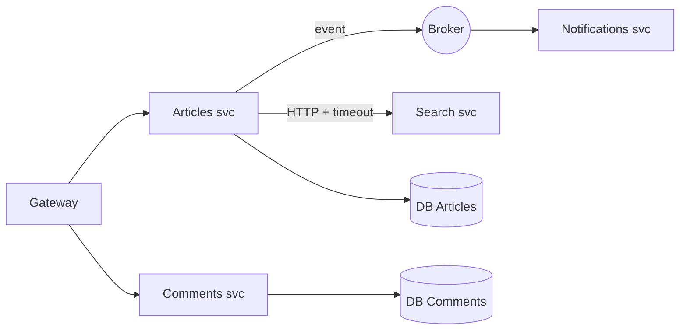

# Microservices Fundamentals

*Microservices* memecah sistem menjadi layanan kecil yang di-deploy dan diskalakan sendiri-sendiri, masing-masing memiliki datanya. Sub bab ini menjelaskan konsep dengan jujur tentang **biaya**-nya, kapan layak, dan alternatifnya. Materi ini tidak memintamu membangun microservices; tujuannya agar kamu dapat menilai dan berkomunikasi tentangnya.

## Tujuan Pembelajaran

- [ ] Menjelaskan ciri microservices dan perbedaannya dengan monolit modular.
- [ ] Menyebutkan manfaat dan biaya (jaringan, data, operasi).
- [ ] Menjelaskan komunikasi sinkron (HTTP) vs asinkron (antrean/event).
- [ ] Memahami data per layanan dan konsistensi (saga, eventual).
- [ ] Mengenali pola ketahanan (timeout, retry, circuit breaker).
- [ ] Memutuskan kapan memecah dan kapan tidak.

## Prasyarat

- [Event-Driven Architecture](11-11-event-driven-architecture.md), [Modular Architecture](11-05-modular-application-architecture.md), [Application Scalability](../level-09/09-13-application-scalability.md).

## Pengantar

Tim mengusulkan memecah `cms-artikel` menjadi layanan Artikel, Komentar, Notifikasi, dan Pencarian "agar skalabel". Pertanyaan yang tepat: masalah apa yang sekarang tidak bisa diselesaikan oleh monolit modular?

## Penjelasan Konsep

### Ciri

| Ciri | Arti |
|---|---|
| Dideploy mandiri | Rilis satu layanan tanpa yang lain |
| Memiliki datanya | Tidak ada tabel bersama antar layanan |
| Dibangun di sekitar kemampuan bisnis | Selaras dengan bounded context (11.06) |
| Berkomunikasi lewat jaringan | HTTP/gRPC/pesan |
| Tim kecil mandiri | Kepemilikan jelas |

### Monolit modular vs microservices

| Aspek | Monolit modular | Microservices |
|---|---|---|
| Deploy | Satu | Banyak |
| Panggilan antar-bagian | Dalam proses (cepat, andal) | Jaringan (lambat, bisa gagal) |
| Transaksi | ACID tunggal | Terdistribusi (saga/eventual) |
| Debug | Satu log/trace | Tracing terdistribusi |
| Operasi | Sederhana | Kompleks (orkestrasi, observabilitas) |
| Skala tim | Menengah | Besar |

### Biaya yang sering diremehkan

- **Kegagalan parsial**: layanan lain bisa lambat atau mati kapan saja.
- **Konsistensi data**: tidak ada JOIN lintas layanan; data diduplikasi atau dikomposisi.
- **Versi kontrak**: perubahan API harus kompatibel (06.19).
- **Observabilitas**: log/metrik/trace terpusat wajib.
- **Pengujian**: uji integrasi/kontrak lebih rumit.
- **Keamanan**: lebih banyak titik masuk; autentikasi antar-layanan.

### Komunikasi

| Gaya | Kelebihan | Kekurangan |
|---|---|---|
| Sinkron (HTTP/gRPC) | Sederhana, jawaban langsung | Kopling waktu, rantai kegagalan |
| Asinkron (antrean/event) | Longgar, tahan gangguan | Eventual, lebih rumit |

### Menjaga ketahanan klien HTTP

Laravel menyediakan klien HTTP dengan timeout dan retry:

```php
use Illuminate\Support\Facades\Http;

$respons = Http::timeout(3)
    ->retry(2, 200, throw: false)
    ->withToken(config('services.search.token'))
    ->get(config('services.search.url').'/query', ['q' => $kata]);

if ($respons->failed()) {
    return $this->fallback($kata);   // degradasi anggun
}
```

| Pola | Tujuan |
|---|---|
| Timeout | Jangan menunggu selamanya |
| Retry dengan jeda | Pulih dari gangguan singkat (hanya untuk operasi idempoten!) |
| Circuit breaker | Berhenti memanggil layanan yang gagal sementara |
| Fallback | Tampilan degradasi saat layanan mati |
| Bulkhead | Batasi sumber daya per layanan |

Retry pada operasi non-idempoten (mis. membuat pembayaran) dapat menggandakan efek.

### Data dan saga

Pemesanan lintas layanan tidak dapat satu transaksi. **Saga**: rangkaian langkah lokal dengan langkah kompensasi bila gagal (batalkan pesanan bila pembayaran gagal). Konsistensi bersifat eventual.

### Menuju microservices secara bertahap

1. Monolit modular dengan batas tegas (11.05).
2. Pisahkan kebutuhan skala/teknologi yang jelas (mis. pencarian).
3. Ekstrak satu layanan dengan kontrak stabil; pertahankan fallback.
4. Evaluasi sebelum memecah berikutnya.

### Kapan tidak?

Tim kecil, domain belum stabil, tidak ada kebutuhan skala berbeda, kapasitas operasi terbatas. "Distributed monolith" (layanan yang saling bergantung ketat) menggabungkan kerugian kedua dunia.

### Keamanan

- Autentikasi antar-layanan (token layanan, mTLS), bukan kepercayaan jaringan.
- Prinsip hak terkecil per layanan; rahasia per layanan.
- Validasi data dari layanan lain (jangan percaya buta).
- Jaringan privat; batasi eksposur publik lewat gateway (11.14).

## Cara Kerja



## Contoh Praktik

Kamu **tidak membangun** microservices; kamu menulis dokumen keputusan: apakah `cms-artikel` perlu memecah modul Pencarian, dengan kriteria, biaya, dan rencana bertahap.

## Penjelasan Kode

Contoh klien HTTP di atas adalah titik integrasi ke layanan pencarian hipotetis, dengan timeout, retry, dan fallback.

## Implementasi Langkah demi Langkah

### Langkah 1: masalah nyata

Tulis masalah yang monolit modular tak bisa selesaikan (data, bukan opini).

### Langkah 2: opsi

Bandingkan: tetap modular, pisahkan hanya Pencarian, pisahkan semua.

### Langkah 3: biaya

Daftar biaya operasi, uji, keamanan, dan tim.

### Langkah 4: kontrak & ketahanan

Rancang API layanan, timeout, retry (hanya idempoten), fallback.

### Langkah 5: ADR

Tulis `docs/adr/0005-pencarian-layanan-terpisah.md`.

### Langkah 6: commit

```bash
git add docs/adr && git commit -m "Tambah ADR layanan pencarian"
```

## Eksekusi dan Verifikasi

| Langkah | Hasil yang diharapkan |
|---|---|
| 5 | ADR dengan keputusan, alasan, dan kriteria tinjau ulang |

## Hasil yang Diharapkan

Berupa dokumen keputusan; tidak ada kode jaringan dijalankan.

## Kesalahan Umum dan Pemecahan Masalah

| Gejala | Penyebab | Cara mengenali | Solusi | Pencegahan |
|---|---|---|---|---|
| Distributed monolith | Layanan saling bergantung ketat | Rilis harus serempak | Perbaiki batas atau gabung | Batas domain |
| Cascading failure | Tanpa timeout/fallback | Satu layanan jatuh, semua jatuh | Timeout, breaker, fallback | Pola ketahanan |
| Retry menggandakan efek | Operasi non-idempoten | Duplikasi | Kunci idempotensi | Hanya retry idempoten |
| Data tak konsisten | Duplikasi tanpa strategi | Perbedaan data | Event/saga | Rancang konsistensi |
| Tak bisa debug | Tanpa tracing | Log terpisah | Correlation ID | Observabilitas |

## Latihan Praktik

### Latihan dasar

**D1. Kapan memecah?**
- *Masalah:* menilai.
- *Persyaratan:* nilai: tim 3 orang, domain berubah cepat; vs tim 40 orang dengan beban pencarian 50× lipat.
- *Perilaku yang diharapkan:* jangan; pertimbangkan pemisahan pencarian.
- *Tujuan belajar:* keputusan berbasis konteks.

### Latihan implementasi

**I1. Klien tangguh**
- *Masalah:* layanan eksternal lambat.
- *Persyaratan:* bungkus panggilan dengan timeout, retry terbatas, dan fallback; uji dengan `Http::fake()` memicu timeout/500.
- *Perilaku yang diharapkan:* aplikasi tetap merespons.
- *Tujuan belajar:* ketahanan.

### Latihan tantangan

**T1. Rancang saga**
- *Masalah:* pemesanan melibatkan Stok, Pembayaran, Pengiriman.
- *Persyaratan:* gambar saga dengan langkah kompensasi dan penanganan kegagalan.
- *Perilaku yang diharapkan:* alur lengkap.
- *Tujuan belajar:* transaksi terdistribusi.
- *Catatan:* kerjakan mandiri; tidak ada kunci jawaban.

## Uji Pemahaman

1. Apa ciri utama microservices?
2. Mengapa retry berbahaya pada operasi non-idempoten?
3. Apa itu saga?
4. Apa itu distributed monolith?

??? success "Kunci jawaban singkat"
    1. Dideploy mandiri dan memiliki datanya sendiri.
    2. Efek dapat terjadi berulang.
    3. Rangkaian transaksi lokal dengan kompensasi.
    4. Layanan terpisah tetapi terikat ketat sehingga rilis serempak.

## Ringkasan

- Microservices menukar kesederhanaan dengan otonomi; biayanya besar.
- Butuh ketahanan (timeout, retry, fallback), observabilitas, dan strategi data.
- Mulai dari monolit modular; pecah hanya bila ada alasan terukur.

Selanjutnya: *Integration with External Services*.

## Referensi Resmi

- [Laravel: HTTP Client](https://laravel.com/docs/13.x/http-client)
- [microservices.io](https://microservices.io/)
