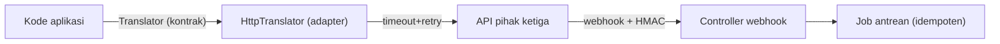

# Integration with External Services

Aplikasi nyata bergantung pada layanan luar: pembayaran, email, penyimpanan, pencarian, peta, SSO. Layanan itu bisa lambat, berubah, atau mati, dan datanya tidak kamu kontrol. Sub bab ini mengajarkan pola integrasi yang tangguh dan aman: adapter di belakang kontrak, klien HTTP Laravel, kredensial, webhook bertanda tangan, dan pengujian dengan fake.

## Tujuan Pembelajaran

- [ ] Membungkus layanan luar di belakang kontrak (adapter/anti-corruption layer).
- [ ] Memakai klien HTTP Laravel (`Http`) dengan timeout, retry, dan penanganan galat.
- [ ] Menyimpan kredensial di konfigurasi (`config/services.php`), bukan kode.
- [ ] Menerima webhook dengan verifikasi tanda tangan dan idempotensi.
- [ ] Menguji dengan `Http::fake()` dan mencegah panggilan nyata.
- [ ] Menangani kuota, pembatasan laju, dan perubahan API.

## Prasyarat

- [Microservices Fundamentals](11-12-microservices-fundamentals.md), [Contracts](../level-07/07-04-contracts-and-interfaces.md), [Mocking](../level-08/08-11-mocking.md).

## Pengantar

Fitur "terjemahan otomatis" memanggil API pihak ketiga dari lima tempat dengan format respons mereka. Saat penyedia mengubah format, lima tempat rusak. Adapter memusatkan ketergantungan itu.

## Penjelasan Konsep

### Adapter di belakang kontrak

```php-inline
interface Translator
{
    public function translate(string $text, string $to): string;
}
```

File: `app/Integrations/Translation/HttpTranslator.php`

```php
<?php

namespace App\Integrations\Translation;

use App\Contracts\Translator;
use Illuminate\Http\Client\ConnectionException;
use Illuminate\Support\Facades\Http;

final class HttpTranslator implements Translator
{
    public function translate(string $text, string $to): string
    {
        try {
            $respons = Http::baseUrl(config('services.translator.url'))
                ->withToken(config('services.translator.token'))
                ->timeout(5)
                ->retry(2, 200, throw: false)
                ->post('/v1/translate', ['q' => $text, 'target' => $to]);
        } catch (ConnectionException $e) {
            throw new TranslationUnavailable('Layanan tidak terjangkau', previous: $e);
        }

        if ($respons->failed()) {
            throw new TranslationUnavailable("Status {$respons->status()}");
        }

        return (string) $respons->json('data.translation');
    }
}
```

Format respons penyedia hanya diketahui di sini (`data.translation`). Aplikasi lain hanya mengenal `Translator` dan `TranslationUnavailable`.

### Kredensial

File: `config/services.php`

```php-inline
'translator' => [
    'url' => env('TRANSLATOR_URL'),
    'token' => env('TRANSLATOR_TOKEN'),
],
```

Nilai di `.env` (tidak di Git). Gunakan `config()` di kode (10.07). Pisahkan kunci per lingkungan (sandbox vs produksi) dan hak terkecil.

### Ketahanan

Timeout, retry untuk operasi idempoten, degradasi anggun (11.12). Untuk tugas non-kritis, panggil layanan **dari job antrean** agar kegagalan tidak memengaruhi permintaan pengguna dan bisa diulang.

### Kuota dan laju

API pihak ketiga membatasi permintaan. Gunakan job middleware `RateLimited` (09.09) atau cache hasil (09.07) agar hemat kuota. Hormati header `Retry-After` pada 429.

### Webhook masuk

Layanan luar memanggil aplikasimu. Prinsip:

1. **Verifikasi tanda tangan** (HMAC) dengan rahasia bersama.
2. Bandingkan dengan `hash_equals` (tahan serangan waktu).
3. Tolak permintaan yang terlalu lama (anti-replay, cek timestamp).
4. Respons cepat (2xx), proses lewat antrean.
5. Idempoten (penyedia dapat mengirim ulang).

```php-inline
public function handle(Request $request)
{
    $payload = $request->getContent();
    $signature = $request->header('X-Signature', '');
    $expected = hash_hmac('sha256', $payload, config('services.translator.webhook_secret'));

    abort_unless(hash_equals($expected, $signature), 403);

    ProcessTranslationWebhook::dispatch($request->json()->all());

    return response()->noContent();
}
```

Route webhook dikecualikan dari verifikasi CSRF (permintaan server-ke-server) hanya setelah memastikan tanda tangan diverifikasi; jangan mengecualikan route lain.

### Pengujian

```php-inline
Http::fake([
    'translator.test/*' => Http::response(['data' => ['translation' => 'Hello']], 200),
]);
Http::preventStrayRequests();

$this->assertSame('Hello', app(Translator::class)->translate('Halo', 'en'));

Http::assertSent(fn ($r) => $r['target'] === 'en');
```

Uji juga 500, 429, dan timeout (`Http::fake` dengan respons gagal / `Http::failedConnection()` bila tersedia di versimu; periksa dokumentasi HTTP Client) untuk memastikan fallback bekerja. Jangan menguji layanan nyata di suite otomatis.

### Perubahan dan kontrak

Pantau pengumuman perubahan API; sematkan versi API bila disediakan; simpan contoh respons nyata sebagai fixture uji. Adapter membuat migrasi ke penyedia lain murah.

### Keamanan

- Kunci API tidak pernah di kode/klien/log.
- Jangan mengirim data pribadi berlebih ke pihak ketiga; periksa kebijakan privasi/regulasi.
- Verifikasi sertifikat TLS (jangan `withoutVerifying()` di produksi).
- Validasi dan bersihkan data yang diterima dari layanan luar (jangan percaya buta, hindari XSS/SQL injection dari data luar).
- Batasi URL tujuan jika berasal dari input pengguna (SSRF).

## Cara Kerja



## Contoh Praktik

Kamu membuat kontrak `Translator`, adapter HTTP, konfigurasi `services`, endpoint webhook bertanda tangan, dan uji dengan `Http::fake`.

## Penjelasan Kode

`config('services.translator.token')` dibaca saat runtime; `Http::baseUrl()` menyatukan URL dasar. `TranslationUnavailable` adalah pengecualian domain yang tidak membocorkan detail penyedia.

## Implementasi Langkah demi Langkah

### Langkah 1: kontrak dan pengecualian

Buat `Translator` dan `TranslationUnavailable`.

### Langkah 2: adapter

Buat `HttpTranslator`; ikat di provider.

### Langkah 3: konfigurasi

Tambah `services.translator` dan variabel `.env` (nilai uji).

### Langkah 4: uji

Uji sukses, 500, dan timeout dengan `Http::fake`.

### Langkah 5: webhook

Buat controller webhook, verifikasi HMAC, dispatch job; uji tanda tangan benar dan salah.

### Langkah 6: pakai dari job

Panggil penerjemahan dari job antrean dengan `RateLimited`.

### Langkah 7: commit

```bash
git add -A && git commit -m "Tambah adapter penerjemah dan webhook bertanda tangan"
```

## Eksekusi dan Verifikasi

| Langkah | Hasil yang diharapkan |
|---|---|
| 4 | Uji lulus tanpa panggilan nyata |
| 5 | Tanda tangan salah → 403 |

## Hasil yang Diharapkan

Belum dijalankan penulis; layanan `translator` bersifat hipotetis.

## Kesalahan Umum dan Pemecahan Masalah

| Gejala | Penyebab | Cara mengenali | Solusi | Pencegahan |
|---|---|---|---|---|
| Aplikasi hang | Tanpa timeout | Permintaan menggantung | `timeout()` | Standar klien |
| Webhook palsu diterima | Tanpa verifikasi | Data aneh | HMAC + `hash_equals` | Verifikasi wajib |
| Kuota habis | Tanpa cache/limit | 429 | Cache, rate limit | Pantau penggunaan |
| Uji memanggil jaringan | Tanpa fake | Uji lambat/gagal | `Http::fake`, `preventStrayRequests` | Setup uji |
| 419 pada webhook | CSRF aktif | Penyedia gagal | Kecualikan route (setelah HMAC) | Konfigurasi |
| Kunci bocor di log | Mencatat request | Rahasia di log | Saring | Review |

## Latihan Praktik

### Latihan dasar

**D1. Mengapa adapter?**
- *Masalah:* menjelaskan.
- *Persyaratan:* tulis dua manfaat membungkus layanan luar.
- *Perilaku yang diharapkan:* isolasi perubahan, mudah diuji/diganti.
- *Tujuan belajar:* nilai adapter.

### Latihan implementasi

**I1. Anti-replay**
- *Masalah:* webhook bisa diputar ulang.
- *Persyaratan:* tambahkan pemeriksaan timestamp (toleransi 5 menit) dan penyimpanan `event_id` untuk idempotensi.
- *Perilaku yang diharapkan:* duplikat/kedaluwarsa ditolak.
- *Tujuan belajar:* webhook aman.

**I2. Fallback**
- *Masalah:* layanan mati.
- *Persyaratan:* saat `TranslationUnavailable`, tampilkan teks asli dan catat peringatan; uji.
- *Perilaku yang diharapkan:* halaman tetap tampil.
- *Tujuan belajar:* degradasi anggun.

### Latihan tantangan

**T1. Ganti penyedia**
- *Masalah:* penyedia naik harga.
- *Persyaratan:* tulis adapter kedua dan strategi migrasi bertahap (feature flag, perbandingan, rollback).
- *Perilaku yang diharapkan:* rencana aman.
- *Tujuan belajar:* keuntungan abstraksi.
- *Catatan:* kerjakan mandiri; tidak ada kunci jawaban.

## Uji Pemahaman

1. Apa fungsi adapter?
2. Mengapa `hash_equals`?
3. Mengapa webhook diproses lewat antrean?
4. Apa risiko SSRF?

??? success "Kunci jawaban singkat"
    1. Mengisolasi ketergantungan pada layanan luar di belakang kontrak.
    2. Perbandingan tahan serangan waktu.
    3. Merespons cepat dan memproses tanpa batas waktu penyedia.
    4. Server dipaksa memanggil URL internal/berbahaya dari input pengguna.

## Ringkasan

- Bungkus layanan luar dengan adapter dan kontrak; kredensial dari konfigurasi.
- Timeout, retry (idempoten), fallback, dan job antrean untuk ketahanan.
- Webhook: HMAC, anti-replay, idempoten; uji dengan fake.

Selanjutnya: *API Gateway Concepts*.

## Referensi Resmi

- [Laravel: HTTP Client](https://laravel.com/docs/13.x/http-client)
- [Laravel: Configuration](https://laravel.com/docs/13.x/configuration)
- [OWASP: SSRF](https://owasp.org/www-community/attacks/Server_Side_Request_Forgery)
