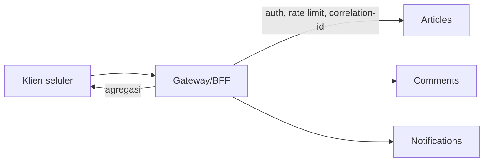

# API Gateway Concepts

*API gateway* adalah pintu masuk tunggal ke sekumpulan layanan: ia mengarahkan permintaan, menegakkan autentikasi dan pembatasan laju, mengubah protokol, dan mengagregasi respons. Sub bab ini membahas konsep, fungsi, pola (Gateway, BFF), kompromi, dan bagaimana aplikasi Laravel berperan sebagai gateway sederhana atau berada di belakang gateway.

## Tujuan Pembelajaran

- [ ] Menjelaskan fungsi gateway: routing, autentikasi, rate limiting, agregasi, observabilitas.
- [ ] Membedakan gateway, reverse proxy, dan load balancer.
- [ ] Menjelaskan pola Backend-for-Frontend (BFF).
- [ ] Merancang kebijakan lintas-fitur yang dipusatkan di gateway.
- [ ] Menerapkan agregasi sederhana di Laravel dengan klien HTTP bertimeout.
- [ ] Menilai risiko (titik kegagalan tunggal, logika bisnis bocor ke gateway).

## Prasyarat

- [Microservices Fundamentals](11-12-microservices-fundamentals.md), [Integration with External Services](11-13-integration-with-external-services.md), [API Rate Limiting](../level-06/06-18-api-rate-limiting.md).

## Pengantar

Aplikasi seluler memanggil lima layanan untuk satu layar beranda: lima koneksi, lima token, lima format. Gateway menyajikan satu endpoint `/home` yang mengurus sisanya.

## Penjelasan Konsep

### Fungsi

| Fungsi | Penjelasan |
|---|---|
| Routing | `/articles/*` → layanan Articles |
| Autentikasi | Memverifikasi token sekali di tepi |
| Otorisasi kasar | Menolak akses jelas tak berhak |
| Rate limiting & kuota | Melindungi layanan belakang |
| Terminasi TLS | HTTPS di tepi |
| Transformasi & agregasi | Menyatukan beberapa panggilan |
| Caching | Respons publik |
| Observabilitas | Log, metrik, ID korelasi |
| Versi | Memetakan `v1`/`v2` ke layanan |

### Istilah terkait

| | Fokus |
|---|---|
| Reverse proxy (Nginx) | Meneruskan permintaan, TLS, cache |
| Load balancer | Membagi beban antar-instans sama |
| API gateway | Reverse proxy + kebijakan API (autentikasi, laju, agregasi) |

Dalam praktik, Nginx sudah memenuhi sebagian fungsi (10.04). Gateway khusus (Kong, Traefik, layanan awan) menambah fitur API; ia dependensi operasional baru.

### Backend-for-Frontend (BFF)

Gateway terpisah per jenis klien (web, seluler) yang membentuk respons sesuai kebutuhan masing-masing, menghindari satu API "serba bisa" yang memboroskan data.

### Agregasi di Laravel

Laravel dapat menjadi BFF kecil dengan klien HTTP paralel:

```php-inline
use Illuminate\Http\Client\Pool;
use Illuminate\Support\Facades\Http;

$hasil = Http::pool(fn (Pool $pool) => [
    $pool->as('artikel')->timeout(2)->get(config('services.articles.url').'/latest'),
    $pool->as('populer')->timeout(2)->get(config('services.articles.url').'/popular'),
    $pool->as('notif')->timeout(2)->withToken($token)->get(config('services.notifications.url').'/unread'),
]);

return [
    'terbaru' => $hasil['artikel']->successful() ? $hasil['artikel']->json('data') : [],
    'populer' => $hasil['populer']->successful() ? $hasil['populer']->json('data') : [],
    'notifikasi' => $hasil['notif']->successful() ? $hasil['notif']->json('data') : null,
];
```

`Http::pool` mengirim permintaan serentak (total waktu ≈ yang terlama, bukan jumlah). Setiap bagian punya timeout dan fallback agar satu layanan lambat tidak menggagalkan seluruh halaman (degradasi anggun). Nilai `$hasil[...]` dapat berupa `ConnectionException` pada kegagalan koneksi pada versi tertentu; periksa dokumentasi HTTP Client dan tangani kasusnya sebelum memanggil `->successful()`.

### Autentikasi di tepi

Pola: gateway memverifikasi token pengguna lalu meneruskan identitas ke layanan lewat token internal atau header terpercaya (dengan jaringan privat/mTLS). Layanan belakang **tidak boleh** dapat diakses langsung dari internet; bila bisa, header identitas dapat dipalsukan.

### Kebijakan terpusat

| Kebijakan | Contoh |
|---|---|
| Rate limit per klien | 60 req/menit per token |
| Batas ukuran body | 1 MB |
| CORS | Asal yang diizinkan |
| Header keamanan | HSTS, nosniff |
| Correlation ID | Dibuat di gateway, diteruskan ke semua layanan |

### Risiko

| Risiko | Mitigasi |
|---|---|
| Gateway = SPOF | Replika, health check |
| Logika bisnis menumpuk di gateway | Gateway hanya lintas-fitur, bukan aturan domain |
| Latensi tambahan | Cache, agregasi paralel |
| Konfigurasi rumit | IaC, review, uji |
| Ketergantungan vendor | Standar terbuka, adapter |

### Keamanan

- Layanan belakang hanya menerima lalu lintas dari gateway (jaringan privat, firewall).
- Validasi di setiap lapisan (pertahanan berlapis), bukan hanya di gateway.
- Jangan meneruskan header klien sensitif (`Authorization` pengguna) ke layanan yang tak membutuhkannya.
- Batasi dan bersihkan header yang diteruskan (`X-Forwarded-*`, identitas).

## Cara Kerja



## Contoh Praktik

Kamu merancang endpoint BFF `/api/home` di Laravel yang mengagregasi tiga sumber (modul/layanan hipotetis) dengan timeout dan fallback, serta kebijakan rate limit dan correlation ID.

## Penjelasan Kode

Contoh `Http::pool` di atas. Untuk modul dalam proses (monolit modular), agregasi dilakukan lewat kontrak modul, bukan HTTP; pola yang sama, tanpa jaringan.

## Implementasi Langkah demi Langkah

### Langkah 1: daftar kebutuhan klien

Tulis layar seluler "beranda" dan data yang dibutuhkannya.

### Langkah 2: rancang endpoint BFF

Respons ringkas hanya field yang dipakai.

### Langkah 3: agregasi

Implementasikan dengan kontrak modul (atau `Http::pool` bila layanan terpisah).

### Langkah 4: ketahanan

Timeout per sumber, fallback bagian, dan uji kegagalan satu sumber dengan fake.

### Langkah 5: kebijakan

Tambah `throttle:api`, correlation ID (middleware `AddRequestContext`), dan header keamanan.

### Langkah 6: dokumentasikan

Tambahkan ke `openapi.yaml` dan ADR gateway.

### Langkah 7: commit

```bash
git add -A && git commit -m "Tambah endpoint BFF beranda dengan agregasi tangguh"
```

## Eksekusi dan Verifikasi

| Langkah | Hasil yang diharapkan |
|---|---|
| 4 | Satu sumber gagal → bagian itu kosong, halaman tetap 200 |
| 5 | Header korelasi ada; laju dibatasi |

## Hasil yang Diharapkan

Belum dijalankan penulis.

## Kesalahan Umum dan Pemecahan Masalah

| Gejala | Penyebab | Cara mengenali | Solusi | Pencegahan |
|---|---|---|---|---|
| Satu layanan lambat memperlambat semua | Tanpa timeout/paralel | Latensi tinggi | `Http::pool` + timeout | Standar klien |
| Layanan belakang terbuka publik | Firewall longgar | Akses langsung berhasil | Jaringan privat | Audit port |
| Header identitas dipalsukan | Layanan percaya header dari luar | Akses tak berhak | Hanya dari gateway, token internal | Desain tepercaya |
| Logika bisnis di gateway | Pintas | Gateway membengkak | Pindah ke layanan | Aturan peran |
| Gateway jatuh = semua jatuh | SPOF | Mati total | Replika | Ketersediaan tinggi |

## Latihan Praktik

### Latihan dasar

**D1. Gateway atau proxy?**
- *Masalah:* klasifikasi.
- *Persyaratan:* tentukan: (a) Nginx meneruskan ke FPM, (b) komponen yang memverifikasi JWT dan membatasi laju per klien.
- *Perilaku yang diharapkan:* (a) reverse proxy, (b) gateway.
- *Tujuan belajar:* membedakan.

### Latihan implementasi

**I1. Correlation ID**
- *Masalah:* sulit melacak permintaan.
- *Persyaratan:* middleware yang membuat/meneruskan `X-Correlation-Id` ke klien HTTP keluar dan log.
- *Perilaku yang diharapkan:* ID sama lintas layanan.
- *Tujuan belajar:* observabilitas.

### Latihan tantangan

**T1. BFF atau satu API?**
- *Masalah:* web dan seluler butuh data berbeda.
- *Persyaratan:* bandingkan satu API vs BFF per klien (biaya, duplikasi, kecepatan tim).
- *Perilaku yang diharapkan:* rekomendasi beralasan.
- *Tujuan belajar:* keputusan arsitektur.
- *Catatan:* kerjakan mandiri; tidak ada kunci jawaban.

## Uji Pemahaman

1. Apa fungsi API gateway?
2. Apa itu BFF?
3. Mengapa layanan belakang tak boleh terbuka publik?
4. Mengapa tidak menaruh logika bisnis di gateway?

??? success "Kunci jawaban singkat"
    1. Pintu masuk tunggal: routing, autentikasi, laju, agregasi.
    2. Gateway per jenis klien yang membentuk respons sesuai kebutuhan.
    3. Header identitas dapat dipalsukan dan kebijakan dilewati.
    4. Gateway menjadi monolit baru yang sulit dipelihara.

## Ringkasan

- Gateway memusatkan kebijakan lintas-fitur di tepi.
- Agregasi paralel dengan timeout dan fallback; BFF per klien bila perlu.
- Jaga layanan belakang privat; hindari SPOF dan logika bisnis di gateway.

Selanjutnya: *Laravel Application Architecture Review*.

## Referensi Resmi

- [Laravel: HTTP Client, Concurrent Requests](https://laravel.com/docs/13.x/http-client#concurrent-requests)
- [microservices.io: API Gateway](https://microservices.io/patterns/apigateway.html)
