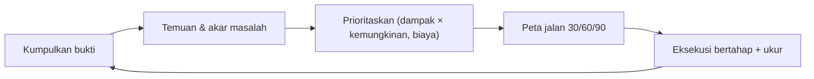

# Laravel Application Architecture Review

Sub bab penutup kurikulum ini mengajarkan **meninjau** arsitektur: menilai aplikasi yang ada secara sistematis, menemukan risiko, dan menyusun rencana perbaikan bertahap. Review yang baik berbasis bukti, memprioritaskan, dan menghasilkan tindakan, bukan daftar keluhan.

## Tujuan Pembelajaran

- [ ] Menyusun kerangka review (struktur, ketergantungan, data, keamanan, kinerja, operasi, uji).
- [ ] Mengumpulkan bukti objektif (metrik, peta ketergantungan, hasil uji).
- [ ] Mengidentifikasi dan memprioritaskan hutang teknis.
- [ ] Menilai risiko berdasarkan dampak dan kemungkinan.
- [ ] Menulis laporan review dan peta jalan perbaikan.
- [ ] Mengomunikasikan temuan secara konstruktif.

## Prasyarat

- Seluruh Level 01–10 dan sub bab 11.01–11.14.

## Pengantar

Aplikasi berjalan, tetapi rilis semakin lambat dan bug berulang. Tim butuh gambaran jujur: apa yang sehat, apa yang rapuh, apa yang diperbaiki lebih dulu.

## Penjelasan Konsep

### Kerangka review

| Area | Pertanyaan utama | Bukti |
|---|---|---|
| Struktur & batas | Apakah modul/domain jelas? Ketergantungan sehat? | Peta impor, uji batas |
| Kualitas kode | Mudah dibaca & diubah? | Ukuran class, kompleksitas, Pint/analisis statis |
| Data | Skema, indeks, integritas, migrasi aman? | `EXPLAIN`, constraint, riwayat migrasi |
| Keamanan | Autentikasi, otorisasi, validasi, rahasia, dependensi | Daftar periksa OWASP, `composer audit` |
| Kinerja | Bottleneck, N+1, cache | Profil, jumlah query, p95 |
| Keandalan & operasi | Deploy, backup, monitoring, insiden | Runbook, uji pemulihan, alarm |
| Pengujian | Cakupan bermakna, stabil | Hasil suite, cakupan, flakiness |
| Proses tim | Review, CI, dokumentasi | Riwayat PR, ADR |

### Kumpulkan bukti dulu

```bash
php artisan about
php artisan route:list --except-vendor | wc -l
composer outdated --direct
composer audit
find app -name '*.php' -exec wc -l {} + | sort -rn | head -10
grep -rln "DB::table\|DB::select" app | head
grep -rn "withoutGlobalScopes\|env(" app | head
php artisan test --compact
```

Perintah-perintah ini contoh; sesuaikan. Tujuannya data, bukan opini. `--compact` tersedia pada runner uji terbaru; hilangkan bila tidak didukung versimu.

### Gejala umum dan kemungkinan akar

| Gejala | Kemungkinan akar |
|---|---|
| Class > 500 baris | SRP dilanggar (11.03) |
| Controller berisi logika bisnis | Tidak ada lapisan aplikasi (07.07) |
| `env()` di banyak tempat | Konfigurasi tak dikelola (10.07) |
| Query di Blade/loop | N+1 (09.06) |
| Tanpa uji untuk otorisasi | Risiko keamanan (08.09) |
| Rilis manual & menakutkan | Tak ada CI/CD (10.16) |
| Backup tak pernah dipulihkan | Risiko kehilangan data (10.18) |
| Modul saling mengimpor internal | Batas bocor (11.05) |

### Hutang teknis

Klasifikasikan: **sengaja** (dikompromikan demi waktu, dicatat), **tidak sengaja** (kurang pengetahuan), **bit rot** (dunia berubah). Hutang bukan dosa; hutang yang tak tercatat dan tak dibayar berbunga.

### Memprioritaskan

Matriks sederhana:

| | Dampak tinggi | Dampak rendah |
|---|---|---|
| **Kemungkinan tinggi** | Perbaiki segera | Jadwalkan |
| **Kemungkinan rendah** | Mitigasi / pantau | Terima / abaikan |

Tambahkan faktor **biaya** dan **ketergantungan** (perbaikan A membuka B). Utamakan yang menurunkan risiko keamanan/data lebih dulu.

### Laporan review

Struktur singkat:

1. Ringkasan eksekutif (3–5 kalimat: kondisi, risiko terbesar, rekomendasi).
2. Konteks & ruang lingkup (apa yang ditinjau, bukti apa).
3. Temuan: tiap item punya **bukti**, **dampak**, **rekomendasi**, **usaha** (S/M/L), **prioritas**.
4. Hal yang sudah baik (penting untuk moral dan agar tidak diubah sembarangan).
5. Peta jalan 30/60/90 hari.
6. Risiko & asumsi.

### Komunikasi

Fokus pada sistem, bukan orang. Gunakan bukti, tawarkan opsi dengan kompromi, dan libatkan tim dalam prioritas. Review adalah awal percakapan.

### Mengukur kemajuan

Tetapkan metrik: waktu rilis, tingkat kegagalan perubahan, waktu pulih, jumlah insiden, cakupan uji pada area berisiko, jumlah modul dengan batas teruji.

### Keamanan

Review keamanan formal (uji penetrasi, audit) melengkapi tetapi tidak digantikan oleh review ini. Laporan berisi detail kerentanan harus diperlakukan sebagai rahasia dan dibagikan terbatas.

## Cara Kerja



## Contoh Praktik

Kamu meninjau `cms-artikel` sendiri: mengumpulkan bukti, menulis lima temuan terprioritas dengan rekomendasi, dan membuat peta jalan 30/60/90 hari.

## Penjelasan Kode

Tidak ada kode aplikasi baru; keluaran perintah bukti disimpan di lampiran laporan.

## Implementasi Langkah demi Langkah

### Langkah 1: tetapkan ruang lingkup

Tulis area yang ditinjau dan yang tidak.

### Langkah 2: kumpulkan bukti

Jalankan perintah bukti; simpan keluaran di `docs/review/bukti/`.

### Langkah 3: telaah per area

Isi tabel kerangka dengan temuan dan bukti.

### Langkah 4: prioritaskan

Gunakan matriks dampak × kemungkinan dan perkirakan usaha.

### Langkah 5: tulis laporan

Buat `docs/review/2026-11-arsitektur.md` sesuai struktur.

### Langkah 6: peta jalan

Pecah menjadi tugas kecil bertanggung jawab dan tenggat 30/60/90 hari.

### Langkah 7: commit

```bash
git add docs/review && git commit -m "Tambah laporan review arsitektur"
```

## Eksekusi dan Verifikasi

| Langkah | Hasil yang diharapkan |
|---|---|
| 2 | Bukti terkumpul tersimpan |
| 5 | Laporan dengan temuan bernomor, bukti, dan prioritas |

## Hasil yang Diharapkan

Hasil bergantung proyekmu; tidak ada angka yang dijanjikan.

## Kesalahan Umum dan Pemecahan Masalah

| Gejala | Penyebab | Cara mengenali | Solusi | Pencegahan |
|---|---|---|---|---|
| Review berupa opini | Tanpa bukti | Debat tanpa data | Kumpulkan metrik | Bukti dulu |
| Daftar terlalu panjang | Tanpa prioritas | Tidak ada tindakan | Matriks & potong | Maks. 5–10 prioritas |
| Menyalahkan individu | Fokus orang | Resistensi | Fokus sistem | Bahasa netral |
| Rencana tak terlaksana | Tanpa pemilik/tenggat | Tak ada kemajuan | Tugas kecil bernama | Peta jalan |
| Laporan bocor detail kerentanan | Dibagikan luas | Risiko eksploitasi | Distribusi terbatas | Klasifikasi |

## Latihan Praktik

### Latihan dasar

**D1. Prioritas**
- *Masalah:* memprioritaskan.
- *Persyaratan:* urutkan: (a) tak ada uji otorisasi, (b) nama variabel kurang jelas, (c) backup tak pernah diuji.
- *Perilaku yang diharapkan:* (a)/(c) lebih tinggi daripada (b).
- *Tujuan belajar:* menilai risiko.

### Latihan implementasi

**I1. Review modul**
- *Masalah:* satu modul dicurigai rapuh.
- *Persyaratan:* review satu modul memakai kerangka dan tulis tiga rekomendasi berbukti.
- *Perilaku yang diharapkan:* laporan satu halaman.
- *Tujuan belajar:* review terfokus.

### Latihan tantangan

**T1. Presentasikan ke pemangku kepentingan**
- *Masalah:* manajemen non-teknis.
- *Persyaratan:* ringkas temuan dalam satu slide: risiko bisnis, biaya, manfaat, pilihan.
- *Perilaku yang diharapkan:* pesan jelas tanpa jargon.
- *Tujuan belajar:* komunikasi.
- *Catatan:* kerjakan mandiri; tidak ada kunci jawaban.

## Uji Pemahaman

1. Mengapa kumpulkan bukti dulu?
2. Bagaimana memprioritaskan temuan?
3. Apa isi laporan review?
4. Mengapa mencantumkan hal yang sudah baik?

??? success "Kunci jawaban singkat"
    1. Agar temuan objektif, bukan opini.
    2. Dampak × kemungkinan, ditambah biaya dan ketergantungan.
    3. Ringkasan, temuan berbukti, prioritas, peta jalan, risiko.
    4. Agar tidak merusak yang berfungsi dan menjaga moral.

## Ringkasan

- Review arsitektur sistematis: bukti, temuan, prioritas, peta jalan.
- Hutang teknis dicatat dan dibayar bertahap.
- Komunikasikan konstruktif dan ukur kemajuan.

Selanjutnya: proyek penutup, *Modular Laravel Enterprise Application*.

## Referensi Resmi

- [Laravel: Deployment](https://laravel.com/docs/13.x/deployment)
- [OWASP Application Security Verification Standard](https://owasp.org/www-project-application-security-verification-standard/)
