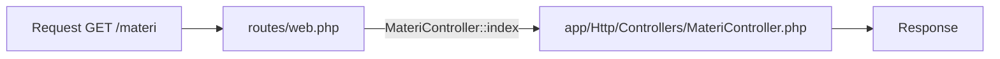

# Controller

Pada bab ini kamu memindahkan logika dari closure di `routes/web.php` ke class
**controller**, supaya file route tetap ringkas dan logika mudah dirawat.

!!! info "Versi yang dipakai"
    Laravel **13.x** (PHP 8.3+). Rujukan: [Controllers 13.x](https://laravel.com/docs/13.x/controllers).

## Tujuan pembelajaran

- [ ] Menjelaskan fungsi controller dan alasan memakainya.
- [ ] Membuat controller dengan `php artisan make:controller`.
- [ ] Menghubungkan route ke method controller.
- [ ] Menerima route parameter di method controller dan memakai `abort(404)`.
- [ ] Membuat *invokable controller* untuk satu aksi.

## Prasyarat

- Sudah menyelesaikan [Routing Dasar](routing-dasar.md); proyek **Pustaka Materi**
  berjalan dengan `php artisan serve`.
- Memahami class, method, dan `namespace` dasar di PHP.

## Konsep

**Masalah.** Closure nyaman untuk contoh kecil. Namun setelah puluhan route,
`routes/web.php` menjadi panjang, sulit dibaca, dan logika yang mirip tersebar di
banyak tempat.

**Solusi.** Kelompokkan logika yang berkaitan dalam satu class. Route hanya
menunjuk "class mana, method mana".

!!! tip "Analogi"
    Route adalah papan petunjuk di lobi; controller adalah staf di tiap bagian
    yang benar-benar mengerjakan permintaan. Papan petunjuk cukup menulis
    "Materi → Bagian Materi, loket `index`".



## Langkah 1: membuat controller

Dari folder proyek:

```bash
php artisan make:controller MateriController
```

Perintah ini membuat `app/Http/Controllers/MateriController.php`. Isinya class
kosong yang mewarisi `Controller`.

## Langkah 2: mengisi controller

Buka file tersebut dan ubah menjadi:

```php title="app/Http/Controllers/MateriController.php"
<?php

namespace App\Http\Controllers;

class MateriController extends Controller
{
    public function index(): array
    {
        return $this->daftar();
    }

    public function show(string $slug): string
    {
        $materi = collect($this->daftar())->firstWhere('slug', $slug);

        abort_if($materi === null, 404);

        return $materi['judul'].': '.$materi['ringkasan'];
    }

    /**
     * Data sementara. Pada bab database, data ini diganti isi tabel.
     */
    private function daftar(): array
    {
        return [
            ['slug' => 'routing-dasar', 'judul' => 'Routing Dasar', 'ringkasan' => 'Memetakan URL ke kode.'],
            ['slug' => 'controller', 'judul' => 'Controller', 'ringkasan' => 'Memindahkan logika dari closure ke class.'],
            ['slug' => 'view-dan-blade', 'judul' => 'View dan Blade', 'ringkasan' => 'Menampilkan HTML dengan template.'],
        ];
    }
}
```

| Bagian | Penjelasan |
|---|---|
| `namespace App\Http\Controllers;` | Lokasi class. Harus cocok dengan folder agar *autoload* menemukannya. |
| `extends Controller` | Mewarisi class dasar bawaan proyek. Tidak wajib, tetapi lazim. |
| `index(): array` | Method publik yang menjawab daftar materi. Array diubah menjadi JSON. |
| `show(string $slug)` | Parameter `{slug}` dari route dikirim sebagai argumen. |
| `collect(...)->firstWhere('slug', $slug)` | Mencari elemen pertama dengan `slug` yang sama; hasilnya `null` jika tidak ada. |
| `abort_if($materi === null, 404)` | Menghentikan proses dan menjawab 404 bila kondisinya benar. |
| `private function daftar()` | Method bantu yang hanya dipakai di class ini. |

## Langkah 3: menghubungkan route

Di `routes/web.php`, **ganti** route `/materi` dan `/materi/{slug}` dari bab 1:

```php title="routes/web.php"
use App\Http\Controllers\MateriController;
use Illuminate\Support\Facades\Route;

Route::get('/materi', [MateriController::class, 'index'])->name('materi.index');

Route::get('/materi/{slug}', [MateriController::class, 'show'])
    ->where('slug', '[a-z0-9-]+')
    ->name('materi.show');
```

`[MateriController::class, 'index']` berarti "panggil method `index` pada class
`MateriController`". Nama route tetap sama dengan bab 1, jadi `route('materi.show')`
yang sudah ada tidak perlu diubah.

## Controller satu aksi

Untuk halaman yang hanya punya satu tugas, gunakan method `__invoke`:

```bash
php artisan make:controller TentangController --invokable
```

```php title="app/Http/Controllers/TentangController.php"
<?php

namespace App\Http\Controllers;

class TentangController extends Controller
{
    public function __invoke(): string
    {
        return 'Pustaka Materi: tempat belajar Laravel.';
    }
}
```

```php title="routes/web.php"
use App\Http\Controllers\TentangController;

Route::get('/tentang', TentangController::class)->name('tentang');
```

Untuk *invokable controller*, route cukup memuat nama class tanpa nama method.
Ganti route `/tentang` lama dengan baris di atas.

## Menjalankan dan memverifikasi

1. Jalankan `php artisan serve`.
2. Buka `/materi`: JSON berisi tiga materi.
3. Buka `/materi/controller`: teks `Controller: Memindahkan logika dari closure ke class.`
4. Buka `/materi/tidak-ada`: halaman **404**.
5. Buka `/tentang`: teks yang sama seperti sebelumnya.
6. Jalankan `php artisan route:list --path=materi`; kolom *Action* sekarang menampilkan
   `MateriController@index` dan `MateriController@show`.

## Kesalahan umum dan debugging

| Gejala | Penyebab | Solusi |
|---|---|---|
| `Class "App\Http\Controllers\MateriController" not found` | Lupa `use` di route, atau `namespace` salah | Tambahkan `use App\Http\Controllers\MateriController;` dan periksa namespace. |
| `Method ... does not exist` | Nama method di route berbeda dengan di class | Samakan ejaan, termasuk huruf besar-kecil. |
| `Unable to resolve dependency` / parameter tidak cocok | Nama atau tipe argumen method tidak sesuai | Pastikan `string $slug` ada di method `show`. |
| Perubahan tidak terlihat | File belum disimpan, atau salah folder | Periksa path lengkap file. |
| 404 untuk slug yang benar | Slug di data berbeda ejaan | Bandingkan dengan isi `daftar()`. |

## Latihan terpandu

1. Tambahkan materi keempat (`form-dan-validasi`) ke `daftar()` dan buka `/materi/form-dan-validasi`.
2. Buat method `jumlah()` pada `MateriController` yang mengembalikan teks `Total materi: N`
   (gunakan `count()`), dan daftarkan route `/materi-jumlah` bernama `materi.jumlah`.
3. Verifikasi dengan `route:list` bahwa dua route baru memakai `MateriController`.

??? success "Petunjuk"
    ```php
    public function jumlah(): string
    {
        return 'Total materi: '.count($this->daftar());
    }
    ```
    URI `/materi-jumlah` tidak diawali `/materi/`, sehingga tidak bentrok dengan `/materi/{slug}`.

## Pertanyaan review

1. Apa masalah yang dipecahkan controller?
2. Perintah apa yang membuat controller, dan di folder mana hasilnya?
3. Bagaimana route menunjuk method controller?
4. Apa yang dilakukan `abort_if($kondisi, 404)`?
5. Kapan *invokable controller* sesuai dipakai?

## Ringkasan

- Controller mengelompokkan logika; route tinggal menunjuk class dan method.
- `php artisan make:controller` membuat file di `app/Http/Controllers`.
- Route parameter diterima sebagai argumen method.
- `abort_if(..., 404)` menjawab halaman tidak ditemukan.
- `--invokable` dan `__invoke` untuk controller satu aksi.

Bab berikutnya: **View dan Blade**, supaya controller mengembalikan halaman HTML.

## Referensi resmi

- [Controllers](https://laravel.com/docs/13.x/controllers)
- [Basic Controllers](https://laravel.com/docs/13.x/controllers#basic-controllers)
- [Single Action Controllers](https://laravel.com/docs/13.x/controllers#single-action-controllers)
- [Error Handling (abort)](https://laravel.com/docs/13.x/errors)
