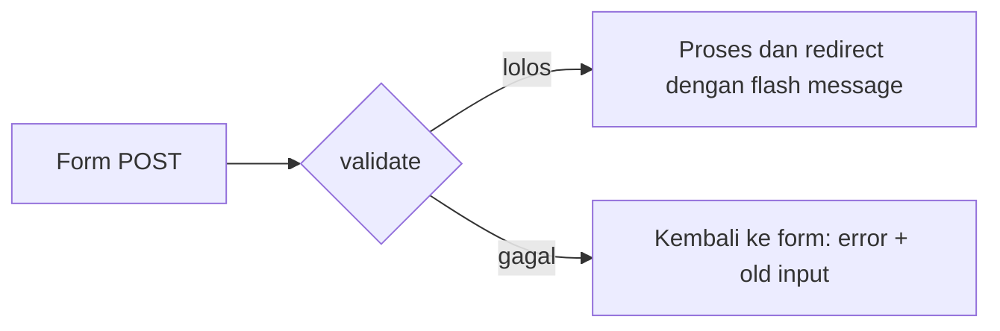

# Form dan Validasi

Pengguna perlu mengirim data ke aplikasi, dan aplikasi **tidak boleh percaya** begitu
saja pada data itu. Pada bab ini kamu membuat form usulan materi, melindunginya
dengan token CSRF, dan memvalidasi isiannya.

!!! info "Versi yang dipakai"
    Laravel **13.x**. Rujukan: [Validation](https://laravel.com/docs/13.x/validation)
    dan [CSRF Protection](https://laravel.com/docs/13.x/csrf).

## Tujuan pembelajaran

- [ ] Membuat form HTML dengan `method="POST"` dan `@csrf`.
- [ ] Memvalidasi input dengan `$request->validate()`.
- [ ] Menampilkan pesan error (`@error`) dan mengisi ulang form (`old()`).
- [ ] Mengirim *flash message* lewat `redirect()->with()`.
- [ ] Menyusun urutan route statis dan dinamis dengan benar.

## Prasyarat

- Bab [Request dan Response](request-response.md) selesai.
- Mengerti perbedaan GET dan POST.

## Konsep

**Masalah.** Input pengguna bisa kosong, terlalu panjang, atau berbahaya.
Memeriksanya dengan `if` manual di setiap tempat melelahkan dan mudah terlewat.

**Solusi.** Laravel menyediakan aturan validasi deklaratif. Jika gagal, pengguna
otomatis dikembalikan ke form beserta pesan error dan isian lamanya.



!!! note "Penyimpanan belum ada"
    Pada bab ini data yang valid **belum disimpan**; database dibahas dua bab ke depan.
    Setelah lolos validasi, kita hanya menampilkan pesan sukses.

## Langkah 1: route

```php title="routes/web.php"
Route::get('/materi/buat', [MateriController::class, 'create'])->name('materi.create');
Route::post('/materi', [MateriController::class, 'store'])->name('materi.store');
```

!!! warning "Urutan route penting"
    Letakkan `/materi/buat` **sebelum** `/materi/{slug}`. Pola slug
    `[a-z0-9-]+` juga cocok dengan kata `buat`, sehingga route dinamis akan
    menangkapnya lebih dulu bila ditulis di atas.

## Langkah 2: method controller

Tambahkan dua method pada `MateriController` (dan `use Illuminate\Http\RedirectResponse;`):

```php title="app/Http/Controllers/MateriController.php"
public function create(): View
{
    return view('materi.create');
}

public function store(Request $request): RedirectResponse
{
    $validated = $request->validate([
        'judul' => ['required', 'string', 'max:100'],
        'ringkasan' => ['required', 'string', 'max:255'],
        'isi' => ['required', 'string', 'min:20'],
    ], [
        'required' => 'Kolom :attribute wajib diisi.',
        'max' => 'Kolom :attribute maksimal :max karakter.',
        'min' => 'Kolom :attribute minimal :min karakter.',
    ]);

    return redirect()
        ->route('materi.index')
        ->with('status', 'Usulan "'.$validated['judul'].'" diterima (belum disimpan).');
}
```

| Kode | Penjelasan |
|---|---|
| `$request->validate([...])` | Menjalankan aturan; jika gagal, langsung redirect kembali (kode setelahnya tidak dijalankan). |
| `['required', 'string', 'max:100']` | Aturan dalam bentuk array: wajib, teks, maksimal 100 karakter. |
| Argumen kedua | Pesan error kustom berbahasa Indonesia. `:attribute`, `:max`, `:min` diganti otomatis. |
| `$validated` | Hanya berisi field yang lolos aturan; gunakan ini, bukan seluruh input. |
| `->with('status', ...)` | Menyimpan *flash message* di sesi untuk **satu** request berikutnya. |

## Langkah 3: view form

```blade title="resources/views/materi/create.blade.php"
<x-layout>
    <x-slot:title>Usulkan Materi</x-slot>

    <h2>Usulkan Materi</h2>

    <form method="POST" action="{{ route('materi.store') }}">
        @csrf

        <p>
            <label for="judul">Judul</label><br>
            <input id="judul" type="text" name="judul" value="{{ old('judul') }}">
            @error('judul')
                <br><small style="color: red">{{ $message }}</small>
            @enderror
        </p>

        <p>
            <label for="ringkasan">Ringkasan</label><br>
            <input id="ringkasan" type="text" name="ringkasan" value="{{ old('ringkasan') }}">
            @error('ringkasan')
                <br><small style="color: red">{{ $message }}</small>
            @enderror
        </p>

        <p>
            <label for="isi">Isi</label><br>
            <textarea id="isi" name="isi" rows="6">{{ old('isi') }}</textarea>
            @error('isi')
                <br><small style="color: red">{{ $message }}</small>
            @enderror
        </p>

        <button type="submit">Kirim</button>
    </form>
</x-layout>
```

- `@csrf` menyisipkan token tersembunyi. Tanpa token, form `POST` ditolak
  dengan status **419**.
- `old('judul')` mengisi ulang kolom dengan isian sebelumnya setelah validasi gagal.
- `@error('judul') ... @enderror` hanya tampil bila field itu bermasalah; `$message`
  berisi pesannya.

## Langkah 4: pesan sukses dan tautan

Tambahkan di `resources/views/components/layout.blade.php`, tepat di atas `{{ $slot }}`:

```blade title="resources/views/components/layout.blade.php"
@if (session('status'))
    <p style="color: green">{{ session('status') }}</p>
@endif
```

Dan tautan di `materi/index.blade.php`, di bawah form pencarian:

```blade title="resources/views/materi/index.blade.php"
<p><a href="{{ route('materi.create') }}">+ Usulkan materi</a></p>
```

## Menjalankan dan memverifikasi

1. Buka `/materi`, klik **Usulkan materi** (atau buka `/materi/buat`).
2. Kirim form **kosong**: kembali ke form dengan tiga pesan error berbahasa Indonesia.
3. Isi judul dan ringkasan, isi `isi` dengan teks pendek (kurang dari 20 karakter),
   lalu kirim: hanya error pada `isi`, dan judul/ringkasan tetap terisi (`old()`).
4. Isi semuanya dengan benar: kamu diarahkan ke `/materi` dengan pesan hijau
   `Usulan "..." diterima (belum disimpan).` Muat ulang halaman: pesan hilang
   (flash hanya sekali).

## Kesalahan umum dan debugging

| Gejala | Penyebab | Solusi |
|---|---|---|
| **419 Page Expired** | `@csrf` hilang atau sesi habis | Tambahkan `@csrf` di dalam `<form>`; muat ulang halaman form. |
| **405 Method Not Allowed** | Form `POST` ke URL yang hanya punya route `GET` | Samakan `method` form dengan metode route. |
| `/materi/buat` menampilkan 404 atau "Materi: buat" | Route `{slug}` ditulis sebelum `/materi/buat` | Pindahkan route statis ke atas. |
| Error tidak muncul | Nama di `@error('x')` tidak sama dengan `name="x"` | Samakan ejaan. |
| Isian hilang setelah gagal | Lupa `old()` | Tambahkan `value="{{ old('...') }}"`. |
| Pesan error masih bahasa Inggris | Pesan kustom tidak diberikan | Tambahkan argumen pesan, atau publikasikan berkas bahasa dengan `php artisan lang:publish`. |
| `Route [materi.store] not defined` | Nama route belum ada | Periksa `->name('materi.store')`. |

## Latihan terpandu

1. Tambahkan field `tingkat` (pilih: `pemula`, `menengah`) dengan aturan
   `Rule::in([...])` atau `'in:pemula,menengah'`, dan tampilkan sebagai `<select>`.
2. Ubah pesan khusus untuk `judul.required` menjadi `Judul tidak boleh kosong.`
   (kunci pesan: `'judul.required'`).
3. Pastikan `old('tingkat')` mempertahankan pilihan (`@selected(old('tingkat') === 'pemula')`).
4. Verifikasi dengan mengirim nilai di luar pilihan (ubah lewat DevTools browser): harus ditolak.

## Pertanyaan review

1. Apa fungsi token CSRF dan apa yang terjadi bila hilang?
2. Apa yang dilakukan `$request->validate()` saat validasi gagal?
3. Mengapa memakai `$validated`, bukan `$request->all()`?
4. Bagaimana flash message bekerja, dan berapa lama ia bertahan?
5. Mengapa `/materi/buat` harus ditulis sebelum `/materi/{slug}`?

## Ringkasan

- Form `POST` wajib memakai `@csrf`.
- `$request->validate()` memeriksa input; gagal berarti redirect ke form dengan error dan old input.
- `@error` menampilkan pesan, `old()` mengisi ulang form.
- `redirect()->with()` mengirim pesan satu kali.
- Route statis harus ditulis sebelum route dinamis.

Bab berikutnya: **Database dan Migration**, agar data benar-benar disimpan.

## Referensi resmi

- [Validation Quickstart](https://laravel.com/docs/13.x/validation#validation-quickstart)
- [Displaying Validation Errors](https://laravel.com/docs/13.x/validation#quick-displaying-the-validation-errors)
- [Available Validation Rules](https://laravel.com/docs/13.x/validation#available-validation-rules)
- [CSRF Protection](https://laravel.com/docs/13.x/csrf)
