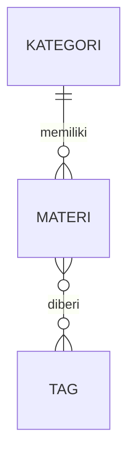

# Relasi Eloquent

Data jarang berdiri sendiri: sebuah materi **termasuk** satu kategori, dan sebuah
materi bisa punya **banyak** tag. Pada bab ini kamu menghubungkan tabel dengan
relasi *one-to-many* dan *many-to-many*.

!!! info "Versi yang dipakai"
    Laravel **13.x**. Rujukan:
    [Eloquent: Relationships](https://laravel.com/docs/13.x/eloquent-relationships).

## Tujuan pembelajaran

- [ ] Menjelaskan relasi *one-to-many* dan *many-to-many*.
- [ ] Membuat tabel dengan foreign key dan tabel pivot lewat migration.
- [ ] Mendefinisikan relasi `hasMany`, `belongsTo`, dan `belongsToMany`.
- [ ] Mengakses data relasi dan menghindari masalah N+1 dengan `with()`.
- [ ] Mengaitkan tag lewat `sync()`.

## Prasyarat

- Bab [Eloquent ORM](eloquent-orm.md) selesai: model `Materi` dan CRUD berjalan.

## Konsep



- **One-to-many**: satu `Kategori` memiliki banyak `Materi`; setiap `Materi`
  termasuk satu `Kategori`. Tabel `materi` menyimpan kolom `kategori_id`.
- **Many-to-many**: satu `Materi` punya banyak `Tag`, dan satu `Tag` dipakai banyak
  `Materi`. Dibutuhkan **tabel pivot** `materi_tag` yang menyimpan pasangan `materi_id` dan `tag_id`.

!!! tip "Analogi"
    Kategori seperti rak buku (satu buku di satu rak). Tag seperti stiker warna
    (satu buku boleh ditempel banyak stiker, satu stiker ditempel di banyak buku).

## Langkah 1: migration

```bash
php artisan make:migration create_kategori_table
php artisan make:migration create_tag_table
php artisan make:migration add_kategori_id_to_materi_table
php artisan make:migration create_materi_tag_table
```

!!! warning "Urutan file migration"
    Migration dijalankan menurut urutan nama file (awalan tanggal-waktu). Pastikan
    `create_kategori_table` dan `create_tag_table` bernama lebih awal daripada
    `add_kategori_id_to_materi_table` dan `create_materi_tag_table`. Jalankan perintah
    di atas satu per satu sesuai urutan, dan cek di `database/migrations/`.

```php title="database/migrations/..._create_kategori_table.php (isi up)"
Schema::create('kategori', function (Blueprint $table) {
    $table->id();
    $table->string('nama');
    $table->string('slug')->unique();
    $table->timestamps();
});
```

```php title="database/migrations/..._create_tag_table.php (isi up)"
Schema::create('tag', function (Blueprint $table) {
    $table->id();
    $table->string('nama')->unique();
    $table->timestamps();
});
```

```php title="database/migrations/..._add_kategori_id_to_materi_table.php"
public function up(): void
{
    Schema::table('materi', function (Blueprint $table) {
        $table->foreignId('kategori_id')->nullable()->constrained('kategori')->nullOnDelete();
    });
}

public function down(): void
{
    Schema::table('materi', function (Blueprint $table) {
        $table->dropConstrainedForeignId('kategori_id');
    });
}
```

```php title="database/migrations/..._create_materi_tag_table.php (isi up)"
Schema::create('materi_tag', function (Blueprint $table) {
    $table->id();
    $table->foreignId('materi_id')->constrained('materi')->cascadeOnDelete();
    $table->foreignId('tag_id')->constrained('tag')->cascadeOnDelete();
    $table->unique(['materi_id', 'tag_id']);
});
```

Isi `down()` untuk tiga migration pembuat tabel: `Schema::dropIfExists('nama_tabel');`.

| Kode | Penjelasan |
|---|---|
| `foreignId('kategori_id')` | Kolom bilangan bulat untuk menyimpan `id` kategori. |
| `->nullable()` | Materi lama (tanpa kategori) tetap valid. |
| `->constrained('kategori')` | Menjadikannya *foreign key* ke tabel `kategori`; nama tabel ditulis eksplisit. |
| `->nullOnDelete()` | Jika kategori dihapus, `kategori_id` materi menjadi `NULL`. |
| `cascadeOnDelete()` | Menghapus baris pivot bila materi/tag dihapus. |
| `unique(['materi_id','tag_id'])` | Mencegah pasangan materi-tag ganda. |

Jalankan:

```bash
php artisan migrate
```

Nama tabel pivot `materi_tag` mengikuti konvensi: nama dua model digabung
berdasarkan urutan abjad (Materi, Tag), dalam huruf kecil dengan garis bawah.

## Langkah 2: model

```bash
php artisan make:model Kategori
php artisan make:model Tag
```

```php title="app/Models/Kategori.php"
<?php

namespace App\Models;

use Illuminate\Database\Eloquent\Attributes\Fillable;
use Illuminate\Database\Eloquent\Attributes\Table;
use Illuminate\Database\Eloquent\Model;
use Illuminate\Database\Eloquent\Relations\HasMany;

#[Table('kategori')]
#[Fillable(['nama', 'slug'])]
class Kategori extends Model
{
    public function materi(): HasMany
    {
        return $this->hasMany(Materi::class);
    }
}
```

```php title="app/Models/Tag.php"
<?php

namespace App\Models;

use Illuminate\Database\Eloquent\Attributes\Fillable;
use Illuminate\Database\Eloquent\Attributes\Table;
use Illuminate\Database\Eloquent\Model;
use Illuminate\Database\Eloquent\Relations\BelongsToMany;

#[Table('tag')]
#[Fillable(['nama'])]
class Tag extends Model
{
    public function materi(): BelongsToMany
    {
        return $this->belongsToMany(Materi::class);
    }
}
```

Tambahkan ke model `Materi` (serta `use` untuk `BelongsTo`, `BelongsToMany`,
dan atribut `kategori_id` pada `#[Fillable]`):

```php title="app/Models/Materi.php"
use Illuminate\Database\Eloquent\Relations\BelongsTo;
use Illuminate\Database\Eloquent\Relations\BelongsToMany;

#[Table('materi')]
#[Fillable(['slug', 'judul', 'ringkasan', 'isi', 'kategori_id'])]
class Materi extends Model
{
    public function kategori(): BelongsTo
    {
        return $this->belongsTo(Kategori::class);
    }

    public function tags(): BelongsToMany
    {
        return $this->belongsToMany(Tag::class);
    }
}
```

Eloquent menebak foreign key dari nama model: `Kategori` → `kategori_id`, `Tag` →
`tag_id`, dan `Materi` → `materi_id`. Karena nama tabel kita kustom (`kategori`, `tag`),
nama tabelnya sudah diberi tahu lewat `#[Table]`.

## Langkah 3: data contoh

Gunakan Tinker (`php artisan tinker`):

```php
use App\Models\{Kategori, Materi, Tag};

$dasar = Kategori::create(['nama' => 'Dasar', 'slug' => 'dasar']);
$php   = Tag::create(['nama' => 'php']);
$web   = Tag::create(['nama' => 'web']);

$routing = Materi::where('slug', 'routing-dasar')->first();
$routing->kategori_id = $dasar->id;
$routing->save();
$routing->tags()->sync([$php->id, $web->id]);
```

- `sync([...])` membuat daftar tag materi sama persis dengan daftar `id` yang diberikan.
  Tag yang tidak ada dalam daftar dilepas. Gunakan `attach()` untuk menambah saja.
- `$routing->save()` dipakai karena `kategori_id` ditetapkan lewat properti.

## Langkah 4: mengakses relasi

```php
$routing->kategori->nama;      // "Dasar"
$routing->tags->pluck('nama'); // koleksi: php, web
$dasar->materi->count();       // jumlah materi pada kategori
```

Mengakses `$materi->kategori` (tanpa tanda kurung) menghasilkan **data**.
Memanggil `$materi->kategori()` menghasilkan objek relasi yang bisa dirangkai
(`->where(...)`).

## Langkah 5: menampilkan di aplikasi

Muat relasi di controller dengan *eager loading*:

```php title="app/Http/Controllers/MateriController.php"
private function cari(string $q)
{
    return Materi::query()
        ->with('kategori')
        ->when($q !== '', fn ($query) => $query->where('judul', 'like', '%'.$q.'%'))
        ->orderBy('judul')
        ->get();
}
```

Dan pada `show`:

```php title="app/Http/Controllers/MateriController.php"
public function show(Materi $materi): View
{
    $materi->load('kategori', 'tags');

    return view('materi.show', ['materi' => $materi]);
}
```

Di view daftar, setelah ringkasan:

```blade title="resources/views/materi/index.blade.php"
@if ($materi->kategori)
    <small>[{{ $materi->kategori->nama }}]</small>
@endif
```

Di `show.blade.php`, di bawah isi:

```blade title="resources/views/materi/show.blade.php"
@if ($materi->kategori)
    <p>Kategori: {{ $materi->kategori->nama }}</p>
@endif

@if ($materi->tags->isNotEmpty())
    <p>Tag: {{ $materi->tags->pluck('nama')->join(', ') }}</p>
@endif
```

**Mengapa `with()`?** Tanpa eager loading, setiap iterasi `@forelse` yang membaca
`$materi->kategori` menjalankan query tambahan: 1 query daftar + N query kategori
(masalah **N+1**). `with('kategori')` mengambil semua kategori dalam satu query tambahan.

Halaman kategori (opsional, route baru sebelum atau sesudah route materi):

```php title="routes/web.php"
use App\Models\Kategori;

Route::get('/kategori/{kategori:slug}', function (Kategori $kategori) {
    return view('materi.index', [
        'daftarMateri' => $kategori->materi()->with('kategori')->orderBy('judul')->get(),
        'q' => '',
    ]);
})->name('kategori.show');
```

## Menjalankan dan memverifikasi

1. `php artisan migrate:status` menunjukkan empat migration baru berstatus *Ran*.
2. Jalankan langkah Tinker di atas tanpa error.
3. Buka `/materi`: "Routing Dasar" menampilkan `[Dasar]`.
4. Buka `/materi/routing-dasar`: ada baris "Kategori: Dasar" dan "Tag: php, web".
5. Buka `/kategori/dasar`: hanya materi pada kategori itu.

## Kesalahan umum dan debugging

| Gejala | Penyebab | Solusi |
|---|---|---|
| `Call to a member function ... on null` | Materi belum punya kategori | Cek dengan `@if ($materi->kategori)` atau `?->`. |
| `no such table: kategoris` / `tags` | Nama tabel tidak diatur di model | Pastikan `#[Table('kategori')]` dan `#[Table('tag')]`. |
| `no such table: materi_tag`/kolom tak ditemukan | Nama pivot atau kolom berbeda dari konvensi | Samakan dengan `materi_tag`, `materi_id`, `tag_id`, atau beri argumen tambahan pada `belongsToMany`. |
| `Add [kategori_id] to fillable` | `kategori_id` tidak di `#[Fillable]` | Tambahkan atau gunakan penetapan properti seperti contoh. |
| Banyak query di halaman daftar | Tidak memakai eager loading | Tambahkan `with('relasi')`. |
| Error foreign key saat migrate | Urutan migration salah (tabel induk belum ada) | Pastikan `kategori`/`tag` dibuat sebelum migration yang merujuknya (cek nama berkas). |

## Latihan terpandu

1. Buat kategori kedua dan kaitkan materi "Controller" dengannya.
2. Tambahkan field kategori (`<select>`) pada form buat dan ubah materi, validasi dengan
   `'kategori_id' => ['nullable', 'exists:kategori,id']`.
3. Buat halaman `/tag/{tag}` yang menampilkan materi sebuah tag (pakai `{tag:nama}`).
4. Verifikasi bahwa `sync([])` mengosongkan tag sebuah materi.

## Pertanyaan review

1. Apa beda one-to-many dan many-to-many dalam struktur tabelnya?
2. Mengapa many-to-many memerlukan tabel pivot?
3. Apa beda `$materi->kategori` dan `$materi->kategori()`?
4. Apa itu masalah N+1 dan bagaimana `with()` mengatasinya?
5. Apa beda `attach()` dan `sync()`?

## Ringkasan

- Foreign key ditambahkan lewat `foreignId()->constrained()`.
- `hasMany`/`belongsTo` untuk one-to-many, `belongsToMany` untuk many-to-many.
- Konvensi nama kolom (`kategori_id`) dan pivot (`materi_tag`) memudahkan Eloquent.
- `with()` mencegah query berulang; `sync()` mengatur isi pivot.

Bab berikutnya: **Autentikasi**, membatasi siapa yang boleh mengubah materi.

## Referensi resmi

- [Eloquent: Relationships](https://laravel.com/docs/13.x/eloquent-relationships)
- [One To Many](https://laravel.com/docs/13.x/eloquent-relationships#one-to-many)
- [Many To Many](https://laravel.com/docs/13.x/eloquent-relationships#many-to-many)
- [Eager Loading](https://laravel.com/docs/13.x/eloquent-relationships#eager-loading)
- [Migrations: Foreign Key Constraints](https://laravel.com/docs/13.x/migrations#foreign-key-constraints)
