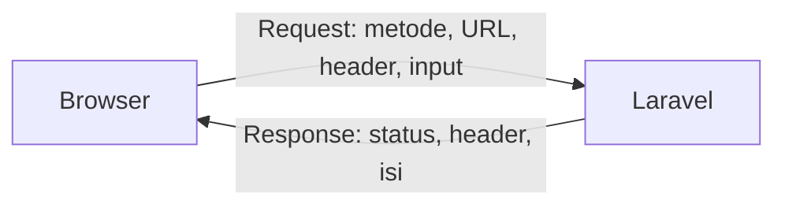

# Request dan Response

Aplikasi web pada dasarnya menerima **request** dan mengirim **response**. Pada bab ini
kamu membaca data dari request (misalnya kata kunci pencarian) dan memilih
jenis response yang tepat: view, JSON, atau redirect.

!!! info "Versi yang dipakai"
    Laravel **13.x**. Rujukan: [HTTP Requests](https://laravel.com/docs/13.x/requests)
    dan [HTTP Responses](https://laravel.com/docs/13.x/responses).

## Tujuan pembelajaran

- [ ] Menjelaskan alur request → response.
- [ ] Menerima `Illuminate\Http\Request` di method controller.
- [ ] Membaca *query string* dengan `$request->query()`.
- [ ] Mengembalikan view, JSON, dan redirect.
- [ ] Mengatur status code dan header response.

## Prasyarat

- Bab [View dan Blade](view-blade.md) selesai.
- Mengerti bentuk URL dengan query string, mis. `/materi?q=routing`.

## Konsep

Setiap interaksi HTTP terdiri dari dua bagian:



- **Request** membawa metode (`GET`, `POST`, ...), URL, header, dan input.
  Laravel membungkusnya dalam objek `Illuminate\Http\Request`.
- **Response** membawa status code (`200`, `302`, `404`, ...), header, dan isi.

!!! tip "Analogi"
    Request seperti formulir pesanan yang diisi pelanggan; response adalah
    barang yang dikirim kembali beserta struknya (status).

## Mencari materi: membaca query string

Kita tambahkan pencarian judul lewat `/materi?q=routing`. Controller lengkap
setelah bab ini:

```php title="app/Http/Controllers/MateriController.php"
<?php

namespace App\Http\Controllers;

use Illuminate\Http\JsonResponse;
use Illuminate\Http\Request;
use Illuminate\View\View;

class MateriController extends Controller
{
    public function index(Request $request): View
    {
        $q = trim((string) $request->query('q', ''));

        return view('materi.index', [
            'daftarMateri' => $this->cari($q),
            'q' => $q,
        ]);
    }

    public function json(Request $request): JsonResponse
    {
        $q = trim((string) $request->query('q', ''));

        return response()
            ->json($this->cari($q), 200)
            ->header('X-Aplikasi', 'Pustaka Materi');
    }

    public function show(string $slug): View
    {
        $materi = collect($this->daftar())->firstWhere('slug', $slug);

        abort_if($materi === null, 404);

        return view('materi.show', ['materi' => $materi]);
    }

    private function cari(string $q): array
    {
        return collect($this->daftar())
            ->filter(fn (array $m) => $q === ''
                || str_contains(mb_strtolower($m['judul']), mb_strtolower($q)))
            ->values()
            ->all();
    }

    private function daftar(): array
    {
        return [
            ['slug' => 'routing-dasar', 'judul' => 'Routing Dasar', 'ringkasan' => 'Memetakan URL ke kode.'],
            ['slug' => 'controller', 'judul' => 'Controller', 'ringkasan' => 'Memindahkan logika dari closure ke class.'],
            ['slug' => 'view-dan-blade', 'judul' => 'View dan Blade', 'ringkasan' => 'Menampilkan HTML dengan template.'],
        ];
    }
}
```

| Kode | Penjelasan |
|---|---|
| `Request $request` | Laravel menyuntikkan objek request secara otomatis (*dependency injection*). |
| `$request->query('q', '')` | Mengambil `q` dari query string; `''` adalah nilai default bila tidak ada. |
| `(string)` dan `trim()` | Memastikan tipe string dan membuang spasi di tepi. |
| `str_contains(mb_strtolower(...), ...)` | Pencocokan judul tanpa membedakan huruf besar-kecil, aman untuk karakter non-ASCII. |
| `response()->json($data, 200)` | Membuat response JSON dengan status 200. |
| `->header('X-Aplikasi', ...)` | Menambahkan header kustom pada response. |

!!! note "`query()` dan `input()`"
    `$request->query('q')` hanya membaca query string. `$request->input('q')`
    membaca dari seluruh input (query string dan body form). Pilih `query()`
    untuk data di URL agar maksudnya jelas.

## Route baru

```php title="routes/web.php"
Route::get('/materi', [MateriController::class, 'index'])->name('materi.index');
Route::get('/data/materi', [MateriController::class, 'json'])->name('materi.json');
```

Route `/materi/{slug}` tetap seperti pada bab Controller.

## Form pencarian di view

Tambahkan di `resources/views/materi/index.blade.php`, tepat di bawah `<h2>`:

```blade title="resources/views/materi/index.blade.php"
<form method="GET" action="{{ route('materi.index') }}">
    <input type="search" name="q" value="{{ $q }}" placeholder="Cari judul materi">
    <button type="submit">Cari</button>
</form>
```

Form `GET` menaruh isian di URL (`?q=...`) dan tidak membutuhkan token CSRF.
`value="{{ $q }}"` mempertahankan kata kunci di kolom setelah pencarian.

## Redirect dan status code

Redirect adalah response dengan status `302` (atau `301`) dan header `Location`.

```php
return redirect()->route('materi.index');        // ke route bernama
return redirect('/materi');                      // ke URL
return back();                                   // ke halaman sebelumnya
```

Status code yang paling sering kamu temui:

| Kode | Arti | Contoh pemicu |
|---|---|---|
| 200 | OK | Halaman berhasil ditampilkan |
| 301 / 302 | Redirect | `redirect()` |
| 404 | Tidak ditemukan | `abort(404)`, URL tidak cocok |
| 405 | Metode tidak diizinkan | Membuka route `POST` dengan GET |
| 419 | Token CSRF/sesi kedaluwarsa | Form `POST` tanpa `@csrf` |
| 422 | Data tidak valid | Validasi gagal pada request XHR/JSON |
| 500 | Error server | Kesalahan kode PHP |

## Mengamati request: route sementara

Tambahkan route ini hanya untuk belajar, lalu **hapus** setelah selesai:

```php title="routes/web.php"
use Illuminate\Http\Request;

Route::get('/info-request', function (Request $request) {
    return response()->json([
        'metode' => $request->method(),
        'path' => $request->path(),
        'url_lengkap' => $request->fullUrl(),
        'q' => $request->query('q'),
    ]);
});
```

## Menjalankan dan memverifikasi

1. Buka `/materi`: tiga materi.
2. Buka `/materi?q=blade`: hanya "View dan Blade"; kolom pencarian terisi "blade".
3. Buka `/materi?q=xyz`: pesan "Belum ada materi."
4. Periksa header dan isi JSON:

    ```bash
    curl -i "http://127.0.0.1:8000/data/materi?q=route"
    ```

    Yang diharapkan: status `200`, header `Content-Type: application/json`, header
    `X-Aplikasi: Pustaka Materi`, dan array berisi materi "Routing Dasar".
5. Buka `/info-request?q=halo`: JSON dengan `metode` `GET`, `path` `info-request`, dan `q` `halo`.

## Kesalahan umum dan debugging

| Gejala | Penyebab | Solusi |
|---|---|---|
| `q` selalu kosong | Nama field di form berbeda dengan yang dibaca | Samakan `name="q"` dan `query('q')`. |
| `Undefined variable $q` di view | Controller tidak mengirim `q` | Tambahkan `'q' => $q` pada array data. |
| JSON tampil sebagai teks mentah di browser | Normal; browser menampilkan JSON apa adanya | Gunakan `curl -i` untuk melihat header. |
| Pencarian "Blade" tidak cocok dengan "blade" | Lupa `mb_strtolower` | Samakan huruf kecil pada kedua sisi. |
| `Class "Request" not found` | Tidak ada `use Illuminate\Http\Request;` | Tambahkan `use`. |

## Latihan terpandu

1. Tambahkan pencarian pada ringkasan juga (judul **atau** ringkasan).
2. Buat route `GET /materi-lama` yang mengalihkan ke `materi.index` memakai
   `redirect()->route(...)`. Verifikasi status `302` dengan `curl -i`.
3. Pada `json()`, kembalikan status `404` dan pesan `{"pesan": "Tidak ada hasil"}`
   bila hasil pencarian kosong.
4. Hapus route `/info-request`.

??? success "Petunjuk nomor 3"
    ```php
    $hasil = $this->cari($q);

    if ($hasil === []) {
        return response()->json(['pesan' => 'Tidak ada hasil'], 404);
    }

    return response()->json($hasil)->header('X-Aplikasi', 'Pustaka Materi');
    ```

## Pertanyaan review

1. Apa isi sebuah request dan sebuah response?
2. Apa beda `$request->query('q')` dan `$request->input('q')`?
3. Mengapa form pencarian cocok memakai metode GET?
4. Status code apa yang dihasilkan `redirect()`?
5. Bagaimana menambahkan header pada response?

## Ringkasan

- `Request` disuntikkan otomatis ke method controller.
- `query()` membaca query string; berikan nilai default.
- Response dapat berupa view, JSON (`response()->json`), atau redirect.
- Status code dan header dapat diatur lewat objek response.

Bab berikutnya: **Form dan Validasi**.

## Referensi resmi

- [HTTP Requests](https://laravel.com/docs/13.x/requests)
- [Retrieving Input](https://laravel.com/docs/13.x/requests#retrieving-input)
- [HTTP Responses](https://laravel.com/docs/13.x/responses)
- [Redirects](https://laravel.com/docs/13.x/responses#redirects)
