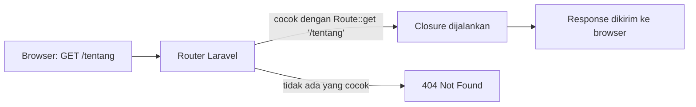

# Routing Dasar

Pada bab ini kamu belajar cara memberi tahu Laravel: "kalau ada yang membuka alamat
ini, jalankan kode itu". Itulah fungsi **routing**, pintu masuk setiap halaman
di aplikasi Laravel.

!!! info "Versi yang dipakai"
    Bab ini mengikuti **Laravel 13.x** (membutuhkan PHP 8.3 atau lebih baru) dan
    dokumentasi [Routing 13.x](https://laravel.com/docs/13.x/routing). Contoh
    proyek memakai nama **Pustaka Materi**, aplikasi kecil yang kita kembangkan
    bab demi bab.

## Tujuan pembelajaran

Setelah menyelesaikan bab ini, kamu dapat:

- [ ] Menjelaskan apa itu route dan di mana Laravel menyimpannya.
- [ ] Membuat route `GET` yang mengembalikan teks, JSON, redirect, dan view.
- [ ] Memakai route parameter (wajib dan opsional) beserta batasannya (`where`).
- [ ] Memberi nama route dan membuat URL dengan helper `route()`.
- [ ] Melihat seluruh route dengan `php artisan route:list`.
- [ ] Membuat route `fallback` untuk halaman 404 buatan sendiri.

## Prasyarat

- Dasar PHP: variabel, fungsi, array, dan *closure* (fungsi tanpa nama).
- PHP 8.3+ dan [Composer](https://getcomposer.org/) sudah terpasang
  (cek dengan `php -v` dan `composer -V`).
- Sudah punya proyek Laravel 13. Jika belum, lihat bagian
  [Persiapan proyek](#persiapan-proyek).
- Pemahaman dasar HTTP: browser mengirim *request* ke sebuah URL, server
  membalas dengan *response*.

## Konsep: apa itu routing?

**Masalah.** Ketika browser meminta `http://127.0.0.1:8000/tentang`, aplikasi harus
tahu kode mana yang bertugas menjawab. Tanpa aturan yang jelas, setiap alamat
harus ditangani manual.

**Solusi.** Laravel menyediakan *router*. Kamu mendaftarkan pasangan
**metode HTTP + URI → aksi**. Saat request masuk, router mencari pasangan yang cocok
dan menjalankan aksinya.

!!! tip "Analogi"
    Bayangkan resepsionis gedung. Tamu menyebut tujuan ("lantai 3, bagian
    keuangan"), lalu resepsionis melihat daftar dan mengarahkannya ke ruangan yang tepat.
    Daftar itu adalah file route, tamu adalah request, ruangannya adalah kode
    yang dijalankan.



## Persiapan proyek

Jika belum punya proyek, buat satu (pilih salah satu cara):

```bash
composer create-project laravel/laravel pustaka-materi
cd pustaka-materi
```

Perintah di bawah dijalankan dari **folder proyek** (`pustaka-materi`). Struktur
yang relevan untuk bab ini:

```text
pustaka-materi/
├── bootstrap/app.php     # mendaftarkan file route yang dimuat
└── routes/
    └── web.php           # tempat kita menulis route (file utama bab ini)
```

Jalankan server pengembangan:

```bash
php artisan serve
```

Biarkan terminal ini terbuka, lalu buka alamat yang ditampilkan Laravel
(umumnya `http://127.0.0.1:8000`). Tekan ++ctrl+c++ untuk berhenti.

!!! note "Mengapa `routes/web.php`?"
    Laravel memuat file ini lewat `bootstrap/app.php` dan memasangnya pada
    *middleware group* `web` (sesi, cookie, proteksi CSRF). Route untuk API
    stateless disimpan di `routes/api.php`, yang baru dibuat setelah
    `php artisan install:api`. Bab ini hanya memakai `routes/web.php`.

## Route pertama

Buka `routes/web.php`. Di bawah route bawaan `/`, tambahkan:

```php title="routes/web.php"
<?php

use Illuminate\Support\Facades\Route;

Route::get('/tentang', function () {
    return 'Pustaka Materi: tempat belajar Laravel.';
});
```

!!! warning "Jangan hapus `<?php` dan `use` yang sudah ada"
    File bawaan sudah memiliki baris pembuka dan `use` di atas. Jangan menggandakannya;
    cukup tambahkan blok `Route::get(...)` di bawah route yang ada.

Penjelasan baris demi baris:

| Kode | Arti |
|---|---|
| `use Illuminate\Support\Facades\Route;` | Mengimpor *facade* `Route` agar bisa dipanggil sebagai `Route::...`. |
| `Route::get(` | Mendaftarkan route yang hanya menjawab request dengan metode **GET** (membuka halaman). |
| `'/tentang'` | **URI** yang dicocokkan. Alamat lengkapnya `http://127.0.0.1:8000/tentang`. |
| `function () { ... }` | *Closure*: kode yang dijalankan saat route cocok. |
| `return '...'` | Nilai kembalian diubah Laravel menjadi response HTTP (di sini teks biasa). |

### Menjalankan dan memverifikasi

1. Pastikan `php artisan serve` masih berjalan.
2. Buka `http://127.0.0.1:8000/tentang` di browser.
3. Atau lewat terminal lain:

    ```bash
    curl -i http://127.0.0.1:8000/tentang
    ```

    (Di Windows PowerShell, tulis `curl.exe`, sebab `curl` adalah alias
    cmdlet lain.)

**Hasil yang diharapkan:** status `200 OK` dan isi halaman
`Pustaka Materi: tempat belajar Laravel.`

Laravel tidak perlu di-restart setiap kali `routes/web.php` diubah; cukup muat ulang halaman.

## Jenis nilai kembalian

Closure tidak hanya boleh mengembalikan teks:

```php title="routes/web.php"
Route::get('/materi', function () {
    return [
        ['slug' => 'routing-dasar', 'judul' => 'Routing Dasar'],
        ['slug' => 'controller', 'judul' => 'Controller'],
    ];
});
```

Array otomatis diubah menjadi **JSON** (dengan header `Content-Type: application/json`).
Buka `/materi`: kamu akan melihat daftar dua materi dalam format JSON.

## Metode HTTP

Laravel menyediakan satu metode per HTTP verb:

```php
Route::get($uri, $callback);
Route::post($uri, $callback);
Route::put($uri, $callback);
Route::patch($uri, $callback);
Route::delete($uri, $callback);
Route::options($uri, $callback);
```

Browser yang mengetik alamat selalu mengirim **GET**. Untuk saat ini kita hanya memakai
`Route::get`. `POST`, `PUT`, `PATCH`, dan `DELETE` biasanya datang dari form dan
membutuhkan token CSRF; keduanya dibahas pada bab form.

!!! note "Mengapa route `POST` tidak bisa dites dari browser?"
    Mengetik alamat di browser hanya mengirim GET. Membuka URL route `POST`
    menghasilkan `405 Method Not Allowed`. Itu perilaku normal, bukan *bug*.

## Redirect dan view

Dua kebutuhan umum punya jalan pintas sehingga tidak perlu menulis closure:

```php title="routes/web.php"
// /beranda dialihkan ke /  (status 302 secara default)
Route::redirect('/beranda', '/');

// Menampilkan view resources/views/welcome.blade.php
Route::view('/selamat-datang', 'welcome');
```

- `Route::redirect(dari, ke)` mengarahkan browser ke URI lain. Tambahkan argumen ketiga
  `301` (atau pakai `Route::permanentRedirect`) untuk redirect permanen.
- `Route::view(uri, nama_view)` menampilkan view tanpa logika tambahan. View
  `welcome` sudah disediakan starter Laravel; cara membuat view sendiri dibahas
  di bab Blade.

Verifikasi: `/beranda` seharusnya pindah ke `/`, dan `/selamat-datang` menampilkan
halaman sambutan Laravel.

## Route parameter

Sering kali sebagian URI berubah-ubah, misalnya `/materi/routing-dasar` dan
`/materi/controller`. Bungkus bagian itu dengan kurung kurawal:

```php title="routes/web.php"
Route::get('/materi/{slug}', function (string $slug) {
    return 'Materi: '.$slug;
});
```

- `{slug}` menangkap potongan URI pada posisi itu.
- Nilainya dikirim ke closure sebagai argumen. Laravel mencocokkan berdasarkan
  **urutan**, bukan nama variabel, tetapi memberi nama yang sama membuat kode mudah dibaca.
- Nama parameter hanya boleh berupa huruf dan garis bawah (`_`).

Coba `/materi/routing-dasar`. **Hasil:** `Materi: routing-dasar`.

### Parameter opsional

Tambahkan `?` setelah nama dan beri **nilai default** pada closure:

```php title="routes/web.php"
Route::get('/sapa/{nama?}', function (?string $nama = null) {
    return 'Halo, '.($nama ?? 'Tamu').'!';
});
```

| URL | Hasil |
|---|---|
| `/sapa` | `Halo, Tamu!` |
| `/sapa/Budi` | `Halo, Budi!` |

### Membatasi format parameter

Secara default `{slug}` menerima teks apa saja (selain `/`). Batasi dengan `where`:

```php title="routes/web.php"
Route::get('/materi/{slug}', function (string $slug) {
    return 'Materi: '.$slug;
})->where('slug', '[a-z0-9-]+');

Route::get('/bab/{nomor}', function (string $nomor) {
    return 'Bab ke-'.$nomor;
})->whereNumber('nomor');
```

`where` menerima ekspresi reguler; `whereNumber`, `whereAlpha`,
`whereAlphaNumeric`, dan lainnya adalah jalan pintas yang sering dipakai. Jika URL tidak
memenuhi pola, Laravel menjawab **404**.

!!! warning "Parameter selalu berupa string"
    Meski route memakai `whereNumber`, nilai yang diterima closure tetap
    `string`. Ubah tipenya sendiri bila perlu, misalnya `(int) $nomor`.

!!! danger "Jangan percaya input URL"
    Isi parameter berasal dari pengguna. Jika kelak dipakai untuk query database atau
    ditampilkan sebagai HTML, validasi dan *escape* dulu. Pembatasan `where`
    membantu, tetapi bukan pengganti validasi.

## Route bernama

Menulis URL manual (`'/materi/routing-dasar'`) di banyak tempat rawan salah ketik, dan
semuanya harus diubah jika URL berubah. Beri route sebuah **nama**:

```php title="routes/web.php"
Route::get('/tentang', function () {
    return 'Pustaka Materi: tempat belajar Laravel.';
})->name('tentang');

Route::get('/materi/{slug}', function (string $slug) {
    return 'Materi: '.$slug;
})->where('slug', '[a-z0-9-]+')->name('materi.show');

Route::get('/kontak', function () {
    return redirect()->route('tentang');
});
```

- `->name('tentang')` memberi nama unik pada route.
- `route('materi.show', ['slug' => 'routing-dasar'])` menghasilkan URL lengkap
  `http://127.0.0.1:8000/materi/routing-dasar`.
- `redirect()->route('tentang')` mengalihkan ke route bernama.
- Nama `materi.show` memakai titik sebagai konvensi pengelompokan.

Buka `/kontak`: browser berpindah ke `/tentang`.

## Melihat semua route

```bash
php artisan route:list
```

Perintah ini menampilkan tabel route aplikasi: metode, URI, nama, dan aksi.
Pastikan `/tentang`, `/materi/{slug}`, dan route lain yang kamu tulis muncul. Opsi
yang berguna:

| Perintah | Fungsi |
|---|---|
| `php artisan route:list --path=materi` | Hanya route yang URI-nya memuat `materi`. |
| `php artisan route:list -v` | Menampilkan juga middleware tiap route. |
| `php artisan route:list --except-vendor` | Menyembunyikan route bawaan package. |

## Route fallback

Jika tidak ada route yang cocok, Laravel menampilkan halaman 404 bawaan. Untuk
menggantinya, daftarkan route `fallback` **paling akhir** di file:

```php title="routes/web.php"
Route::fallback(function () {
    return response('Halaman tidak ditemukan.', 404);
});
```

`response(isi, status)` memastikan status HTTP tetap `404`, bukan `200`. Buka
`/alamat-ngawur` untuk memeriksa.

## Contoh lengkap

Berikut isi akhir `routes/web.php` untuk proyek Pustaka Materi setelah bab ini
(route `/` bawaan dipertahankan):

```php title="routes/web.php"
<?php

use Illuminate\Support\Facades\Route;

Route::get('/', function () {
    return view('welcome');
});

Route::get('/tentang', function () {
    return 'Pustaka Materi: tempat belajar Laravel.';
})->name('tentang');

Route::get('/materi', function () {
    return [
        ['slug' => 'routing-dasar', 'judul' => 'Routing Dasar'],
        ['slug' => 'controller', 'judul' => 'Controller'],
    ];
})->name('materi.index');

Route::get('/materi/{slug}', function (string $slug) {
    return 'Materi: '.$slug;
})->where('slug', '[a-z0-9-]+')->name('materi.show');

Route::get('/sapa/{nama?}', function (?string $nama = null) {
    return 'Halo, '.($nama ?? 'Tamu').'!';
});

Route::redirect('/beranda', '/');

Route::get('/kontak', function () {
    return redirect()->route('tentang');
});

Route::fallback(function () {
    return response('Halaman tidak ditemukan.', 404);
});
```

## Kesalahan umum dan debugging

| Gejala | Kemungkinan penyebab | Solusi |
|---|---|---|
| `404` padahal route sudah ditulis | Salah ketik URI, atau file `routes/web.php` belum tersimpan | Jalankan `php artisan route:list --path=...` untuk melihat apa yang benar-benar terdaftar. |
| `/materi/terbaru` memakai route `/materi/{slug}` | Route dinamis ditulis **sebelum** route statis | Tulis route statis (`/materi/terbaru`) lebih dulu; route dicocokkan dari atas ke bawah. |
| `405 Method Not Allowed` | Metode request tidak sama dengan metode route | Samakan metode (mis. buka via browser = GET). |
| `Class "Route" not found` | Lupa `use Illuminate\Support\Facades\Route;` | Tambahkan baris `use` di atas file. |
| `Route [x] not defined` | Nama di `route('x')` salah atau route belum diberi `->name()` | Periksa kolom *Name* di `route:list`. |
| `Missing required parameter` | `route()` dipanggil tanpa nilai parameter | Sertakan array: `route('materi.show', ['slug' => '...'])`. |
| Halaman kosong atau error 500 | Salah sintaks PHP (mis. titik koma hilang) | Baca pesan error di browser dan `storage/logs/laravel.log`. |
| Route `fallback` menangkap semuanya | Ditulis di tengah file | Pindahkan ke baris paling akhir. |

!!! tip "Alur debugging"
    1. Baca pesan error; biasanya menyebut file dan nomor baris.
    2. Cek `php artisan route:list`.
    3. Uji dengan `curl -i` untuk melihat status dan header yang sebenarnya.

## Latihan terpandu

Tambahkan fitur berikut ke proyek Pustaka Materi:

1. Buat route `GET /katalog` yang mengembalikan array JSON berisi tiga materi
   (`slug`, `judul`). Beri nama `katalog.index`.
2. Buat route `GET /katalog/{slug}` yang hanya menerima huruf kecil, angka, dan tanda
   hubung. Isi response: `Detail materi: <slug>`. Beri nama `katalog.show`.
3. Buat route `GET /penulis/{id}` yang hanya menerima angka (`whereNumber`).
4. Buat route `/daftar-materi` yang mengalihkan **permanen** ke `/katalog`
   (`permanentRedirect`).
5. Verifikasi:
    - [ ] `/katalog` menampilkan JSON.
    - [ ] `/katalog/routing-dasar` berhasil, tetapi `/katalog/Routing_Dasar` menghasilkan 404.
    - [ ] `/penulis/abc` menghasilkan 404, `/penulis/7` berhasil.
    - [ ] `curl -i http://127.0.0.1:8000/daftar-materi` menunjukkan status `301`.
    - [ ] `php artisan route:list --path=katalog` menampilkan dua route.

??? success "Petunjuk (buka setelah mencoba)"
    ```php
    Route::get('/katalog/{slug}', function (string $slug) {
        return 'Detail materi: '.$slug;
    })->where('slug', '[a-z0-9-]+')->name('katalog.show');

    Route::get('/penulis/{id}', function (string $id) {
        return 'Penulis #'.$id;
    })->whereNumber('id');

    Route::permanentRedirect('/daftar-materi', '/katalog');
    ```

## Pertanyaan review

1. Di file mana route untuk halaman web ditulis, dan siapa yang memuat file itu?
2. Apa beda `Route::get('/a', ...)` dengan `Route::post('/a', ...)`?
3. Mengapa `/materi/{slug}` sebaiknya ditulis setelah `/materi/terbaru`?
4. Apa yang terjadi jika URL tidak memenuhi pola `where`?
5. Apa keuntungan memakai route bernama dibanding menulis URL manual?
6. Perintah apa yang menampilkan semua route yang terdaftar?
7. Mengapa route `fallback` harus ditulis paling akhir?

## Ringkasan

- Route memasangkan **metode HTTP + URI** dengan **aksi**. Untuk web, ditulis di
  `routes/web.php`.
- `Route::get` menjawab request GET; closure boleh mengembalikan teks, array
  (menjadi JSON), atau redirect.
- `Route::redirect` dan `Route::view` adalah jalan pintas tanpa closure.
- `{parameter}` menangkap bagian URI; `{parameter?}` bersifat opsional;
  `where`/`whereNumber` membatasi formatnya.
- `->name()` + `route()` menghindari URL yang ditulis manual.
- `php artisan route:list` adalah alat utama untuk memeriksa route.
- Route dicocokkan dari atas ke bawah; `fallback` ditaruh paling akhir.

Bab berikutnya membahas **Controller**, tempat memindahkan logika dari closure agar
`routes/web.php` tetap rapi.

## Referensi resmi

- [Routing (13.x)](https://laravel.com/docs/13.x/routing)
- [Route parameters](https://laravel.com/docs/13.x/routing#route-parameters)
- [Named routes](https://laravel.com/docs/13.x/routing#named-routes)
- [Fallback routes](https://laravel.com/docs/13.x/routing#fallback-routes)
- [Responses](https://laravel.com/docs/13.x/responses)
- [Instalasi Laravel](https://laravel.com/docs/13.x/installation)
